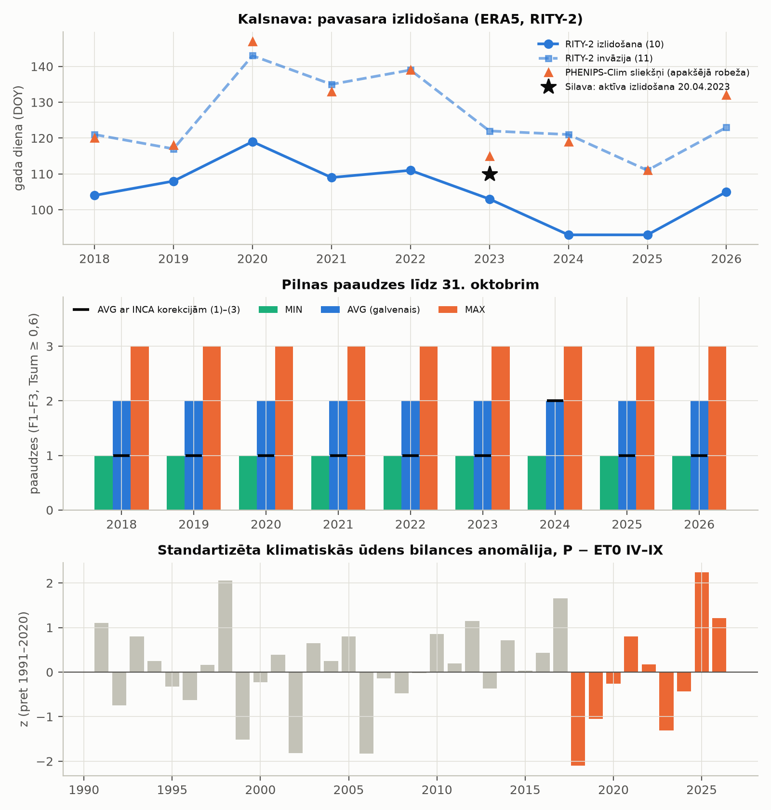
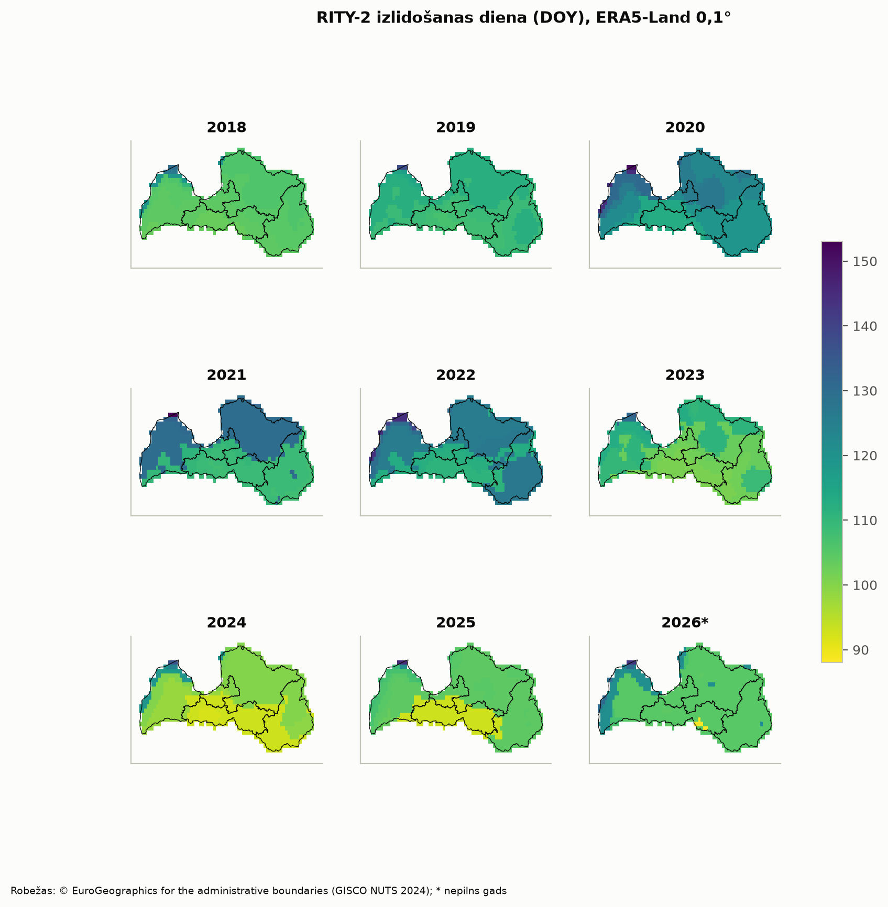
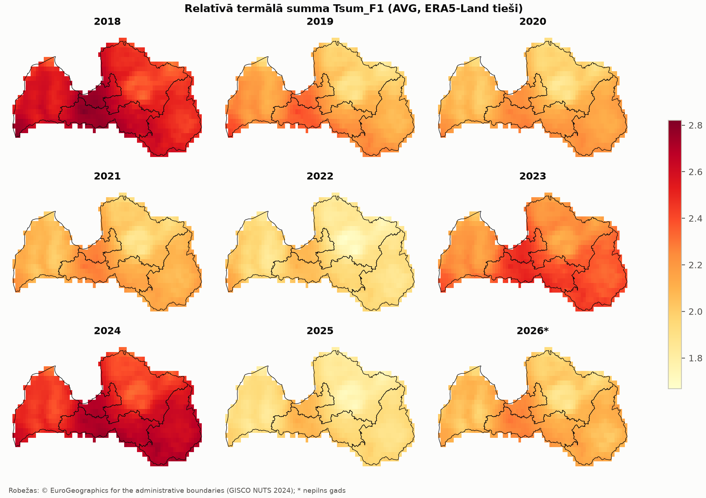
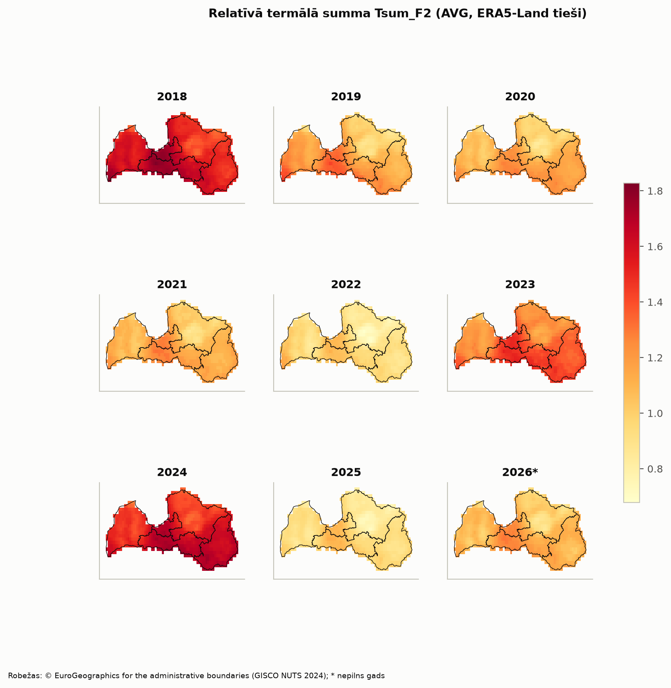
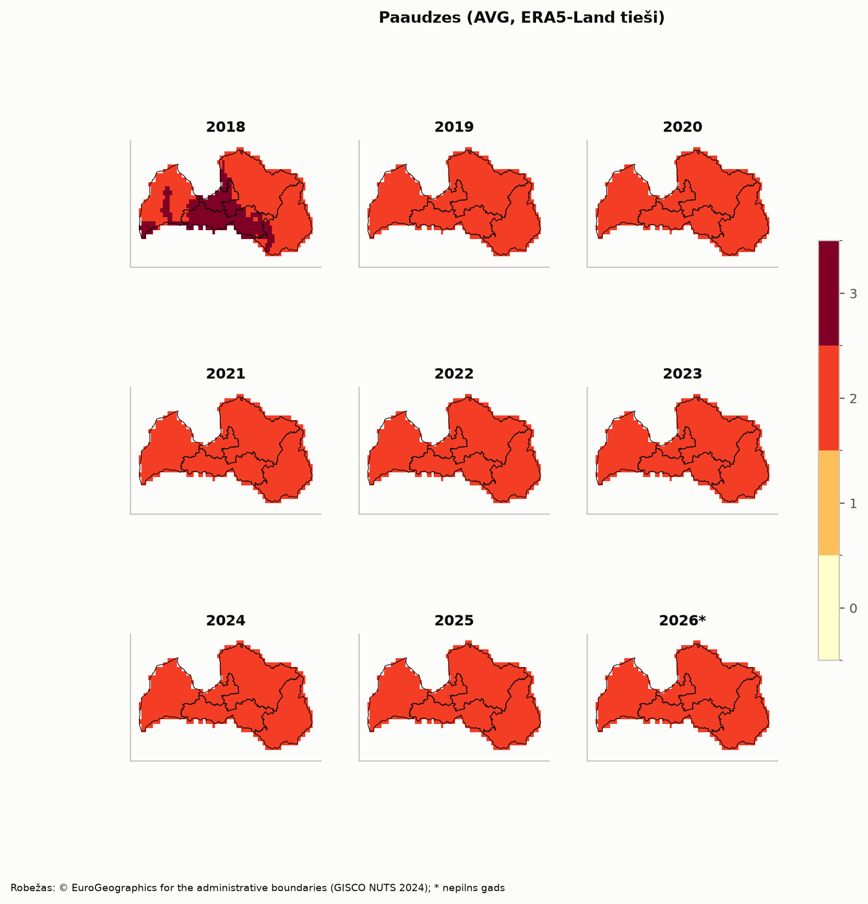
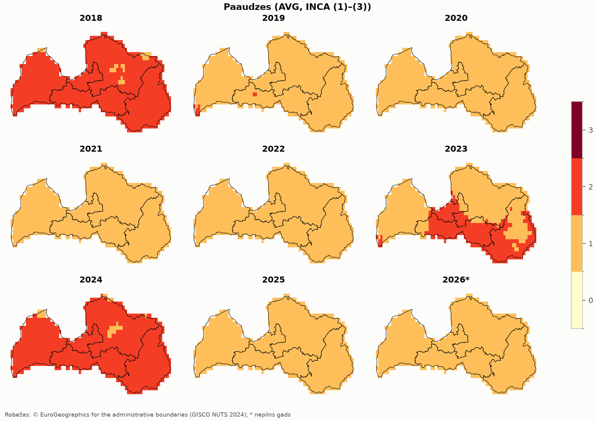
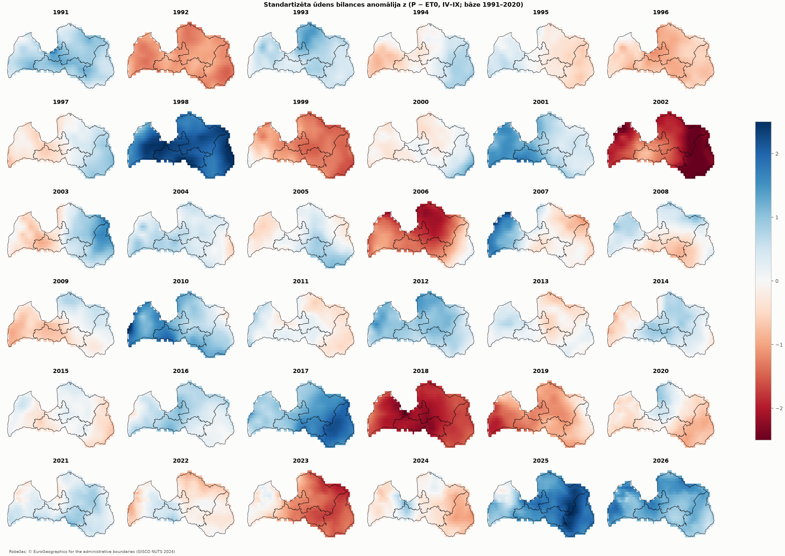

# 4. posms: laikapstākļi (ERA5), RITY-2 fenoloģija un ūdens bilance

> **PROTOTIPS (lietotāja lēmums 2026-10-29):** šis Kalsnavas rezultāts ir aprēķināts ar Open-Meteo `era5` un paliek tikai
> kā prototips. Latvijas mērogam Open-Meteo bezmaksas līmeni neizmanto (svērtie izsaukumi, nekomerciālas lietošanas
> noteikumi). Galvenais laikapstākļu avots būs Copernicus CDS ERA5-Land (plāns 2.21); riska modeļa fenoloģijas
> galvenā pazīme — relatīvā termālā summa (plāns 2.22).

Statuss (2026-11-04): **Kalsnava (Open-Meteo prototips) pabeigta; Latvija aprēķināta ar CDS ERA5-Land 0,1°** — sk.
sadaļu „Latvija: ERA5-Land 0,1° (2026-11-04)” dokumenta beigās. Sausuma salīdzinājums un 6. posms vēl nav sākti.
**[P]** = aprēķināts no datiem vai nolasīts avotā, **[N]** = pieņēmums vai interpretācija.

Reproducēšana:

```
mezasargs-risk weather configs/rm_4_klimats.yaml --scope points     # ERA5 lejupielāde (kešs cache/rm/openmeteo/)
mezasargs-risk climate configs/rm_4_klimats.yaml --scope points     # RITY-2, ūdens bilance, tabulas, attēls
mezasargs-risk weather configs/rm_4_klimats.yaml --scope latvia --dry-run   # tikai mezgli un izsaukumu skaits
```

Izvade: `output/rm4_klimats/tables/` (`rity2_points.csv` — visi scenāriji / varianti, `climate_summary_points.csv`,
`water_balance_points.csv`, `era5_nodes_points.csv`, `check_silava_kalsnava.csv`), `figures/rm4_kalsnava.png`.

## Avoti [P]

- **Open-Meteo vēsturiskais API**, `https://archive-api.open-meteo.com/v1/archive`, `models=era5` (lietotāja lēmums: ne
  `best_match`, ne `era5_land`). ERA5: globāls, 0,25° (~25 km), 1940–, atjaunots „Daily with 5 days delay”. Licence
  CC BY 4.0. Atsauces (Open-Meteo lapa): Hersbach u. c. (2023) ERA5 hourly data on single levels from 1940 to present,
  doi:10.24381/cds.adbb2d47; Zippenfenig (2023) Open-Meteo.com Weather API, doi:10.5281/ZENODO.7970649;
  „Generated using Copernicus Climate Change Service information”.
- **Dienas mainīgie** (pārbaudīti ar atbildi): `temperature_2m_max/min/mean` (°C), `precipitation_sum` (mm),
  `et0_fao_evapotranspiration` (mm), `daylight_duration` (s). Laika josla `Europe/Riga`. API atgrieza
  `utc_offset_seconds` 7200 arī vasaras laikā (atbildē „GMT+2”), t. i. dienas robeža ir UTC+2 [P].
- **Limiti** (cenu lapa, 2026-10-29): 600 / min, 5 000 / h, 10 000 / dienā, 300 000 / mēn. Pieprasījums, kas aptver
  „more than 2 weeks for a single location” vai „more than 10 weather variables”, skaitās kā vairāki izsaukumi
  (piemērs: 2 nedēļas × 15 mainīgie = 1,5). Svara formula kodā `max(1, dienas/14) × max(1, mainīgie/10)` ir šī teksta
  interpretācija [N]. Savs budžets: 500 / min, 4 500 / h, 9 000 / dienā (`cache/rm/openmeteo/ledger.csv`).
- **RITY-2:** Ogris N. (2020) Calculation procedure for RITY — a phenology model of *Ips typographus*. MethodsX
  7:100845, doi:10.1016/j.mex.2020.100845, PMC7076557, CC BY 4.0. Pilns teksts no Europe PMC (`cache/rm_test/`,
  1. posms) šajā posmā izlasīts vēlreiz; vienādojumi kodā ar numuriem (`src/mezasargs_risk/rity.py`).
- **PHENIPS-Clim** (tikai jutīgums): Jakoby, Lischke, Wermelinger (2019) GCB, doi:10.1111/gcb.14766, 1. tabula:
  Tsw_sum 100 dd virs Tdev_min 5,12 °C „starting from 1st January” (diapauzes beigas, tā vien. 4), Tfly_min 16,11 °C.
- **Saprāta pārbaude:** VMD paziņojums LV portālā 02.06.2023, LVMI „Silava” monitorings: „aktīva izlidošana šogad ir
  sākusies 20. aprīlī” —
  https://lvportals.lv/dienaskartiba/352281-valsts-meza-dienests-rosina-turpinat-eglu-astonzobu-mizgrauza-izplatibas-ierobezojosos-pasakumus-2023

## Metode

### Laikapstākļi

- **Mezgli:** ERA5 0,25° mezgli, kuru šūna (± 0,125° ap mezglu) skar Latviju (GISCO NUTS 2024), + 1 šūnas buferis:
  **294 mezgli (198 skar Latviju)** [P]. Punktam (Kalsnava) — tuvākais mezgls.
- **Kalsnava:** AOI centroids 25,8688 / 56,6771 → mezgls **56,75 / 25,75**; API atgrieza tieši 56,75 / 25,75,
  augstums 168 m (Open-Meteo 90 m DEM) [P]. Atgrieztās koordinātas saglabātas (`era5_nodes_points.csv`).
- **Pieprasījumi mezglam:** 1991–2017 tikai IV–IX (ūdens bilances bāze), 2018–2026 1. janvāris–31. oktobris (RITY-2 no
  7. marta, PHENIPS-Clim no 1. janvāra; ietver IV–IX). 2026. gads līdz 23.10 (šodiena − 6 dienas). Kopā 36 pieprasījumi,
  **548 svērti izsaukumi** vienam mezglam [P].
- **Pārbaudes:** atbildes shēma (atslēgas, visi mainīgie, vienāds garums, mērvienības) pirms kešošanas; JSON `null` →
  NaN. Kalsnavas mezglā trūkstošu vērtību nav (0) [P].

### RITY-2 (Ogris 2020)

| Solis | Vienādojums | Parametri |
|---|---|---|
| meža gaisa t° no INCA | (1)–(3) | AT = 1,44 + 0,82·I_min; 0,50 + 0,81·I_mean; 1,03 + 0,86·I_max — **tikai jutīguma variantā** |
| mizas t° | (4)–(6) | BT = 0,56 + 0,99·AT_min; −0,48 + 1,03·AT_mean; 0,03 + 0,99·AT_max |
| efektīvā mizas t° | (7)–(9) | DT_L 8,3; T_O 30,4; DT_U 38,9 °C; α 0,02876507, β 3,5922336, γ 1,24657367, Tmax 40,9958913 |
| izlidošana / invāzija | (10) / (11) | I_max > 14,5 °C un Σ(I_max − 8,3) ≥ 53,0 / 155,6 dd no 7. marta |
| F1 | (12) | Tsum = ΣBTeff / K, K = 557 dd, no invāzijas dienas |
| māsu perējumi S_j | (13) | Tsum_F1 > j − 0,5, I_max > 14,5 °C, diena ≥ 14,5 h |
| F2 / F3 | (14) / (15) | Tsum_F1 > 1 / > 2, I_max > 14,5 °C, diena ≥ 14,5 h |
| paaudžu skaits | teksts pēc (15) | uzsākta paaudze skaitās, ja Tsum ≥ 0,6 līdz 31. oktobrim |

- **Galvenais variants (lietotāja lēmums):** ERA5 temperatūra tieši kā meža gaisa t° (AT = ERA5), tad (4)–(9).
  **Jutīgums:** (1)–(3) ar I = ERA5. Sliekšņi (10)–(15) abos variantos lieto I_max = ERA5 maksimumu, kā rakstā; tāpēc
  INCA korekcijas izlidošanas dienu nemaina [P, kods].
- **Scenāriji** kā rakstā: MIN / AVG / MAX = BTeff no BT_min / BT_mean / BT_max. Galvenais — AVG (rakstā kartes
  parādītas AVG scenārijam [P]; izvēle par galveno [N]).
- **Dienas garums:** Open-Meteo `daylight_duration` (rakstā formula nav dota).
- **Interpretācijas [N]:** (10)–(11) summā tikai pozitīvās daļas (I_max − 8,3); diena, kurā slieksni sasniedz, skaitās;
  F3 sākums Tsum_F1 > 2 tieši kā (15) rakstīts; māsu perējumi skaitīti atsevišķi (`n_sister`), „paaudzes” =
  F1–F3; 7. marta sākuma datums ir Slovēnijas kalibrācija (rakstā: jākalibrē katram reģionam).
- **Tekošais gads:** 2026 aprēķināts līdz pēdējai datu dienai (2026-10-23), `complete = False`.
- **PHENIPS-Clim sliekšņi (jutīgums):** pirmā diena no 1. janvāra ar Σ(T_mean − 5,12)+ ≥ 100 dd un T_max ≥ 16,11 °C.
  Modeļa papildbarošanās posms un stundas lidojuma modelis nav atveidoti, tāpēc tas ir **apakšējā robeža** [N].

### Ūdens bilance

CWB = Σ(P − ET0) IV–IX; **standartizēta klimatiskās ūdens bilances anomālija** z = (CWB − vid.₁₉₉₁₋₂₀₂₀) / sd₁₉₉₁₋₂₀₂₀
(ddof = 1). Tas **nav SPEI** (nav sadalījuma pielāgošanas). Gads ar kaut vienu trūkstošu dienu → NaN.

## Rezultāti: Kalsnava (mezgls 56,75 / 25,75) [P]

| Gads | Izlidošana (10) | Invāzija (11) DOY | F1 pabeigta DOY | Paaudzes AVG / MIN / MAX | AVG ar (1)–(3) | PHENIPS-Clim DOY | P − ET0 IV–IX, mm | z |
|---|---|---|---|---|---|---|---|---|
| 2018 | 14.04 (104) | 121 | 196 | 2 / 1 / 3 | 1 | 120 | −319,9 | −2,10 |
| 2019 | 18.04 (108) | 117 | 200 | 2 / 1 / 3 | 1 | 118 | −210,1 | −1,05 |
| 2020 | 28.04 (119) | 143 | 210 | 2 / 1 / 3 | 1 | 147 | −127,9 | −0,26 |
| 2021 | 19.04 (109) | 135 | 195 | 2 / 1 / 3 | 1 | 133 | −17,6 | 0,80 |
| 2022 | 21.04 (111) | 139 | 211 | 2 / 1 / 3 | 1 | 139 | −83,0 | 0,17 |
| 2023 | 13.04 (103) | 122 | 204 | 2 / 1 / 3 | 1 | 115 | −236,5 | −1,30 |
| 2024 | 02.04 (93) | 121 | 191 | 2 / 1 / 3 | 2 | 119 | −146,3 | −0,44 |
| 2025 | 03.04 (93) | 111 | 210 | 2 / 1 / 3 | 1 | 111 | 132,6 | 2,24 |
| 2026* | 15.04 (105) | 123 | 205 | 2 / 1 / 3 | 1 | 132 | 25,2 | 1,21 |

\* 2026 līdz 23.10. Bāze 1991–2020: vid. −100,7 mm, sd 104,2 mm.

- **Paaudzes (AVG):** F1 pabeidz attīstību 10.–30. jūlijā (DOY 191–211), kad diena vēl ir ≥ 14,5 h, tāpēc F2 sākas uzreiz
  un līdz 31.10 sasniedz Tsum 0,74–1,42 ≥ 0,6. Rezultāts katru gadu ir 2 paaudzes. F3 nesākas nevienā gadā [P].
- **Jutīgums ir liels:** MIN 1, MAX 3, ar INCA korekcijām 1 (2024. gadā 2) paaudze. Tsum_F2 ar INCA korekcijām ir
  0,15–0,65; 2020., 2025. un 2026. gadā F2 nesākas [P]. Paaudžu skaits šajā konfigurācijā ir vairāk atkarīgs no temperatūras pārveidojuma nekā no gada.
- **Māsu perējumi (AVG):** 1–2 gadā (`n_sister`) [P].
- **Ūdens bilance:** sausākie gadi 2018 (z −2,10), 2023 (−1,30), 2019 (−1,05); mitrākais 2025 (2,24) [P].



### Saprāta pārbaude: Silava 20.04.2023 [P]

| | Datums | DOY | Starpība pret 20.04 |
|---|---|---|---|
| Silava / VMD: aktīva izlidošana | 20.04.2023 | 110 | — |
| RITY-2 izlidošana (10), Kalsnava | 13.04.2023 | 103 | −7 dienas |
| RITY-2 invāzija (11) | 02.05.2023 | 122 | +12 dienas |
| PHENIPS-Clim sliekšņi (apakšējā robeža) | 25.04.2023 | 115 | +5 dienas |

- RITY-2 izlidošanas diena ir nedēļu pirms publiski minētā datuma, PHENIPS-Clim apakšējā robeža — 5 dienas pēc tā.
  Abi ir vienas nedēļas robežās; pretrunu nav, bet tas ir **viens gads un viens punkts** [P].
- Silava datums ir slazdu monitorings visā Latvijā (vietas nav norādītas), Kalsnava ir viens ERA5 mezgls; tieši
  salīdzināmi tie nav [N]. Kalibrācijai vajag Silava slazdu datus (atvērti nav atrasti, 1. posms).

## Latvija ar Open-Meteo — NETIKA izmantots (vēsturiska piezīme) [P]

Lietotāja lēmums 2026-10-29: Latvijai Open-Meteo neizmanto; Latvija aprēķināta ar CDS ERA5-Land (sk. dokumenta beigas).
Zemāk — toreizējais Open-Meteo apjoma novērtējums.

| Apjoms | Mezgli | Svērti izsaukumi | Dienas pie 9 000 / dienā |
|---|---|---|---|
| Pilns uzdevums: 294 mezgli, 1991–2017 IV–IX + 2018–2026 I–X | 294 | 161 091 | ~18 |
| Tikai mezgli, kuru šūna skar Latviju (bez bufera) | 198 | ~108 500 | ~12 |
| Tikai fenoloģija 2018–2026 (bez ūdens bilances bāzes 1991–2017) | 294 | ~57 300 | ~6,5 |

- Plāna 2.4 novērtējums „~350 Open-Meteo izsaukumi” bija kļūdains: tas neņēma vērā svēršanu pēc perioda garuma [P].
- Kods Latvijas režģim ir gatavs (`--scope latvia`): mezgli, atsākama lejupielāde ar budžetu, kartes pa gadiem
  (`rm4_lv_izlidosana.png`, `rm4_lv_paaudzes.png`, `rm4_lv_udens_bilance.png`). Kartes nav pārbaudītas ar īstiem datiem.

## Testi [P]

- `tests/test_rm_rity.py`: (7)–(9) vērtības (pie T_O 22,1 lineāri / 21,68 nelineāri, pie DT_U ≈ 0,014, ārpus 0);
  sintētiska rinda ar zināmu termālo summu (I_max 18,3 °C → 10 dd/dienā → izlidošana 12.03, invāzija 22.03);
  lidojuma slieksnis; paaudžu skaitīšana (F2 / F3 / S_j sākumi, 0,6 slieksnis, dienas garums); INCA variants;
  nepilns un tekošais gads; PHENIPS-Clim sliekšņi.
- `tests/test_rm_weather.py`: ierakstīta Open-Meteo atbilde (`tests/data/openmeteo_era5_daily_sample.json`, 4 dienas,
  bez tīkla) — shēma, mērvienības, `null`; kešs bez tīkla; tuvākais mezgls; mezglu režģis; logi; svari (piemērs
  1,5); budžeta gaidīšana un žurnāls; ūdens bilance un anomālija ar sintētiskiem datiem.
- Visi offline testi: 128 passed (2026-10-29). s2forest kods nav mainīts.

## Ierobežojumi

- **RITY-2 kalibrēts Slovēnijai ar INCA** (plāna R5): sākuma datums 7. marts, sliekšņi un mizas t° modeļi nav pārbaudīti
  Latvijā. ERA5 0,25° (~25 km) ir rupjš mežaudzes mikroklimatam (R4) [N].
- **Paaudžu skaits ir ļoti jutīgs** pret temperatūras pārveidojumu (1 / 2 / 3 atkarībā no varianta). Pazīmei var
  izmantot relatīvo termālo summu (`tsum_F1`, `tsum_F2`), nevis tikai veselu paaudžu skaitu [N].
- Dienas robeža UTC+2 visu gadu (API atbilde) [P]; ietekme uz dienas min/maks. nav vērtēta [N].
- Viens saprāta pārbaudes datums; ar to nevar kalibrēt.

## Fakti pret pieņēmumiem

- **[P]:** API shēma un mezgls; mezglu un izsaukumu skaits; visas tabulu vērtības; RITY-2 vienādojumi un parametri no
  avota; Silava citāts; testu rezultāti.
- **[N]:** svara formulas interpretācija; (10)–(11) summas un (15) interpretācija; AVG kā galvenais scenārijs; māsu
  perējumu atsevišķa skaitīšana; PHENIPS-Clim kā apakšējā robeža; RITY-2 / ERA5 derīgums Latvijai.

## Kas NAV izdarīts

- ~~Latvijas režģis (294 mezgli) nav lejupielādēts~~ — Latvija aprēķināta ar ERA5-Land 2026-11-04 (dokumenta beigās).
- Nav kalibrācijas pret Latvijas slazdu datiem (nav atvērtu datu).
- PHENIPS oriģinālie sliekšņi (60,5 / 140,3 dd no 1. aprīļa, 16,5 °C; sekundāri Ogris 2020) nav izmantoti — uzdevumā
  jutīgumam paredzēti tikai PHENIPS-Clim parametri.
- Nav vēja brāzmu (`wind_gusts_10m_max`) un nav nobīdīto (t−1, t−2) pazīmju tabulas — tas ir 6. posms.

## CDS ERA5-Land: pilots, pārbaudes mēnesis un pilnā lejupielāde (2026-10-29 / 30)

Plāns: `PLANS_RISKA_MODELIS.md` 2.21. Visas dienas ir **UTC dienas** (lietotāja lēmums 2026-10-29).
Kods: `src/mezasargs_risk/cds.py`, CLI `cds-pilot`, `cds-download`, `cds-check-month`; ET0 skaidrojums
`scripts/rm4_et0_decomposition.py`. Tabulas `output/rm4_klimats/tables/` (nav git).

### Pilots: 2023. gada aprīlis [P, mērīts]

| Pieprasījums | Datu kopa | Laiks kopā (rindā) | Izmērs | Formāts |
|---|---|---|---|---|
| T_max (Latvija) | `derived-era5-land-daily-statistics` | 262 s | 0,12 MB | netCDF4 |
| T_min | dienas statistika | 5 532 s (5 341 s) | 0,13 MB | netCDF4 |
| vidējie t2m, d2m, u10, v10, sp | dienas statistika | 11 178 s (10 680 s) | 0,78 MB | **zip** (viens .nc katram mainīgajam) |
| tp, ssrd, pev 00 UTC | `reanalysis-era5-land` | 54 s | 0,46 MB | netCDF4 |
| u10 / v10 stundas (Kalsnava) | `reanalysis-era5-land` | 175 s | 0,11 MB | netCDF4 |

- **Formāts:** laika ass `valid_time` (dienas statistikai 00:00 katrai dienai); papildu koordinātas `number`, `expver`;
  mainīgie `t2m`, `d2m` (K), `u10`, `v10` (m s⁻¹), `sp` (Pa), `tp` (m), `ssrd` (J m⁻²), `pev` (m, negatīvs =
  iztvaikošana); režģis 28 × 77 = 2 156 punkti (1 761 sauszemes punkts ar datiem). Koordinātās peldošā punkta troksnis
  (25.900000000000073) — salīdzinot noapaļo līdz 0,1°.
- **Rindas ierobežojums:** paralēli iesniegts otrs `reanalysis-era5-land` darbs tika noraidīts: „Maximum number queued
  requests for this dataset has been reached. Please configure your scripts to request data sequentially” [P]. Tāpēc
  lejupielāde ir stingri secīga.
- **Vējš:** dienas statistikas vidējie u / v = 24 stundu vidējais (maks. starpība 0,0000) → UTC dienas apstiprinātas.
  Ātrums no vidējiem u / v 2,44 m/s pret stundu ātrumu vidējo 2,59 m/s (attiecība 0,93; min. 0,69); ET0 mēneša summa
  63,62 pret 64,17 mm (−0,9 %).
- **FAO-56 Example 18:** 3,88 mm/d pret grāmatas 3,9 — tests iziet.
- **Kalsnava pret Open-Meteo (1.–29. aprīlis):** T_max / T_min / T_mean nobīde +0,14 / +0,12 / +0,06 °C (r 0,96–0,99);
  P 32,1 pret 29,2 mm; ET0 63,6 pret 72,7 mm (−12,5 %); dienas garums FAO-56 Eq. 34 par 0,27 h īsāks nekā Open-Meteo
  `daylight_duration`; `pev` summa −145,9 mm (2,3 × ET0 — `pev` kā ET0 neder, kā plānā).

### Lēmums: tikai stundu dati (lietotājs 2026-10-30)

- Dienas statistikas rinda bija 4 min – 3 h vienam pieprasījumam (756 pieprasījumi), stundu datu kopa — minūtes. Tāpēc
  **viens `reanalysis-era5-land` pieprasījums mēnesī**: 24 h, 8 mainīgie (t2m, d2m, u10, v10, sp, tp, ssrd, pev) =
  5 952 lauki (< 12 000).
- **T_max / T_min / T_mean** = 24 stundu vērtību maks. / min. / vidējais UTC dienā (`cds.daily_from_hourly`); diena
  tiek izmantota tikai ar visām 24 stundām. ERA5-Land nav 2 m maks. / min. temperatūras mainīgā [P, CDS forma:
  12 temperatūras mainīgie, starp tiem nav max / min]; stundu ekstrēmi var nedaudz **nenovērtēt** īstos (nepārtrauktos)
  ekstrēmus [N]. Pret dienas statistiku starpība ir 0,000 (sk. zemāk), jo arī dienas statistika ir aprēķināta no
  stundām (`frequency = 1_hourly`) — tātad ar ERA5-Land šo nenovērtējumu **izmērīt nevar** [P / N].
- **Akumulētie (tp, ssrd, pev):** uzkrāti no 00 UTC; dienas d summa = d+1 00 UTC vērtība, **nevis** stundu summa
  [P ECMWF]. Mēneša pēdējai dienai vajag nākamā mēneša 1. dienas 00 UTC: ja nākamais mēnesis netiek lejupielādēts,
  pievieno mazu pieprasījumu (`acc00_YYYY_MM`, 3 mainīgie × 1 diena × 00:00).
- **Vējš:** ET0 lieto stundu ātrumu vidējo (vektoru vidējošanas nobīde vairs nav).
- **Atsākšana:** `cache/rm/cds/hourly_state.json` — darba ID tiek ierakstīts uzreiz pēc iesniegšanas; darbs ar ID
  **nekad netiek iesniegts atkārtoti** (tikai statuss / lejupielāde); 5xx un savienojuma kļūdas → tikai lejupielādes
  vai statusa atkārtojums; `failed` / `rejected` / pazudis ID → apstājas (bez jauniem pieprasījumiem). Testi ar viltotu
  klientu (`tests/test_rm_cds.py`).

### Pārbaudes mēnesis 2023-04 (stundu dati) pret pilotu [P]

- 1 pieprasījums: 457 s serverī (rindā 12 s) + ~66 s lejupielāde; **19,0 MB** netCDF4 (viens fails, ne zip).
- Visās 1 761 sauszemes šūnās × 30 dienās (52 830 vērtības) starpība pret pilota failiem ir **0,0** visiem mainīgajiem:
  T_max, T_min, T_mean, T_dew, u10, v10, sp pret dienas statistiku; tp, ssrd, pev dienas summas pret pilota 00 UTC
  failu.
- Kalsnava: ET0 64,174 = pilota 64,174 mm (maks. dienas starpība 1·10⁻⁷); P 32,067 = 32,067 mm.

### Pilnā lejupielāde (sākta 2026-10-30, fonā; pabeigta 2026-11-04 — rezultāts sadaļā „Latvija”)

- Datu kopas beigas (katalogs) 2026-10-24 00:00 → pēdējā pilnā UTC diena 2026-10-23.
- **287 pieprasījumi:** 252 mēneši (IV–IX 1991–2026; I–III un X 2018–2026; 2026-10 līdz 23.10) + 35 `acc00`
  (1.10 1991–2017, 1.11 2018–2025). 2026-10-23 akumulētās summas trūks (24.10 00 UTC nav pieprasīts).
- **Ekstrapolācija [N]:** ~19 MB × 252 ≈ **4,8 GB**; ~8–9 min vienam mēnesim → ~36–40 h, ja rinda paliek īsa.
  Katrs fails < 200 MB.

### ET0 −12,5 % pret Open-Meteo: sadalījums pa ievaddatiem (Kalsnava, 1.–29.04.2023) [P aprēķins, N interpretācija]

Pilota starpība 72,74 − 63,62 = 9,12 mm (29 dienas):

| Daļa | mm | Kā izmērīts |
|---|---|---|
| vēja vektoru vidējošana (pilota dienas u / v) | 0,55 | 64,17 − 63,62 (stundu datos novērsts) |
| dienas robeža UTC+2 pret UTC | −0,23 | Open-Meteo dienas ET0 pret tās stundu ET0 summu UTC dienās |
| **stundu FAO-56 (Open-Meteo) pret dienas FAO-56 (mūsu)** | **3,90** | Open-Meteo stundu ET0 summa pret mūsu `et0_daily` ar Open-Meteo ievaddatiem |
| **ievaddati ERA5 0,25° pret ERA5-Land 0,1°** | **4,90** | mūsu `et0_daily` ar Open-Meteo pret ERA5-Land ievaddatiem |

Ievaddatu daļa, aizstājot pa vienai grupai (vidējais no abiem virzieniem; summa 4,92 ≈ 4,90):

| Ievade | Δ ET0, mm | ERA5-Land vid. | Open-Meteo vid. |
|---|---|---|---|
| **vējš (10 m, m/s)** | **3,29** | 2,56 | 3,21 |
| **mitrums (e_a, kPa)** | **2,01** | 0,688 | 0,649 |
| temperatūra (T_max, T_min) | −0,47 | 7,78 °C | 7,64 °C |
| spiediens | 0,06 | 100,5 kPa | 99,8 kPa |
| radiācija (R_s, MJ m⁻² d⁻¹) | 0,03 | 14,71 | 14,74 |

- **Lielākā daļa:** aprēķina solis (stundu pret dienas Penman–Monteith, ~3,9 mm) un vējš (ERA5 mezglā par 25 % stiprāks,
  ~3,3 mm), tad mitrums (ERA5-Land mitrāks, ~2,0 mm). Radiācija un spiediens praktiski neietekmē.
- Nekas nav labots; FAO-56 dienas solis paliek (plāns 2.21). Iemesls vēja atšķirībai (režģa izšķirtspēja, virsmas
  raupjums, mezgla novietojums) nav pārbaudīts [N].
- Open-Meteo stundu dati: 1 pieprasījums (Kalsnavas mezgls, 2023-04, 7 mainīgie, `timezone=GMT`), kešs
  `cache/rm/openmeteo/`; radiācija / ET0 / nokrišņi ir iepriekšējās stundas vērtības [P Open-Meteo docs] → nobīdīti
  par −1 h pirms UTC dienas summām.

### Dienas garums 14,5 h slieksnim (lietotāja lēmums 2026-10-30)

- Ogris (2020) (13)–(15) un 2. attēlā ir tikai „daylength ≥ 14.5 h” / „day length = 14.5 h”; kā dienas garums
  aprēķināts, **raksts nenosaka** [P, pilns teksts PMC7076557]. Rakstā minēts RITY-2 pirmkods (atsauces 20, 21,
  zdravgozd.si zip) — nav atvērts.
- Tāpēc **[N]: FAO-56 Eq. 34 (astronomiskais N)**; jutīgums ±16 min (Open-Meteo starpība pilotā 0,27 h).
- Ietekme: N ≥ 14,5 h Latvijā no ~21.–24.04 līdz ~18.–21.08 (55,7–57,9° Z); ±16 min nobīda abas robežas par ±3–4
  dienām [P aprēķins]. Augusta robeža nosaka, vai pēc tās vēl var sākties F2 / F3 / māsu perējums.
- Ieviešana Latvijas fenoloģijas aprēķinā (pēc lejupielādes, ar apstāšanos pirms tā).

## Latvija: ERA5-Land 0,1° (2026-11-04)

Lietotāja lēmums 2026-11-04: aprēķins notiek **serverī** (tmux, RAM 3,7 GB, atmiņā viens gads). Uz laptopu kopēti tikai
rezultāti; dati ir ārpus git. Kods: `src/mezasargs_risk/lvclimate.py`, CLI `cds-latvia` (serverī) un
`cds-latvia-report` (laptopā), commits f8426f7 un šīs sadaļas commits. Abas mašīnas izmanto vienu un to pašu
GitHub commitu f8426f7 (pārbaudīts ar `git rev-parse`).

```
mezasargs-risk cds-latvia configs/rm_4_klimats.yaml --step all     # serverī: dienas kubi, ūdens bilance, RITY-2
mezasargs-risk cds-latvia-report configs/rm_4_klimats.yaml         # laptopā: Latvijas maska, pārbaudes, tabulas, kartes
```

Izvade (nav git):
- **serverī:** `cache/rm/cds/daily/era5land_daily_YYYY.nc`;
- **`output/rm4_klimats/latvia/`:**
  - rastri uz ERA5-Land 0,1° režģa (gads × platums × garums): `water_balance_latvia.nc`, `rity2_latvia.nc`;
  - tabulas: `water_balance_cells.csv`, `rity2_cells.csv`, `rity2_cells_long.csv.gz` (visi scenāriji, varianti un
    ±16 min), `data_coverage.csv`;
- **laptopā:** `tables/lv_*.csv`, `tables/lv_checks.json`, `figures/rm4_lv_era5land_*.png`.

### Dati [P]

- **Lejupielāde (serverī):**
  - 287 faili (252 `h_YYYY_MM` un 35 `acc00`), statuss `done` visiem 287.
  - **4,7 GB** diskā (4 959 MB pēc baitiem; lielākais fails 21 MB).
  - Iesniegts no 2026-10-30 12:44 līdz 2026-11-04 10:27 UTC.
  - Mēneša pieprasījums: mediāna 1 268 s (no tām rindā 480 s), maks. 5 829 s.
  - 22 pirmie darbi (1991-04 – 1994-04) serverī iesniegti otrreiz, jo lejupielāde sākās pirms stāvokļa faila kopēšanas
    (sk. iepriekš).
- **Pārbaudes mēnesis 2023-04 serverī** (`cds-check-month`; pilota faili nokopēti ar scp):
  - starpība 0,0 visām 52 830 vērtībām × 10 mainīgajiem;
  - Kalsnava: ET0 64,174 = 64,174 mm, P 32,067 = 32,067 mm — tāpat kā laptopā.
- **Pārklājums (`data_coverage.csv`):**
  - 1991–2017: 1.04–30.09 (183 dienas); 2018–2025: 1.01–31.10.
  - **2026 nepilns:** temperatūra līdz 27.10, akumulētie mainīgie (P, R_s, ET0) līdz 26.10 (kataloga beigas
    2026-11-04).
  - 2026 tabulās un kartēs atzīmēts ar `*`; 2026. gada RITY-2 Tsum ir 27.10 vērtība. Ūdens bilances periods IV–IX
    2026. gadā ir pilns.
- **Režģis:** aprēķinā ir 1 761 sauszemes šūna. Statistikā izmantotas **946 šūnas, kuru centrs ir Latvijā**
  (NUTS LV); kartēs — 1 037 šūnas, kas skar Latviju.
- **Izpildes laiks serverī:**
  - dienas kubi: 8–10 s gadā (IV–IX) un 13–14 s gadā (I–X);
  - **RITY-2: 63–69 s gadā, kopā 589 s (9,8 min).** Tas ir 1 761 šūnai × 9 gadiem × 10 palaišanām
    (3 scenāriji × 2 varianti, plus AVG × 2 varianti × ±16 min);
  - viss `--step all`: 16 min 11 s, maks. RAM 303 MB.

### RITY-2 fenoloģija 2018–2026 (946 šūnas Latvijā; AVG, ERA5-Land tieši, Eq. 34) [P]

| Gads | Izlidošana DOY p10 / med. / p90 (min–maks.) | Nav sasniegta | Tsum_F1 vid. | Tsum_F2 vid. (min–maks.) | 3 paaudzes AVG | 2 paaudzes INCA | ZA − DR, d |
|---|---|---|---|---|---|---|---|
| 2018 | 104 / 105 / 106 (103–130) | 0 | 2,56 | 1,57 (1,31–1,83) | 31 % | 98 % | 0,0 |
| 2019 | 108 / 112 / 112 (107–138) | 0 | 2,13 | 1,14 (0,84–1,46) | 0 | 1 % | +0,6 |
| 2020 | 114 / 122 / 127 (113–151) | 0 | 2,09 | 1,10 (0,83–1,30) | 0 | 0 | +0,4 |
| 2021 | 109 / 130 / 130 (108–153) | 0 | 2,09 | 1,10 (0,86–1,32) | 0 | 0 | +2,2 |
| 2022 | 111 / 126 / 127 (111–144) | 0 | 1,92 | 0,93 (0,68–1,19) | 0 | 0 | +3,2 |
| 2023 | 101 / 103 / 113 (101–133) | 0 | 2,31 | 1,32 (1,02–1,53) | 0 | 35 % | −1,3 |
| 2024 | 93 / 100 / 100 (92–136) | 0 | 2,55 | 1,56 (1,29–1,77) | 0 | 98 % | −0,1 |
| 2025 | 93 / 104 / 105 (93–145) | 0 | 1,91 | 0,92 (0,72–1,14) | 0 | 0 | +2,7 |
| 2026* | 105 / 105 / 121 (88–143) | 0 | 2,08 | 1,09 (0,85–1,31) | 0 | 0 | −5,2 |

- **Izlidošana sasniegta visās šūnās visos gados.** NaN nav nevienā no 946 šūnām un arī nevienā no visām
  1 761 aprēķina šūnām.
- **Paaudžu skaits:**
  - **AVG:** 2 paaudzes visās šūnās visos gados, izņemot 2018. gadu, kad 31 % šūnu ir 3 paaudzes (centrālajā joslā —
    Zemgalē un ap Rīgu);
  - **INCA (1)–(3):** parasti 1; 2 paaudzes 2018. gadā (98 % šūnu), 2024. gadā (98 %) un 2023. gadā (35 %);
  - **MIN:** pārsvarā 1; **MAX:** pārsvarā 3 (54–100 % šūnu).
- Paaudžu skaits joprojām vairāk atkarīgs no temperatūras pārveidojuma nekā no gada vai vietas. Tāpēc galvenā pazīme
  paliek **relatīvā termālā summa** (plāns 2.22): Tsum_F2 gadu vidējie 0,92–1,57, telpiskā amplitūda gada ietvaros
  ~0,5.
- **Pēc Tsum** siltākie gadi ir 2018 un 2024 (Tsum_F1 ≈ 2,55), vēsākie — 2022 un 2025 (≈ 1,91).
- **Dienas garums ±16 min:**
  - F2 sākums un Tsum_F2 nemainās nevienā šūnā, jo F1 pabeidz attīstību, kamēr diena vēl ir ≥ 14,5 h.
  - Paaudžu skaits mainās tikai caur F3: 2018. gadā −16 min maina 18,9 % šūnu, +16 min — 4,4 %; 2024. gadā +16 min
    maina 12,8 % šūnu; citos gados 0. INCA variantā izmaiņu nav.
- **Izlidošanas sadalījumam ir divas virsotnes.** Piemēram, 2021. gadā p10 ir 109, bet mediāna 130, un starp tām ir
  aukstuma periods [P likums, N: tas ir sliekšņa efekts, nevis klimata gradients]:
  - izlidošanas diena ir pirmā diena ar I_max ≥ 14,5 °C pēc tam, kad sasniegti 53 dd;
  - ja 53 dd sasniedz tieši pirms aukstuma perioda, izlidošanas diena pārlec par 2–3 nedēļām.

  Tāpēc izlidošanas DOY kā pazīme ir nestabila, bet termālā summa mainās gludi.







### Ūdens bilance P − ET0 (IV–IX) 1991–2026, anomālija pret 1991–2020 (nav SPEI) [P]

- **2018. gada pārbaude izpildīta:** z < 0 visās 946 šūnās (100 %), vidējais z −1,88, z < −1 arī visās šūnās.
- **Sausākie gadi** (Latvijas vidējais z): 2002 (−1,95), **2018 (−1,88)**, 2006 (−1,31), 1999 (−1,19),
  1992 (−1,12), 2023 (−1,12), 2019 (−1,01).
- **Mitrākie gadi:** 1998 (2,06), 2025 (1,58), 2017 (1,37), 2026* (1,23), 2010 (1,03).
- **2018–2026 pa gadiem:**

  | | 2018 | 2019 | 2020 | 2021 | 2022 | 2023 | 2024 | 2025 | 2026* |
  |---|---|---|---|---|---|---|---|---|---|
  | vidējais z | −1,88 | −1,01 | −0,28 | 0,41 | −0,16 | −1,12 | −0,31 | 1,58 | 1,23 |
  | negatīvo šūnu daļa | 100 % | 99 % | 77 % | 10 % | 75 % | 94 % | 80 % | 2 % | 0 % |
- **Latvijas vidējā CWB 1991–2026:** no −279 mm (2002) līdz +128 mm (1998); ET0 IV–IX 449–586 mm, P 299–577 mm.
- **Telpiski:** 2023. gadā sausums bija austrumos (Latgalē, Vidzemē), bet rietumos tuvu normai. 2002. gadā sausākais
  bija austrumos (Latgalē) un Kurzemē.



### Pārbaude: Kalsnava — ERA5-Land šūna (56,7 / 25,9) pret Open-Meteo prototipu (ERA5 0,25°, 56,75 / 25,75) [P]

| Gads | Izlidošana DOY ERA5-Land / OM (starpība) | Tsum_F1 E / OM | Tsum_F2 E / OM | Paaudzes AVG E / OM | INCA E / OM | z E / OM |
|---|---|---|---|---|---|---|
| 2018 | 105 / 104 (+1) | 2,55 / 2,33 | 1,56 / 1,34 | 2 / 2 | 2 / 1 | −2,03 / −2,11 |
| 2019 | 109 / 108 (+1) | 2,09 / 1,89 | 1,09 / 0,90 | 2 / 2 | 1 / 1 | −1,08 / −1,05 |
| 2020 | 119 / 119 (0) | 2,09 / 1,87 | 1,10 / 0,88 | 2 / 2 | 1 / 1 | −0,41 / −0,26 |
| 2021 | **130 / 109 (+21)** | 2,06 / 1,91 | 1,07 / 0,91 | 2 / 2 | 1 / 1 | 0,82 / 0,80 |
| 2022 | 113 / 111 (+2) | 1,89 / 1,74 | 0,90 / 0,74 | 2 / 2 | 1 / 1 | −0,03 / 0,17 |
| 2023 | 103 / 103 (0) | 2,34 / 2,10 | 1,35 / 1,11 | 2 / 2 | 1 / 1 | −1,57 / −1,30 |
| 2024 | 93 / 93 (0) | 2,58 / 2,41 | 1,58 / 1,42 | 2 / 2 | 2 / 2 | −0,42 / −0,44 |
| 2025 | **104 / 93 (+11)** | 1,88 / 1,74 | 0,90 / 0,76 | 2 / 2 | 1 / 1 | 2,00 / 2,24 |
| 2026* | 105 / 105 (0) | 2,06 / 1,88 | 1,09 / 0,88 | 2 / 2 | 1 / 1 | 0,92 / 1,21 |

- **Izlidošana:** 7 gados starpība ir 0–2 dienas; **2021. gadā +21, 2025. gadā +11 dienas** (vidēji +4,0).
  - Abos gados ERA5-Land šūnā Open-Meteo izlidošanas dienās arī bija I_max ≥ 14,5 °C (2021: 17.–19.04, DOY 107–109;
    2025: 1.–3.04, DOY 91–93).
  - Pēc tām sekoja aukstuma periods: I_max < 14,5 °C līdz DOY 130 (2021) un DOY 104 (2025).
  - Tātad atšķirība rodas no tā, kad tieši pirms aukstuma tiek sasniegti 53 dd, nevis no citas siltas dienas
    [P dienas t°, N: šūnas dd summa pa dienām nav izvadīta].
- **Termālā summa:** ERA5-Land Tsum_F1 un Tsum_F2 ir sistemātiski lielāki par **+0,13 … +0,24** (vidēji +0,19).
- **Paaudzes:** AVG sakrīt visos gados; INCA atšķiras 2018. gadā (2 pret 1).
- **Ūdens bilance:**
  - ERA5-Land CWB ir par +8 … +51 mm mitrāka (zemāks ET0, sk. ET0 sadalījumu);
  - z starpība −0,29 … +0,08;
  - sausuma gadu secība nemainās.

### Pārbaude: Silava 20.04.2023 (DOY 110) [P]

- **Kalsnavas šūna:** izlidošana 13.04 (DOY 103), **−7 dienas**, tāpat kā Open-Meteo prototipā; PHENIPS-Clim DOY 115.
- **Latvija 2023:**
  - izlidošana p10 / mediāna / p90 = 101 / 103 / 113;
  - **līdz 20.04 izlidošana sasniegta 68,4 % šūnu** (647 no 946);
  - vēlākās šūnas ir Kurzemes un Rīgas līča piekrastē.
- Tas ir viens publisks datums visai Latvijai, un vietas nav zināmas. Tāpēc tā ir saprāta pārbaude, nevis
  kalibrācija [N].

### Pārbaude: dienvidrietumi pret ziemeļaustrumiem (tikai ziņots) [P]

Šūnas sadalītas trīs daļās pa DR → ZA diagonāli. Tabulā: ZA trešdaļas vidējā izlidošanas diena mīnus DR trešdaļas
vidējā (dienās), slīpums un korelācijas.

| | 2018 | 2019 | 2020 | 2021 | 2022 | 2023 | 2024 | 2025 | 2026* |
|---|---|---|---|---|---|---|---|---|---|
| ZA − DR, dienas | 0,0 | +0,6 | +0,4 | +2,2 | +3,2 | −1,3 | −0,1 | +2,7 | −5,2 |
| d / 100 km uz ZA | +0,2 | +0,3 | +0,1 | +0,9 | +1,5 | −0,7 | −0,1 | +1,1 | −2,7 |
| korelācija ar platumu | 0,38 | 0,55 | 0,56 | 0,73 | 0,36 | 0,51 | 0,51 | 0,41 | 0,20 |
| korelācija ar garumu | −0,12 | −0,14 | −0,24 | −0,26 | 0,01 | −0,37 | −0,26 | −0,01 | −0,49 |

- **Gaidītais „DR agrāk nekā ZA” konsekventi neparādās:** starpība ir −5 … +3 dienas, un zīme mainās pa gadiem.
- **Kas parādās konsekventi:**
  - izlidošana ir vēlāka ziemeļos (korelācija ar platumu 0,2–0,73);
  - izlidošana ir vēlāka piekrastē (Kurzemes rietumu krastā, Rīgas līča krastā) un agrāka Zemgales iekšzemē;
  - korelācija ar garumu ir vāja vai negatīva, t. i., austrumos izlidošana drīzāk ir agrāka.
- Kurzemes DR daļā ir piekrastes šūnas, tāpēc DR trešdaļa nav agrāka [N: jūras pavasara vēsuma efekts, nav
  pārbaudīts]. Nekas nav labots.

### Ierobežojumi (Latvija)

- RITY-2 nav kalibrēts Latvijai (sk. iepriekš). ERA5-Land 0,1° šūna (~6 × 11 km) dod gaisa temperatūru 2 m augstumā,
  nevis mežaudzes vai mizas mikroklimatu [N].
- Izlidošanas DOY ir sliekšņa pazīme ar lēcieniem (2021, 2025). Riska modelim piemērotāka ir gluda Tsum [N].
- 2026. gads ir nepilns (temperatūra līdz 27.10, akumulētie līdz 26.10); ūdens bilanci tas neietekmē, jo IV–IX ir
  pilns.
- Sausuma salīdzinājums (ūdens bilance pret S2 / LVM bojājumiem) un 6. posms **nav sākti** (lietotāja lēmums:
  apstāties).
