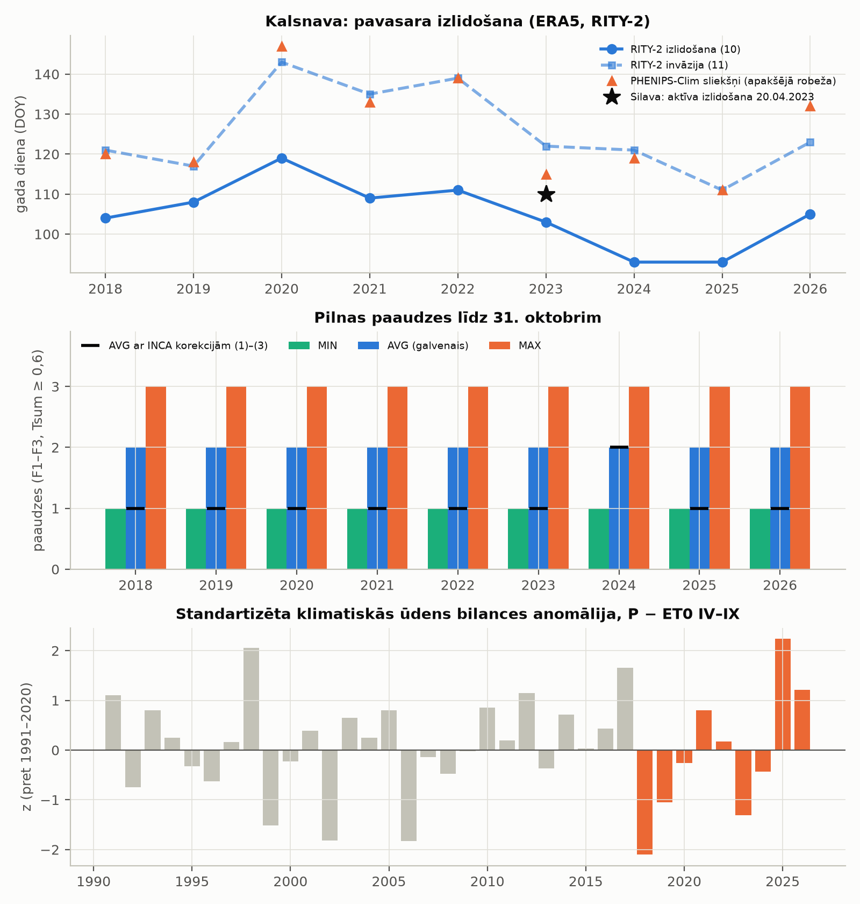

# 4. posms: laikapstākļi (ERA5), RITY-2 fenoloģija un ūdens bilance

Statuss (2026-10-29): **Kalsnava pabeigta; Latvijas režģis NAV lejupielādēts.** Open-Meteo bezmaksas limitu dēļ visa
Latvija aizņemtu ~18 dienas (sk. „Latvija”), tāpēc apjoms jāizlemj lietotājam. **[P]** = aprēķināts no datiem vai
nolasīts avotā, **[N]** = pieņēmums vai interpretācija.

Reproducēšana:

```
mezasargs-risk weather configs/rm_4_klimats.yaml --scope points     # ERA5 lejupielāde (kešs cache/rm/openmeteo/)
mezasargs-risk climate configs/rm_4_klimats.yaml --scope points     # RITY-2, ūdens bilance, tabulas, attēls
mezasargs-risk weather configs/rm_4_klimats.yaml --scope latvia --dry-run   # tikai mezgli un izsaukumu skaits
```

Izvade: `output/rm4_klimats/tables/` (`rity2_points.csv` — visi scenāriji / varianti, `climate_summary_points.csv`,
`water_balance_points.csv`, `era5_nodes_points.csv`, `check_silava_kalsnava.csv`), `figures/rm4_kalsnava.png`.

## Avoti [P]

- **Open-Meteo vēsturiskais API**, `https://archive-api.open-meteo.com/v1/archive`, `models=era5` (lietotāja lēmums: ne
  `best_match`, ne `era5_land`). ERA5: globāls, 0,25° (~25 km), 1940–, atjaunots „Daily with 5 days delay”. Licence
  CC BY 4.0. Atsauces (Open-Meteo lapa): Hersbach u. c. (2023) ERA5 hourly data on single levels from 1940 to present,
  doi:10.24381/cds.adbb2d47; Zippenfenig (2023) Open-Meteo.com Weather API, doi:10.5281/ZENODO.7970649;
  „Generated using Copernicus Climate Change Service information”.
- **Dienas mainīgie** (pārbaudīti ar atbildi): `temperature_2m_max/min/mean` (°C), `precipitation_sum` (mm),
  `et0_fao_evapotranspiration` (mm), `daylight_duration` (s). Laika josla `Europe/Riga`. API atgrieza
  `utc_offset_seconds` 7200 arī vasaras laikā (atbildē „GMT+2”), t. i. dienas robeža ir UTC+2 [P].
- **Limiti** (cenu lapa, 2026-10-29): 600 / min, 5 000 / h, 10 000 / dienā, 300 000 / mēn. Pieprasījums, kas aptver
  „more than 2 weeks for a single location” vai „more than 10 weather variables”, skaitās kā vairāki izsaukumi
  (piemērs: 2 nedēļas × 15 mainīgie = 1,5). Svara formula kodā `max(1, dienas/14) × max(1, mainīgie/10)` ir šī teksta
  interpretācija [N]. Savs budžets: 500 / min, 4 500 / h, 9 000 / dienā (`cache/rm/openmeteo/ledger.csv`).
- **RITY-2:** Ogris N. (2020) Calculation procedure for RITY — a phenology model of *Ips typographus*. MethodsX
  7:100845, doi:10.1016/j.mex.2020.100845, PMC7076557, CC BY 4.0. Pilns teksts no Europe PMC (`cache/rm_test/`,
  1. posms) šajā posmā izlasīts vēlreiz; vienādojumi kodā ar numuriem (`src/mezasargs_risk/rity.py`).
- **PHENIPS-Clim** (tikai jutīgums): Jakoby, Lischke, Wermelinger (2019) GCB, doi:10.1111/gcb.14766, 1. tabula:
  Tsw_sum 100 dd virs Tdev_min 5,12 °C „starting from 1st January” (diapauzes beigas, tā vien. 4), Tfly_min 16,11 °C.
- **Saprāta pārbaude:** VMD paziņojums LV portālā 02.06.2023, LVMI „Silava” monitorings: „aktīva izlidošana šogad ir
  sākusies 20. aprīlī” —
  https://lvportals.lv/dienaskartiba/352281-valsts-meza-dienests-rosina-turpinat-eglu-astonzobu-mizgrauza-izplatibas-ierobezojosos-pasakumus-2023

## Metode

### Laikapstākļi

- **Mezgli:** ERA5 0,25° mezgli, kuru šūna (± 0,125° ap mezglu) skar Latviju (GISCO NUTS 2024), + 1 šūnas buferis:
  **294 mezgli (198 skar Latviju)** [P]. Punktam (Kalsnava) — tuvākais mezgls.
- **Kalsnava:** AOI centroids 25,8688 / 56,6771 → mezgls **56,75 / 25,75**; API atgrieza tieši 56,75 / 25,75,
  augstums 168 m (Open-Meteo 90 m DEM) [P]. Atgrieztās koordinātas saglabātas (`era5_nodes_points.csv`).
- **Pieprasījumi mezglam:** 1991–2017 tikai IV–IX (ūdens bilances bāze), 2018–2026 1. janvāris–31. oktobris (RITY-2 no
  7. marta, PHENIPS-Clim no 1. janvāra; ietver IV–IX). 2026. gads līdz 23.10 (šodiena − 6 dienas). Kopā 36 pieprasījumi,
  **548 svērti izsaukumi** vienam mezglam [P].
- **Pārbaudes:** atbildes shēma (atslēgas, visi mainīgie, vienāds garums, mērvienības) pirms kešošanas; JSON `null` →
  NaN. Kalsnavas mezglā trūkstošu vērtību nav (0) [P].

### RITY-2 (Ogris 2020)

| Solis | Vienādojums | Parametri |
|---|---|---|
| meža gaisa t° no INCA | (1)–(3) | AT = 1,44 + 0,82·I_min; 0,50 + 0,81·I_mean; 1,03 + 0,86·I_max — **tikai jutīguma variantā** |
| mizas t° | (4)–(6) | BT = 0,56 + 0,99·AT_min; −0,48 + 1,03·AT_mean; 0,03 + 0,99·AT_max |
| efektīvā mizas t° | (7)–(9) | DT_L 8,3; T_O 30,4; DT_U 38,9 °C; α 0,02876507, β 3,5922336, γ 1,24657367, Tmax 40,9958913 |
| izlidošana / invāzija | (10) / (11) | I_max > 14,5 °C un Σ(I_max − 8,3) ≥ 53,0 / 155,6 dd no 7. marta |
| F1 | (12) | Tsum = ΣBTeff / K, K = 557 dd, no invāzijas dienas |
| māsu perējumi S_j | (13) | Tsum_F1 > j − 0,5, I_max > 14,5 °C, diena ≥ 14,5 h |
| F2 / F3 | (14) / (15) | Tsum_F1 > 1 / > 2, I_max > 14,5 °C, diena ≥ 14,5 h |
| paaudžu skaits | teksts pēc (15) | uzsākta paaudze skaitās, ja Tsum ≥ 0,6 līdz 31. oktobrim |

- **Galvenais variants (lietotāja lēmums):** ERA5 temperatūra tieši kā meža gaisa t° (AT = ERA5), tad (4)–(9).
  **Jutīgums:** (1)–(3) ar I = ERA5. Sliekšņi (10)–(15) abos variantos lieto I_max = ERA5 maksimumu, kā rakstā; tāpēc
  INCA korekcijas izlidošanas dienu nemaina [P, kods].
- **Scenāriji** kā rakstā: MIN / AVG / MAX = BTeff no BT_min / BT_mean / BT_max. Galvenais — AVG (rakstā kartes
  parādītas AVG scenārijam [P]; izvēle par galveno [N]).
- **Dienas garums:** Open-Meteo `daylight_duration` (rakstā formula nav dota).
- **Interpretācijas [N]:** (10)–(11) summā tikai pozitīvās daļas (I_max − 8,3); diena, kurā slieksni sasniedz, skaitās;
  F3 sākums Tsum_F1 > 2 tieši kā (15) rakstīts; māsu perējumi skaitīti atsevišķi (`n_sister`), „paaudzes” =
  F1–F3; 7. marta sākuma datums ir Slovēnijas kalibrācija (rakstā: jākalibrē katram reģionam).
- **Tekošais gads:** 2026 aprēķināts līdz pēdējai datu dienai (2026-10-23), `complete = False`.
- **PHENIPS-Clim sliekšņi (jutīgums):** pirmā diena no 1. janvāra ar Σ(T_mean − 5,12)+ ≥ 100 dd un T_max ≥ 16,11 °C.
  Modeļa papildbarošanās posms un stundas lidojuma modelis nav atveidoti, tāpēc tas ir **apakšējā robeža** [N].

### Ūdens bilance

CWB = Σ(P − ET0) IV–IX; **standartizēta klimatiskās ūdens bilances anomālija** z = (CWB − vid.₁₉₉₁₋₂₀₂₀) / sd₁₉₉₁₋₂₀₂₀
(ddof = 1). Tas **nav SPEI** (nav sadalījuma pielāgošanas). Gads ar kaut vienu trūkstošu dienu → NaN.

## Rezultāti: Kalsnava (mezgls 56,75 / 25,75) [P]

| Gads | Izlidošana (10) | Invāzija (11) DOY | F1 pabeigta DOY | Paaudzes AVG / MIN / MAX | AVG ar (1)–(3) | PHENIPS-Clim DOY | P − ET0 IV–IX, mm | z |
|---|---|---|---|---|---|---|---|---|
| 2018 | 14.04 (104) | 121 | 196 | 2 / 1 / 3 | 1 | 120 | −319,9 | −2,10 |
| 2019 | 18.04 (108) | 117 | 200 | 2 / 1 / 3 | 1 | 118 | −210,1 | −1,05 |
| 2020 | 28.04 (119) | 143 | 210 | 2 / 1 / 3 | 1 | 147 | −127,9 | −0,26 |
| 2021 | 19.04 (109) | 135 | 195 | 2 / 1 / 3 | 1 | 133 | −17,6 | 0,80 |
| 2022 | 21.04 (111) | 139 | 211 | 2 / 1 / 3 | 1 | 139 | −83,0 | 0,17 |
| 2023 | 13.04 (103) | 122 | 204 | 2 / 1 / 3 | 1 | 115 | −236,5 | −1,30 |
| 2024 | 02.04 (93) | 121 | 191 | 2 / 1 / 3 | 2 | 119 | −146,3 | −0,44 |
| 2025 | 03.04 (93) | 111 | 210 | 2 / 1 / 3 | 1 | 111 | 132,6 | 2,24 |
| 2026* | 15.04 (105) | 123 | 205 | 2 / 1 / 3 | 1 | 132 | 25,2 | 1,21 |

\* 2026 līdz 23.10. Bāze 1991–2020: vid. −100,7 mm, sd 104,2 mm.

- **Paaudzes (AVG):** F1 pabeidz attīstību 10.–30. jūlijā (DOY 191–211), kad diena vēl ir ≥ 14,5 h, tāpēc F2 sākas uzreiz
  un līdz 31.10 sasniedz Tsum 0,74–1,42 ≥ 0,6. Rezultāts katru gadu ir 2 paaudzes. F3 nesākas nevienā gadā [P].
- **Jutīgums ir liels:** MIN 1, MAX 3, ar INCA korekcijām 1 (2024. gadā 2) paaudze. Tsum_F2 ar INCA korekcijām ir
  0,15–0,65; 2020., 2025. un 2026. gadā F2 nesākas [P]. Paaudžu skaits šajā konfigurācijā ir vairāk atkarīgs no temperatūras pārveidojuma nekā no gada.
- **Māsu perējumi (AVG):** 1–2 gadā (`n_sister`) [P].
- **Ūdens bilance:** sausākie gadi 2018 (z −2,10), 2023 (−1,30), 2019 (−1,05); mitrākais 2025 (2,24) [P].



### Saprāta pārbaude: Silava 20.04.2023 [P]

| | Datums | DOY | Starpība pret 20.04 |
|---|---|---|---|
| Silava / VMD: aktīva izlidošana | 20.04.2023 | 110 | — |
| RITY-2 izlidošana (10), Kalsnava | 13.04.2023 | 103 | −7 dienas |
| RITY-2 invāzija (11) | 02.05.2023 | 122 | +12 dienas |
| PHENIPS-Clim sliekšņi (apakšējā robeža) | 25.04.2023 | 115 | +5 dienas |

- RITY-2 izlidošanas diena ir nedēļu pirms publiski minētā datuma, PHENIPS-Clim apakšējā robeža — 5 dienas pēc tā.
  Abi ir vienas nedēļas robežās; pretrunu nav, bet tas ir **viens gads un viens punkts** [P].
- Silava datums ir slazdu monitorings visā Latvijā (vietas nav norādītas), Kalsnava ir viens ERA5 mezgls; tieši
  salīdzināmi tie nav [N]. Kalibrācijai vajag Silava slazdu datus (atvērti nav atrasti, 1. posms).

## Latvija — NAV izdarīts (lēmums vajadzīgs) [P]

| Apjoms | Mezgli | Svērti izsaukumi | Dienas pie 9 000 / dienā |
|---|---|---|---|
| Pilns uzdevums: 294 mezgli, 1991–2017 IV–IX + 2018–2026 I–X | 294 | 161 091 | ~18 |
| Tikai mezgli, kuru šūna skar Latviju (bez bufera) | 198 | ~108 500 | ~12 |
| Tikai fenoloģija 2018–2026 (bez ūdens bilances bāzes 1991–2017) | 294 | ~57 300 | ~6,5 |

- Plāna 2.4 novērtējums „~350 Open-Meteo izsaukumi” bija kļūdains: tas neņēma vērā svēršanu pēc perioda garuma [P].
- Kods Latvijas režģim ir gatavs (`--scope latvia`): mezgli, atsākama lejupielāde ar budžetu, kartes pa gadiem
  (`rm4_lv_izlidosana.png`, `rm4_lv_paaudzes.png`, `rm4_lv_udens_bilance.png`). Kartes nav pārbaudītas ar īstiem datiem.

## Testi [P]

- `tests/test_rm_rity.py`: (7)–(9) vērtības (pie T_O 22,1 lineāri / 21,68 nelineāri, pie DT_U ≈ 0,014, ārpus 0);
  sintētiska rinda ar zināmu termālo summu (I_max 18,3 °C → 10 dd/dienā → izlidošana 12.03, invāzija 22.03);
  lidojuma slieksnis; paaudžu skaitīšana (F2 / F3 / S_j sākumi, 0,6 slieksnis, dienas garums); INCA variants;
  nepilns un tekošais gads; PHENIPS-Clim sliekšņi.
- `tests/test_rm_weather.py`: ierakstīta Open-Meteo atbilde (`tests/data/openmeteo_era5_daily_sample.json`, 4 dienas,
  bez tīkla) — shēma, mērvienības, `null`; kešs bez tīkla; tuvākais mezgls; mezglu režģis; logi; svari (piemērs
  1,5); budžeta gaidīšana un žurnāls; ūdens bilance un anomālija ar sintētiskiem datiem.
- Visi offline testi: 128 passed (2026-10-29). s2forest kods nav mainīts.

## Ierobežojumi

- **RITY-2 kalibrēts Slovēnijai ar INCA** (plāna R5): sākuma datums 7. marts, sliekšņi un mizas t° modeļi nav pārbaudīti
  Latvijā. ERA5 0,25° (~25 km) ir rupjš mežaudzes mikroklimatam (R4) [N].
- **Paaudžu skaits ir ļoti jutīgs** pret temperatūras pārveidojumu (1 / 2 / 3 atkarībā no varianta). Pazīmei var
  izmantot relatīvo termālo summu (`tsum_F1`, `tsum_F2`), nevis tikai veselu paaudžu skaitu [N].
- Dienas robeža UTC+2 visu gadu (API atbilde) [P]; ietekme uz dienas min/maks. nav vērtēta [N].
- Viens saprāta pārbaudes datums; ar to nevar kalibrēt.

## Fakti pret pieņēmumiem

- **[P]:** API shēma un mezgls; mezglu un izsaukumu skaits; visas tabulu vērtības; RITY-2 vienādojumi un parametri no
  avota; Silava citāts; testu rezultāti.
- **[N]:** svara formulas interpretācija; (10)–(11) summas un (15) interpretācija; AVG kā galvenais scenārijs; māsu
  perējumu atsevišķa skaitīšana; PHENIPS-Clim kā apakšējā robeža; RITY-2 / ERA5 derīgums Latvijai.

## Kas NAV izdarīts

- Latvijas režģis (294 mezgli) nav lejupielādēts — gaida lēmumu (sk. „Latvija”).
- Nav kalibrācijas pret Latvijas slazdu datiem (nav atvērtu datu).
- PHENIPS oriģinālie sliekšņi (60,5 / 140,3 dd no 1. aprīļa, 16,5 °C; sekundāri Ogris 2020) nav izmantoti — uzdevumā
  jutīgumam paredzēti tikai PHENIPS-Clim parametri.
- Nav vēja brāzmu (`wind_gusts_10m_max`) un nav nobīdīto (t−1, t−2) pazīmju tabulas — tas ir 6. posms.
