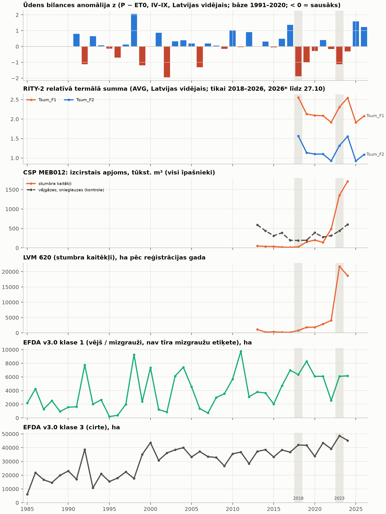
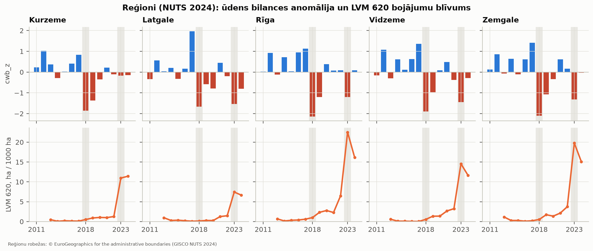

# Sausuma salīdzinājums (pēc 4. posma): bojājumi pret ūdens bilanci un termālo summu

Plāns: L7 / 2.15 2. punkts („sakarība ar sausuma gadiem”, nobīde 0–2 gadi). Lietotāja lēmums 2026-11-04:
**aprakstoši**. Gadu ir maz (n = 5–34), tāpēc šeit **nav cēloņsakarību apgalvojumu**. Katrā tabulā ir n, korelācijas
ir tikai ar permutācijas p vērtību un bloku bootstrap ticamības intervālu (TI). **[P]** = aprēķināts no datiem,
**[N]** = pieņēmums vai interpretācija.

```
mezasargs-risk drought-compare configs/rm_4b_sausums.yaml
```

Kods: `src/mezasargs_risk/drought.py`, CLI `drought-compare`, testi `tests/test_rm_drought.py`. Izvade (nav git):
`output/rm4b_sausums/tables/drought_*.csv`, attēli `figures/rm4b_sausums_*.png` (kopija `docs/rm_figures`).

## Ievaddati — tikai esošie (nekas nav lejupielādēts vai dublēts) [P]

| Sērija | Gadi | Avots repo |
|---|---|---|
| Ūdens bilances anomālija cwb_z (P − ET0, IV–IX, pret 1991–2020), Latvijas vid. (946 šūnas) un reģionu vid. | 1991–2026 | 4. posms: `output/rm4_klimats/tables/lv_water_balance_years.csv`, `latvia/water_balance_cells.csv` |
| RITY-2 Tsum_F1, Tsum_F2 (AVG, ERA5-Land tieši), Latvijas un reģionu vid. | 2018–2026 | 4. posms: `lv_rity2_years.csv`, `latvia/rity2_cells.csv` |
| **CSP MEB012** stumbra kaitēkļi: izcirstais apjoms tūkst. m³ un bojā gājušās audzes ha (visi īpašnieki); vējgāzes, snieglauzes tūkst. m³ (kontrole) | 2013–2024 | `cache/rm5_sources/csp_MEB012.csv` (5. posms) |
| **CSP MEB011** stumbra kaitēkļi pa statistiskajiem reģioniem (no 01.01.2024), visi īpašnieki | 2021–2025 | `cache/rm5_sources/csp_MEB011_owner.csv` (5a) |
| **EFDA v3.0** klase 1 (vējš / mizgrauži) un klase 3 (cirte), ha Latvijā | 1985–2024 | 5. posms: `efda_annual_counts.csv` (px × 0,09 ha) |
| **LVM 620** (stumbra kaitēkļi) ha un poligoni pēc `DISTRBYEAR`; pa NUTS 2024 reģioniem uz 1000 ha LVM zemes | 2013–2024 | 5a: `lvm_620_vs_csp_meb012.csv`, `lvm_620_by_region.csv`; 0,1° pārbaudei — LVM_BOJAJUMI Wayback kopija |

- LVM 2025 nav izmantots (arhīvs līdz 2025-04-27); MEB012 beidzas 2024. EFDA klase 1 **nav tīra mizgraužu etiķete**
  (5. posms) — tikai aprakstoši.
- cwb_z < 0 = sausāks. Gaidāmā zīme, ja sausums palielina bojājumus: **negatīva** korelācija.

## Metode

- **Nobīdes:** t, t−1, t−2 un divu gadu summa (t−1) + (t−2) gan cwb_z, gan Tsum.
- **Spearman ρ**; **permutācijas p** (9 999 permutācijas, divpusējs); **bloku bootstrap 95 % TI** (pārklājošie bloki,
  garums round(n^⅓), min. 2: n = 12 → 2, n = 32–34 → 3; 9 999 atkārtojumi; tikai ja n ≥ 8). Sēkla 20261104.
- **Pirmās diferences** (Δbojājumi pret Δpazīme, secīgi gadi): pārbaude pret kopīgu trendu.
- **Reģionu panelis** (5 reģioni × gadi): *kopējais* ρ (TI — bootstrap pa veseliem gadiem; p — veselu gadu
  permutācija) un *gada iekšienē* ρ (rangi centrēti katrā gadā = tikai telpiskās atšķirības; p — reģionu permutācija
  gada iekšienē).
- Permutācijas p pieņem, ka gadi ir apmaināmi; ar trendu tas ir **par optimistisku** [N]. Bloku TI ir piesardzīgāks.

## 1. Nacionālais līmenis: bojājumi pret cwb_z [P]

ρ [95 % TI], p_perm. CSP / LVM: n = 12 (2013–2024); EFDA: n = 34 / 33 / 32 / 32.

| Sērija | t | t−1 | t−2 | t−1 + t−2 |
|---|---|---|---|---|
| CSP stumbra kaitēkļi, tūkst. m³ | −0,56 [−0,93; 0,09] 0,063 | −0,59 [−0,84; 0,09] 0,048 | −0,29 [−0,61; 0,46] 0,37 | −0,66 [−0,86; 0,08] 0,022 |
| CSP stumbra kaitēkļi, bojā gājušas audzes ha | −0,57 [−0,84; 0,22] 0,060 | −0,59 [−0,92; 0,09] 0,049 | −0,20 [−0,44; 0,76] 0,55 | −0,64 [−0,82; 0,13] 0,026 |
| CSP vējgāzes (kontrole), tūkst. m³ | −0,01 [−0,68; 0,68] 0,99 | −0,25 [−0,89; 0,42] 0,43 | −0,15 [−0,65; 0,63] 0,65 | −0,14 [−0,88; 0,60] 0,66 |
| LVM 620, ha | −0,60 [−0,98; 0,23] 0,043 | −0,47 [−0,66; 0,34] 0,12 | −0,33 [−0,67; 0,46] 0,31 | −0,63 [−0,82; 0,13] 0,029 |
| LVM 620, poligoni | −0,59 [−0,93; 0,17] 0,048 | −0,51 [−0,78; 0,21] 0,089 | −0,26 [−0,56; 0,55] 0,43 | −0,61 [−0,75; 0,26] 0,036 |
| EFDA klase 1, ha | 0,09 [−0,23; 0,54] 0,60 | 0,00 [−0,39; 0,34] 0,99 | −0,04 [−0,37; 0,30] 0,83 | −0,08 [−0,41; 0,25] 0,67 |
| EFDA klase 3 (cirte), ha | −0,34 [−0,55; 0,12] 0,054 | −0,06 [−0,32; 0,27] 0,73 | 0,13 [−0,20; 0,56] 0,48 | 0,05 [−0,27; 0,45] 0,80 |

- **CSP un LVM stumbra kaitēkļi:**
  - zīme ir gaidītā (negatīva), ρ −0,56 … −0,66 nobīdēm t, t−1 un t−1 + t−2;
  - t−2 viena pati ir vājāka (−0,20 … −0,33);
  - **visi bloku TI ietver 0**.
- **Pirmās diferences** (n = 11): ρ −0,42 … +0,46, un gandrīz visi TI ietver 0. Gada pārmaiņas bojājumos neseko gada
  pārmaiņām cwb_z [P].
  - Vienīgais TI, kas neietver 0: CSP ha t−2, +0,46 [0,05; 1,00] — pretēja zīme.
  - Tātad līmeņu korelāciju lielā mērā nosaka **kopīgs laika modelis**: 2013–2017 bija mitri / normāli un ar maz
    bojājumu, 2018–2024 sausāki un ar strauju bojājumu pieaugumu. Ar 12 gadiem to no sausuma efekta atdalīt nevar.
- **Vējgāzes (kontrole):** sakarības nav (|ρ| ≤ 0,25).
- **EFDA klase 1:** nav sakarības nevienā nobīdē (n = 32–34, |ρ| ≤ 0,09). Tas saskan ar 5. posma secinājumu, ka klase 1
  Latvijā lielā mērā ir vējš [N].
- **EFDA klase 3 (cirte):** sausākos gados ir vairāk cirtes tajā pašā gadā (ρ −0,34; diferencēs −0,45 [−0,64; −0,07],
  p 0,008) [P]. Iespējams, sausās vasarās ir labāki ciršanas apstākļi vai uzņēmumi labāk atklājami [N, nav
  pārbaudīts].

### Tsum (tikai 2018–2026 → n = 5–7; bez TI) [P]

| Sērija | Tsum_F1 t (n = 7) | t−1 (n = 6) | t−2 (n = 5) | t−1 + t−2 (n = 5) |
|---|---|---|---|---|
| CSP stumbra kaitēkļi, tūkst. m³ | 0,00 (p 1,0) | −0,20 (0,71) | −0,90 (0,08) | −0,20 (0,79) |
| LVM 620, ha | −0,14 (0,78) | −0,66 (0,18) | −0,90 (0,09) | −0,70 (0,23) |
| EFDA klase 1, ha | 0,64 (0,14) | 0,71 (0,14) | −0,50 (0,45) | 0,20 (0,78) |

- Tsum_F2 rangi Latvijas vidējā līmenī sakrīt ar Tsum_F1 (rezultāti identiski), tāpēc tabulā ir tikai F1.
- **Ar n = 5–7 secinājumu nav.** Zīmes ir nestabilas un mainās pa nobīdēm.
- Lai Tsum būtu par 1991–2017, vajag ERA5-Land I–III un X 1991–2017 (108 mēneši; nav lejupielādēts) — tas ir
  lietotāja lēmums.



## 2. Telpiskais līmenis [P]

**0,1° šūnas: dati par retiem — NAV rēķināts** (`drought_lvm_cells_sparsity.csv`, 946 šūnas Latvijā):

| | 2013 | 2014 | 2015 | 2016 | 2017 | 2018 | 2019 | 2020 | 2021 | 2022 | 2023 | 2024 |
|---|---|---|---|---|---|---|---|---|---|---|---|---|
| LVM 620 poligoni | 606 | 169 | 163 | 98 | 95 | 483 | 1 110 | 1 027 | 1 269 | 1 926 | 9 838 | 10 857 |
| šūnas ar ≥ 1 poligonu | 19 % | 12 % | 9 % | 6 % | 6 % | 19 % | 38 % | 39 % | 38 % | 50 % | 75 % | 75 % |

Mediāna šūnā, kurā poligoni ir, ir 1–2 poligoni (2023–2024: 9). Šūnu līmenī būtu vajadzīgi vismaz vairāki pilni
gadi; tādi ir tikai 2023–2024.

**NUTS 2024 reģioni (5): LVM 620 ha uz 1000 ha LVM zemes pret reģiona vid. cwb_z / Tsum** (`drought_regional_panel.csv`):

| Pazīme, nobīde | n reģ.-gadi (gadi) | ρ kopējais [TI], p | ρ gada iekšienē [TI], p |
|---|---|---|---|
| cwb_z t | 60 (12) | −0,40 [−0,69; 0,11] 0,12 | 0,08 [−0,25; 0,39] 0,62 |
| cwb_z t−1 | 60 (12) | −0,34 [−0,57; 0,04] 0,21 | −0,03 [−0,34; 0,27] 0,83 |
| cwb_z t−2 | 60 (12) | −0,20 [−0,53; 0,20] 0,45 | 0,05 [−0,28; 0,38] 0,75 |
| cwb_z t−1 + t−2 | 60 (12) | −0,45 [−0,65; −0,08] 0,084 | 0,03 [−0,22; 0,28] 0,89 |
| Tsum_F1 t | 35 (7) | 0,14 [−0,54; 0,76] 0,71 | 0,30 [0,04; 0,54] 0,12 |
| Tsum_F1 t−1 | 30 (6) | −0,23 [−0,64; 0,70] 0,56 | **0,45 [0,12; 0,70] 0,030** |
| Tsum_F1 t−2 | 25 (5) | −0,52 [−0,71; 0,30] 0,25 | 0,36 [0,08; 0,60] 0,12 |
| Tsum_F1 t−1 + t−2 | 25 (5) | −0,40 [−0,62; 0,32] 0,33 | 0,44 [0,16; 0,64] 0,051 |

- **cwb_z:**
  - kopējais ρ ir negatīvs: tas ir tas pats laika modelis, kas nacionālajā līmenī;
  - **gada iekšienē ≈ 0** (−0,03 … 0,08): reģioni, kas konkrētajā gadā ir sausāki, nav tie, kuros konkrētajā gadā ir
    vairāk LVM 620 bojājumu.
- **Tsum:** gada iekšienē pozitīvs (0,30–0,45). Siltākos reģionos (Zemgale, Rīga) bojājumu blīvums ir lielāks, vēsākā
  Latgalē — mazāks. Tomēr:
  - ir tikai 5–7 gadi;
  - tā var būt **pastāvīga reģionu atšķirība** (egļu īpatsvars, LVM prakse), nevis gada efekts [N, nav pārbaudīts].
  - Tsum_F2 rezultāti ir tādi paši.



## 3. Notikumu pārbaude [P]

`drought_events_national.csv` un `drought_event_2023_regions.csv`. Salīdzinājuma bāze ir mediāna 5 gados pirms notikuma.

**2018** (cwb_z −1,88; 2019 −1,01):

| Sērija | bāze 2013–2017 | 2019 | 2020 | 2021 |
|---|---|---|---|---|
| CSP stumbra kaitēkļi, tūkst. m³ | 36,8 | 151 (×4,1) | 202 (×5,5) | 143 (×3,9) |
| CSP stumbra kaitēkļi, ha | 103 | 742 (×7,2) | 609 (×5,9) | 868 (×8,4) |
| LVM 620, ha | 237 | 1 834 (×7,7) | 1 850 (×7,8) | 2 857 (×12,0) |
| EFDA klase 1, ha | 3 792 | 8 286 (×2,2; 95. procentile no 40 g.) | 6 081 (×1,6) | 6 091 (×1,6) |
| CSP vējgāzes (kontrole), tūkst. m³ | 387 | 198 (×0,5) | 391 (×1,0) | 279 (×0,7) |

- 1–3 gadus pēc 2018. gada stumbra kaitēkļu rādītāji ir 4–12 × virs bāzes; vējgāzes — nē.
- Atgriešanās pie bāzes nav: rādītāji turpina augt līdz 2024. gadam. Tāpēc 2018 ir **pieauguma perioda sākums**, un
  to no turpmākās attīstības atdalīt nevar.

**2002 un 2006 (tikai EFDA klase 1; CSP / LVM sākas 2013):**
- **Pēc 2002** (cwb_z −1,95):
  - 2003: 6 124 ha (×2,6 pret 1997–2001 mediānu 2 381; 78. procentile);
  - 2004: 7 420 ha (×3,1; 90. procentile);
  - 2005: 4 547 ha (janvāra vētra, 5. posms).
- **Pēc 2006** (cwb_z −1,31): 2007 716 ha (×0,16; 8. procentile), 2008 2 976 ha, 2009 3 538 ha (×0,65–0,78) —
  pieauguma nav.
- Tātad viens no diviem sausuma gadiem ir ar pieaugumu, otrs bez tā. Klase 1 ietver vēju [N].

**2023. gada austrumu sausums → 2024–2025 austrumos?**

| Reģions | cwb_z 2023 | LVM 620 ha/1000 ha 2022 → 2023 → 2024 (2024 / 2022) | MEB011 stumbra kaitēkļi, bojā gājušas audzes ha 2022 → 2024 → 2025 (2024 / 2022) |
|---|---|---|---|
| Latgale | −1,54 | 1,5 → 7,4 → 6,7 (×4,5) | 320 → 851 → 769 (×2,7) |
| Vidzeme | −1,44 | 3,2 → 14,5 → 11,7 (×3,6) | 1 267 → 3 076 → 2 923 (×2,4) |
| Zemgale | −1,32 | 3,7 → 19,8 → 15,1 (×4,0) | 519 → 2 041 → 1 782 (×3,9) |
| Rīga | −1,20 | 6,5 → 22,5 → 16,2 (×2,5) | 165 → 560 → 538 (×3,4) |
| Kurzeme | −0,17 | 1,3 → 11,0 → 11,4 (×9,0) | 70 → 1 140 → 581 (×16,4) |

- **Nē, dati to nerāda.** Lielākais relatīvais pieaugums 2022 → 2024 ir Kurzemē (2023. gadā tuvu normai); Latgalē un
  Vidzemē (sausākās 2023. gadā) tas ir vismazākais pēc MEB011 un vidējs pēc LVM. Kurzemes attiecību palielina zemā
  2022. gada bāze.
- 2023. gadā bojājumi auga visos reģionos jau **tajā pašā gadā** — uzliesmojums sākās pirms 2023. gada sausuma.

## 4. Ieteikums 6. posmam (ne lēmums) [N]

| Pazīme | Ieteikums | Pamatojums |
|---|---|---|
| **cwb_z t−1** | ņemt kā kandidātu | nacionāli ρ −0,47 … −0,59 (gaidītā zīme), bet TI ietver 0; diferencēs un reģionu gada iekšienē ≈ 0 |
| **cwb_z (t−1) + (t−2)** | ņemt kā kandidātu | stiprākā nacionālā zīme (−0,61 … −0,66), TI ietver 0; tie paši ierobežojumi |
| cwb_z t−2 viena pati | **dati neatbalsta** — tikai summā | ρ −0,20 … −0,33, TI plaši; diferencēs CSP ha pretēja zīme |
| cwb_z t (tas pats gads) | neņemt prognozei (plāns: pazīmes ≤ t−1) | nacionāli līdzīgs t−1; laikā nav pieejams prognozes brīdī |
| **Tsum_F1 vai Tsum_F2 t−1** (viena no abām) | ņemt kā kandidātu, ar piesardzību | nacionāli n = 6, secinājuma nav; reģionu gada iekšienē +0,45 [0,12; 0,70], bet iespējams pastāvīgs reģiona efekts; F1 un F2 vidējo rangi sakrīt |
| izlidošanas DOY, paaudzes | tikai jutīgumam | sliekšņa lēcieni (4. posms); šeit nav testēts |
| EFDA klase 1 kā sausuma–mizgraužu etiķete | **dati neatbalsta** | nav sakarības nevienā nobīdē (n = 32–34) |

- Gaidītais „sausums t−1 / t−2 → bojājumi” **saskan pēc zīmes**, bet ar šiem datiem **nav atdalāms** no kopīgā
  2018–2024 pieauguma. Konkrētu nobīdi (t vs t−1 vs summa) izvēlēties nevar: atšķirības ir TI robežās.
- 6. posmā šīs pazīmes jāvērtē ar laika krustvalidāciju (gadi atsevišķi). Laika trends (gads) vai reģiona efekts
  jāiekļauj kā kontrole, citādi cwb_z var aizstāt trendu [N].
- Tsum ir tikai 2018–2026, tāpēc ar EFDA 1985–2024 etiķetēm to nevar izmantot bez I–III un X 1991–2017
  lejupielādes (lietotāja lēmums).

## Ko dati NEĻAUJ secināt

- Cēloņsakarību (sausums → mizgrauži); n = 12 neatdala sausumu no uzliesmojuma dinamikas, VMD / LVM reģistrācijas
  prakses un mežizstrādes izmaiņām.
- Kura nobīde (t, t−1, t−1 + t−2) ir „pareizā”.
- Telpisku sausuma efektu (reģionu gada iekšienē ρ ≈ 0; šūnu līmenis par retu).
- Tsum efektu nacionāli (n = 5–7).
- Neko par 2025.–2026. gadu (MEB012 un LVM beidzas 2024).

## Ierobežojumi

- 5 reģioni — ļoti rupjš telpiskais mērogs; LVM 620 ir tikai valsts meži un reģistrācijas gads, nevis bojājuma
  sākums (5a).
- CSP MEB012 un MEB011 ir VMD dati (visi īpašnieki); bojājuma veida klasifikācija ir VMD [P].
- Permutācijas p ar trendu ir par optimistisku; bloku bootstrap ar n = 12 ir rupjš (bloks 2) [N].
