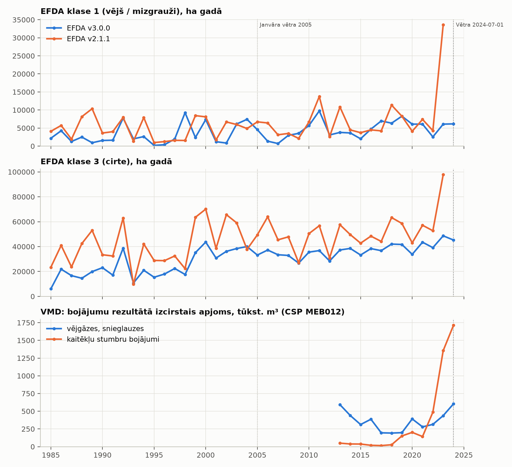
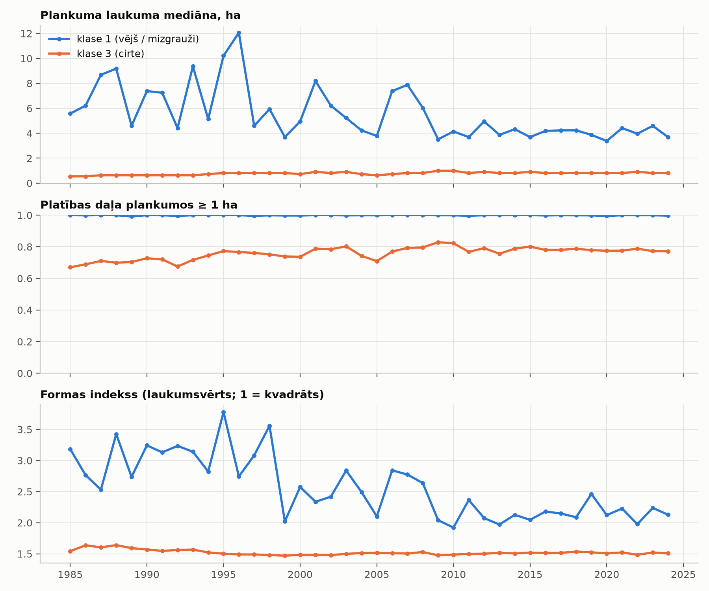
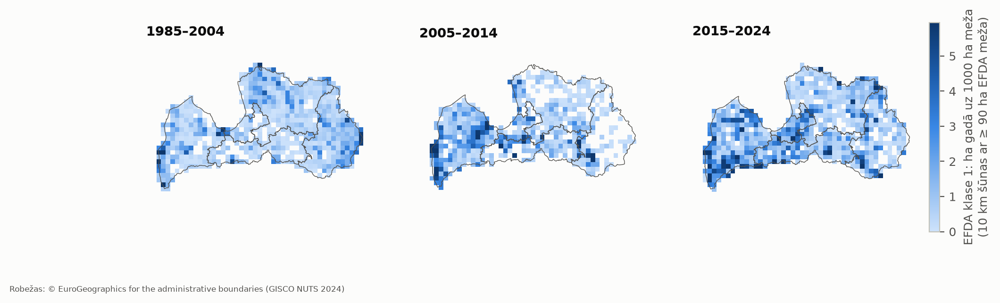
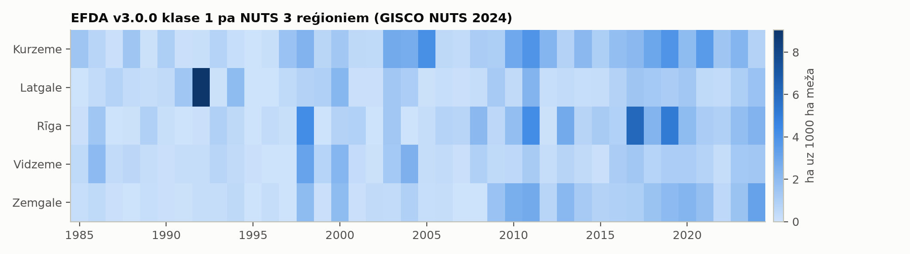
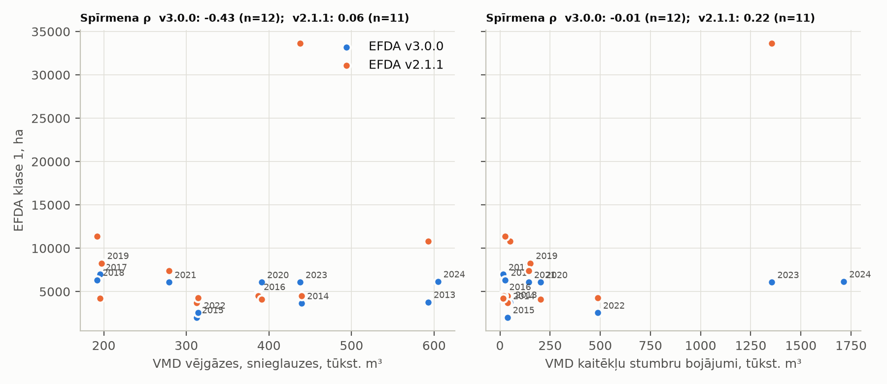
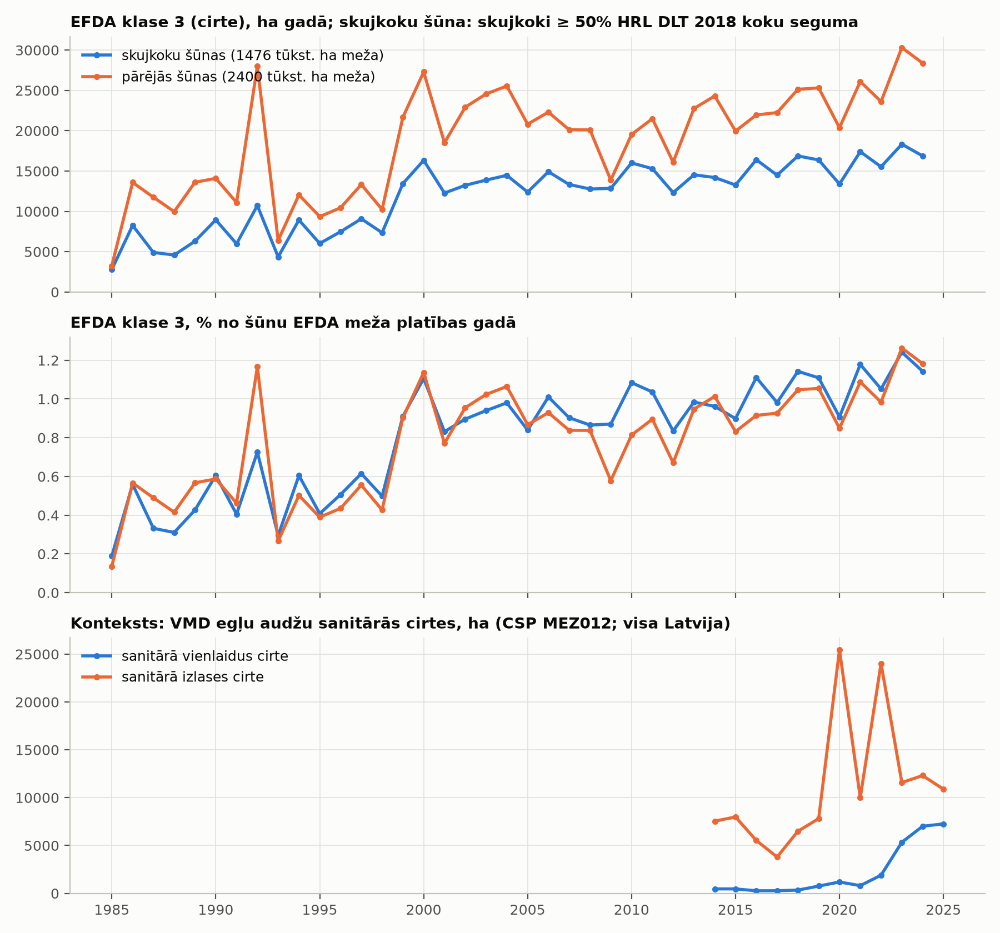
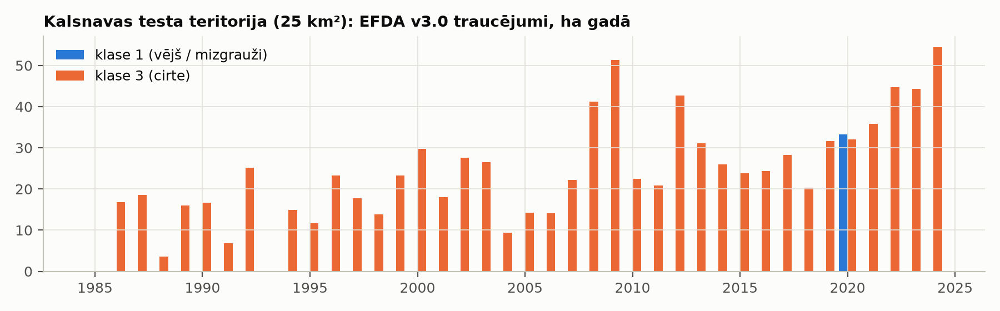

# 5. posms: EFDA ievade un aprakstošā analīze (Latvija)

2026-10-23, zars `feat/risk-model`. Tikai aprakstoši rezultāti: modeļa, cēloņsakarību un mizgraužu secinājumu
nav. Sausuma salīdzinājums atlikts uz 5b posmu. **[P]** = pārbaudīts (aprēķināts vai atvērts avots),
**[N]** = pieņēmums vai interpretācija.

**Reproducēšana:**

```bash
python scripts/rm_efda_extract.py
python scripts/rm_fetch_sources.py
python -m uv run mezasargs-risk labels   configs/rm_latvia.yaml
python -m uv run mezasargs-risk describe configs/rm_latvia.yaml
```

- **Izvade:** `output/rm5_efda_latvia/` (tabulas un attēli) un `run_metadata.json` (DOI, koda commit, robežu
  fails, DLT kešs).
- **Attēli:** nokopēti uz `docs/rm_figures/`.
- **Kods:** jauna pakotne `src/mezasargs_risk/` (`config`, `efda`, `describe`, `viz`, `cli`). s2forest un
  s1windthrow netiek mainīti; no s2forest izmanto tikai HRL DLT lejupielādes funkciju un nolasa Kalsnavas 2025.
  gada izvadi.

## 1. EFDA ievade un robežu pārbaude

- **Lejupielāde [P].** Ar HTTP range pieprasījumiem izvilkti tikai vajadzīgie slāņi (sha256 —
  `cache/efda/download_log.json`):
  - v3.0 no `Lithuania.zip`: 81 MB pārsūtīti;
  - v2.1.1 no `latvia.zip`: 76 MB pārsūtīti.

  Varbūtības slāņi un v3.0 `severity` nav ņemti, jo šim posmam nav vajadzīgi.
- **Robežu pārbaude** (`mezasargs-risk labels`; plāna 2.2, 1. lēmums). Tā nav atkarīga no faila nosaukuma un
  pārbauda trīs lietas:
  - Latvijas (GISCO NUTS 2024) laukuma daļu rastra robežās — vajag ≥ 95 %;
  - EFDA meža maskas pikseļu daļu Latvijā (+1 km buferis) — vajag ≥ 95 %;
  - vai Kalsnavas kontrolpunkta 1 km apkārtnē ir mežs.

| Fails | Laukums robežās | Mežs Latvijā | Kontrolpunkts | Rezultāts |
|---|---|---|---|---|
| v3.0 `Lithuania.zip` | 100 % | 100 % (43,08 milj. px) | mežs 100 % | **OK** [P] |
| v2.1.1 `latvia.zip` | 100 % | 100 % (43,09 milj. px) | mežs 100 % | **OK** [P] |
| v3.0 `Latvia.zip` (negatīvā kontrole) | 20,7 % | 0,7 % | ārpus rastra | **FAIL** [P] |

- **Ārpus Latvijas** ir 0,02–0,09 % EFDA traucējumu pikseļu (robežas pikseļi) [P]. Tie netiek ņemti vērā.
- **EFDA meža maska Latvijā** ir 3,88 milj. ha [P]. Pa reģioniem: Vidzeme 1336, Kurzeme 992, Latgale 787,
  Zemgale 545, Rīga 215 tūkst. ha.
- **Robežas.** Reģioni ir GISCO NUTS 2024 3. līmeņa vienības (5 reģioni). Licence: „© EuroGeographics for the
  administrative boundaries", tikai nekomerciāla izmantošana [P].

## 2. v3.0 un v2.1.1 krustpārbaude pa gadiem (1985–2023)

- **Režģi nav saskaņoti [P].** v2.1.1 režģis ir nobīdīts par 902 rindām un 868 kolonnām, plus ~8,5 m
  (apakšpikseļa nobīde). Pikseļu salīdzinājumā izmantots tuvākais pikselis; gada platības tas neietekmē.
- **Pilnā tabula:** `tables/efda_crosscheck_v30_v211.csv`.

| Rādītājs (Latvija, 1985–2023) | v3.0 | v2.1.1 | Starpība |
|---|---|---|---|
| Visi traucējumi kopā | 1,343 milj. ha | 2,043 milj. ha | **−34 %** |
| Klase 1 kopā | 152 tūkst. ha | 238 tūkst. ha | **−36 %** |
| Gada sakritība klasei 1 (Spīrmena ρ pa gadiem) | | | 0,48 |
| Gada sakritība visiem traucējumiem (ρ) | | | 0,75 |
| Klases 1 pikseļu sakritība tajā pašā gadā (Jaccard), mediāna (min–max) | | | **0,13 (0,01–0,29)** |
| v3.0 klases 1 pikseļi, ko v2.1.1 arī sauc par klasi 1 ±1 gada robežās, mediāna | | | 33 % |

Gadi ar lielākajām klases 1 atšķirībām [P]:

| Gads | v3.0, ha | v2.1.1, ha | Starpība |
|---|---|---|---|
| 1998 | 9 262 | 1 559 | +494 % |
| 1989 | 938 | 10 358 | −91 % |
| 2002 | 849 | 6 691 | −87 % |
| **2023** | **6 084** | **33 615** | **−82 %** |

**Secinājums [P skaitļi; N interpretācija].** Atšķirība ir **būtiska**, tāpēc saskaņā ar plānu par to ziņoju:
- v3.0 visos gados atklāj mazāk traucējumu nekā v2.1.1 (izņemot 4 gadus: 1993, 1998, 2004, 2009);
- klases 1 pikseļi starp versijām lielākoties nesakrīt.

Tātad etiķetes ir stipri atkarīgas no EFDA versijas. Īpaši 2023. gads: v2.1.1 rāda klases 1 lēcienu, kas
sakrīt ar oficiālo kaitēkļu bojājumu pieaugumu (3. sadaļa), bet v3.0 to nerāda. v3.0 metodes rakstu
(RSE 2026, in press) neesmu lasījis [N].



## 3. Klase 1 Latvijā (v3.0)

### 3.1 Platība pa gadiem [P]

- **Kopā 1985–2024:** 158 tūkst. ha klases 1 (vējš / mizgrauži), 1,23 milj. ha klases 3 (cirte), 7,1 tūkst. ha
  uguns.
- **Vidēji gadā:** 3,2 tūkst. ha (1985–2004), 3,9 tūkst. ha (2005–2014), 5,5 tūkst. ha (2015–2024).
- **Lielākie gadi:** 2011 (9 754 ha), 1998 (9 262), 2019 (8 286), 1992 (7 742), 2004 (7 420).

### 3.2 Plankumu izmērs un forma [P]

Tabula: `tables/efda_patches_by_year.csv`. Plankums ir 8-saistīti viena gada viena aģenta pikseļi. Formas
indekss = mala / (4·√laukums): 1 nozīmē kvadrātu, lielāka vērtība — iegarenāku vai neregulārāku formu.

**Klase 1:**
- plankumu mediāna ir 3,4–12 ha;
- ≥ 99 % platības ir plankumos ≥ 1 ha;
- laukumsvērtais formas indekss ir 1,9–3,8.

**Klase 3 (cirte), salīdzinājumam:** mediāna 0,5–1 ha, formas indekss ~1,5.

**Laika tendence klasei 1:** no ~2009 gada plankumi kļūst mazāki un vienkāršāki — mediāna 3,4–5 ha, formas
indekss ~2,0–2,5. Līdz tam mediāna bija 3,7–12 ha un formas indekss 2,0–3,8.

**Ierobežojums [N].** Gandrīz pilnīgs klases 1 plankumu < 1 ha trūkums liek domāt, ka aģenta piešķiršana ir
atkarīga no plankuma izmēra (MMU 0,27 ha ir minēts ESSD rakstā), bet precīzs mehānisms nav pārbaudīts. Tāpēc
plankumu forma pati par sevi **neatšķir** vējgāzes no mizgraužiem: references plankumu nav.



### 3.3 Ģeogrāfiskais sadalījums [P]

Klase 1, ha gadā uz 1000 ha EFDA meža:

| Reģions | 1985–2004 | 2005–2014 | 2015–2024 |
|---|---|---|---|
| Kurzeme | 0,93 | **1,90** | 2,20 |
| Rīga | 0,60 | 1,40 | **2,38** |
| Zemgale | 0,41 | 1,16 | 1,57 |
| Latgale | 1,09 | 0,53 | 0,97 |
| Vidzeme | 0,79 | 0,50 | 0,91 |
| **Latvija** | 0,82 | 1,01 | 1,43 |

Pēc 2005. gada klase 1 koncentrējas Latvijas rietumu daļā (Kurzeme, Zemgale, Rīgas reģions). Pa gadiem
izceļas Latgale 1992. gadā un Rīgas reģions 2017. un 2019. gadā (`tables/efda_c1_rate_by_region.csv`).




## 4. Pārbaude „galvenokārt vējgāzes?" (tikai pārbaudāmi avoti)

### 4.1 Avoti

| Avots | Vai ir Latvija? | Statuss |
|---|---|---|
| **FORWIND** (Forzieri u. c. 2020, ESSD 12:257) | **Nē** — 13 valstis, no Baltijas tikai Lietuva [P, raksta teksts] | neizmantojams |
| **DEFID2** (Forzieri u. c. 2023, GCB; JRC FTP) | **Nav apstiprināts** | sk. zemāk |
| **VMD dati CSP tabulā MEB012** (2013–2024) | jā | oficiāli ikgadēji bojājumi pa veidiem [P] |
| Latvijas Vēstnesis 19.01.2005 ([saite](https://www.vestnesis.lv/ta/id/99761)) | jā | 2005. g. janvāra vētra: VMD provizoriski 7,3 milj. m³ vējgāzēs un vējlauzēs, visvairāk Kurzemē (Kuldīgas raj. 1,3 milj. m³) [P] |
| LSM 03.07.2024 ([saite](https://www.lsm.lv/raksts/zinas/latvija/03.07.2024-1-julija-vetra-visvairak-cietusi-cesu-puses-mezi.a560162/)) | jā | 2024-07-01 vētra: VMD ≥ 70 ha, ~6000 m³ [P] — maza |

**DEFID2: kāpēc Latvija nav apstiprināta.**
- Raksts saka „eight different countries", bet valstis nenosauc, un metadatu PDF tās nav uzskaitītas [P].
- Pilnais raksts nebija pieejams: Wiley un OpenAgrar bloķē automātisku piekļuvi; to neapgāju.
- Attālināts telpiskais vaicājums 569 MB GPKG failam Latvijas robežās atgrieza 0 ierakstu. Taču pozitīvā
  kontrole (Zviedrija, Somija) arī atgrieza 0, tāpēc rezultāts **nav ticams**. R-koka vaicājums neizpildījās
  10 minūtēs.
- Datu kopas licence ir CC BY 4.0 [P].

Citi vētru gadi 1985–2012 **nav atzīmēti kā vētras gadi**, jo neatradu atveramu oficiālu avotu. LVĢMC vētru
saraksts netika atrasts.

### 4.2 Salīdzinājums [P skaitļi]

**2013–2024, VMD bojājumu dēļ izcirstais apjoms (tūkst. m³) pret EFDA klasi 1** (`tables/efda_c1_vs_vmd.csv`):
- **vējgāzes un snieglauzes:** 192–605 tūkst. m³ gadā; lielākie gadi 2013 (593) un 2024 (605);
- **kaitēkļu stumbru bojājumi:** 15–49 (2013–2018) → 143–202 (2019–2021) → 487 (2022) → **1 355 (2023)** →
  **1 713 (2024)**;
- **EFDA v3.0 klase 1 pret VMD vējgāzēm:** Spīrmena ρ = −0,43 (n = 12);
- **EFDA v3.0 klase 1 pret kaitēkļiem:** ρ = −0,01 (n = 12). 2023.–2024. gadā v3.0 klase 1 paliek ~6,1 tūkst. ha;
- **v2.1.1** (n = 11, līdz 2023): ρ = 0,06 ar vējgāzēm, ρ = 0,22 ar kaitēkļiem. 2023. gadā v2.1.1 klase 1 ir 33,6 tūkst. ha — lielākā
  vērtība visā sērijā, tajā pašā gadā, kad kaitēkļu apjoms sasniedz 1 355 tūkst. m³.

**2005. gada vētra:**
- v3.0 klase 1 2005. gadā ir 4 547 ha, 2006. gadā 1 365 ha — nav sērijas maksimums;
- v2.1.1: 6 719 ha 2005. gadā;
- klase 3 (cirte): v3.0 33 tūkst. ha 2005. gadā un 37 tūkst. ha 2006. gadā; v2.1.1 49 un 64 tūkst. ha;
- ESSD raksts norāda, ka sanitārā cirte pēc vējgāzēm EFDA tiek klasificēta kā cirte [P, 1. posmā lasīts].
- Kartē 2005–2014 klases 1 intensitāte ir augstākā Kurzemē, un tieši Kurzemi 2005. gada vētra skāra visvairāk.
  Tā ir tikai telpiska sakritība [N].

**Secinājums [N].**
- Pieejamie dati **neapstiprina**, ka EFDA v3.0 klase 1 Latvijā ir „galvenokārt vējgāzes". Ar VMD vējgāžu
  apjomiem nav pozitīvas gada sakarības, un 2005. gada vētra nerada gada maksimumu.
- Tie arī neapstiprina, ka tie ir galvenokārt mizgrauži: v3.0 neseko 2023.–2024. gada kaitēkļu pieaugumam.
- Klases 1 saturs Latvijā paliek **nezināms**. Plāna L6 nosacījums (pārdēvēt par vējgāžu modeli) **nav izpildīts**.



## 5. Klase 3 (cirte) skujkoku apgabalos — konteksts [P]

- **Skujkoku šūna:** 10 km šūna, kurā HRL DLT 2018 skujkoki ir ≥ 50 % koku seguma. DLT ir nolasīts ar 100 m soli.
  Slieksnis ir mana izvēle [N], tāpēc pārbaudīti arī 40 % un 60 %.
- **Platības:** skujkoku šūnās ir 1,48 milj. ha EFDA meža, pārējās šūnās 2,40 milj. ha.

| Slieksnis | Klase 3, % meža gadā, 1985–2024 (skujkoku / pārējās) | 2014–2024 (skujkoku / pārējās) | Gadi 2014–2024, kad skujkoku > pārējās |
|---|---|---|---|
| 40 % | 0,81 / 0,77 | 1,07 / 0,99 | 11 / 11 |
| **50 %** | **0,81 / 0,78** | **1,07 / 1,01** | **8 / 11** |
| 60 % | 0,80 / 0,79 | 1,04 / 1,03 | 6 / 11 |

**Konteksts:** VMD egļu audžu sanitārā vienlaidus cirte (CSP MEZ012, visa Latvija) pieauga no 270 ha (2016–2017)
līdz 1 894 (2022), 5 333 (2023), 7 011 (2024) un 7 258 ha (2025) [P].
- **Secinājumi par mizgraužiem netiek izdarīti** (jūsu norādījums).
- DLT 2018 attiecībā pret gadiem pirms 2018 ir noplūdes risks (plāna 2.4) — šeit tas ir tikai apraksts.



## 6. Kalsnavas AOI: EFDA pret s2forest 2025. gada cirtēm [P]

- **EFDA v3.0 AOI (25 km²), 1985–2024:**
  - klase 1 tikai 2020. gadā, 33,2 ha;
  - klase 3 kopā 945 ha, 9–54 ha gadā; 2024. gads ir lielākais (54 ha).
- **s2forest 2025. gada cirtes:** 67 no 70 poligoniem (76,8 no 77,1 ha) uz EFDA 30 m režģa. 3 mazākie poligoni
  neaptver nevienu pikseļa centru.
  - 32 poligoniem kādā gadā 1985–2024 bijis EFDA traucējums; laukumsvērti tas ir 10,5 % to pikseļu.
  - Šie traucējumi ir gandrīz tikai klase 3, pēdējā traucējuma gads ir 1987–2020 (mediāna 2004), t. i., vecas
    cirtes tajā pašā vietā.
  - Tikai poligonam #49 (0,27 ha) 1 no 2 pikseļiem ir klase 1 (2020).
- **Interpretācija [N].** 2025. gada s2forest cirtes pārsvarā nav vietās, kur EFDA iepriekš redzēja klasi 1.
  Tieši 2025. gada cirtes EFDA nevar pārbaudīt, jo EFDA beidzas 2024. gadā.
- **Tabulas:** `tables/kalsnava_efda_by_year.csv`, `tables/kalsnava_s2cuts_2025_efda_history.csv`.



## Fakti pret pieņēmumiem

- **[P]:**
  - visi tabulu skaitļi;
  - robežu pārbaude un negatīvā kontrole;
  - FORWIND bez Latvijas;
  - VMD/CSP skaitļi;
  - abu vētru avoti.
- **[N]:**
  - versiju atšķirības cēlonis;
  - klases 1 satura interpretācija;
  - plankumu izmēra mehānisms;
  - skujkoku šūnas slieksnis;
  - CSP datu licence;
  - DEFID2 Latvija.

## Kas NAV izdarīts

- **DEFID2 Latvijas pārbaude nav pabeigta.** Vajag vai nu 569 MB GPKG lejupielādi (jūsu atļauja), vai raksta
  tabulu, ko varat atvērt jūs.
- LVĢMC vai VMD vētru saraksts 1985–2012 nav atrasts; šie gadi nav atzīmēti.
- Sausuma salīdzinājums nav veikts (5b posms).
- v2.1.1 plankumu, kartes un reģionu analīze nav veikta, tikai gada krustpārbaude.
- v3.0 metodes raksts (RSE 2026) nav lasīts.
- CSP licences teksts nav atrasts.
- Etiķešu rastri modelim nav izveidoti (4. un 6. posms).
- Nekas nav nosūtīts EFDA autoriem. Versiju atšķirība varētu būt papildu jautājums `EFDA_zinojums.txt`.
