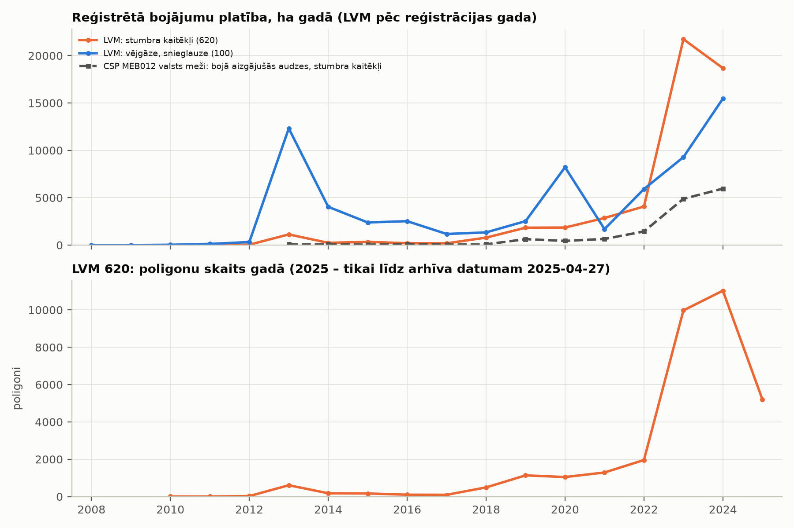
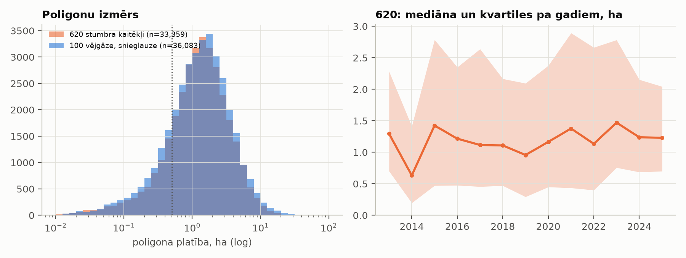
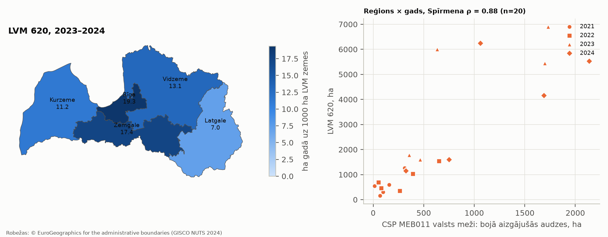
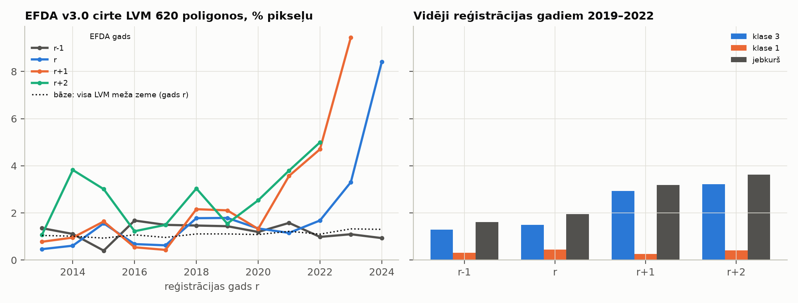
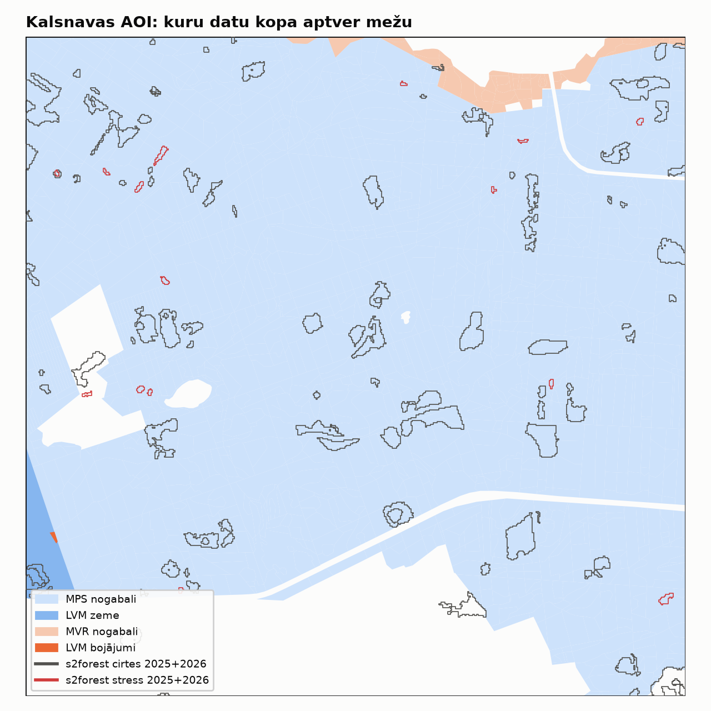

# 5a posms: LVM atvērtie bojājumu dati un s2forest neatkarīgā pārbaude

2026-10-23, zars `feat/risk-model`. Tikai aprakstoši rezultāti un pārbaudes; modeļa nav. s2forest iesaldētā
versija v0.2 netiek mainīta, tiek nolasīta tikai tās izvade. **[P]** = pārbaudīts (aprēķināts vai atvērts avots),
**[N]** = pieņēmums vai interpretācija.

**Reproducēšana:**

```bash
python scripts/rm_fetch_sources.py                         # + CSP MEB012/MEB011 pa īpašniekiem
python scripts/rm_mvr_scan.py cache/vmd_mvr/<virsmežniecība>.7z output/rm5_label_search   # × 5
python -m uv run mezasargs-risk lvm-describe configs/rm_lvm.yaml
```

- **Izvade:** `output/rm5a_lvm/tables/` un `figures/`, `run_metadata.json`. Attēli nokopēti uz `docs/rm_figures/`.
- **Kods:** `src/mezasargs_risk/lvm.py`, komanda `lvm-describe`, testi `tests/test_rm_lvm.py`.
- **Dati:** proveniences dati un sha256 ir `docs/DATU_AVOTI.md` sadaļā „5a posms”. LVM faili glabājas `cache/` un
  netiek commitoti.

## 0. Vai LVM slānis ir publicēts citur? [P]

- **LVM serveris nedarbojas.** Visas `lvmgeo.lvm.lv/PublicData/SHP/*.zip` saites 2026-10-23 atgriež HTTP 404.
  Tas attiecas arī uz datu kopām, kas nav saistītas ar bojājumiem (stigas, nogabali, Södra nogabali).
  - Pārbaudīti arī ArcGIS REST, WFS, GeoServer un `/api/` ceļi: 404.
  - www.lvmgeo.lv: WMS/WMTS sadaļa ir „coming soon”.
  - data.gov.lv metadatos joprojām ir vecā saite (datu kopa atjaunināta 2024-11-14).
- **Iespējamais iemesls [N]:** LV portāls ziņo par kiberuzbrukumu LVM sistēmām 2026. gada jūnijā un daļēji atjaunotu
  LVM GEO.
- **Aktuāla publikācijas vieta nav atrasta.** Tāpēc izmantota Internet Archive kopija no 2025-05-03 (faili zip iekšā
  datēti 2025-04-27). Salīdzināt ar aktuālo versiju nav iespējams.
- **Analīzes kopa:** LVM teritorijai izmantota `LVM_ZEMES_VIENIBAS` Wayback kopija (2025-04-21).
  - Īpašnieka pārbaudei Kalsnavā izmantota `MEZA_PETISANAS_STACIJA_NOGABALI` kopija (2025-04-14).
  - `LVM_NOGABALI` (317 MB) netika lejupielādēts, jo tas pārsniedz 200 MB robežu.

## 1. Lauku inventarizācija un sadalījums (a) [P]

`tables/lvm_inventory.csv`, `lvm_annual_by_subtype.csv`, `lvm_polygon_sizes.csv`

| Pārbaude | Rezultāts |
|---|---|
| Lauki | `DISTRBYEAR` (bojājuma **reģistrēšanas** gads), `DAMAGESUBT` (apakštips); pakāpes un datuma nav |
| Ieraksti | 146 071; EPSG:3059 |
| Ģeometrija | 355 tukšas, 103 nederīgas, 2 469 multipoligoni |
| `DISTRBYEAR` | 75 ārpus 2000–2025 (vērtības 0, 2026, 2027, 2032, 2823); ticamie gadi 2008–2025 |
| `DAMAGESUBT` | visi kodi ir klasifikatorā (17 kodi; sk. `lvm.SUBTYPES`) |
| LVM zemē | 99,1 % poligonu reprezentatīvo punktu ir LVM zemes vienībās (11 124 vienības, 1,61 milj. ha) |

**Stumbra kaitēkļi (620) pa reģistrācijas gadiem**, kopā 33 359 poligoni:

| | 2018 | 2019 | 2020 | 2021 | 2022 | **2023** | **2024** | 2025 (līdz 27.04.) |
|---|---|---|---|---|---|---|---|---|
| poligoni | 490 | 1 136 | 1 046 | 1 290 | 1 958 | **9 977** | **11 032** | 5 211 |
| ha | 786 | 1 834 | 1 850 | 2 857 | 4 073 | **21 736** | **18 681** | 8 306 |

- **Izmērs:** 620 poligonu mediāna ir 1,28 ha (kvartiles 0,65–2,36 ha), 82 % ir ≥ 0,5 ha. Vējgāzēm (100) mediāna ir
  1,31 ha.
- **Vējgāze/snieglauze (100):** lielākie gadi 2013 (12,3 tūkst. ha), 2020 (8,2), 2023 (9,3) un 2024 (15,5 tūkst. ha).




**Salīdzinājums ar CSP (VMD dati, valsts meži)** — `lvm_620_vs_csp_meb012.csv`:
- **MEB012, 2013–2024:** LVM 620 platība pret valsts mežu „bojā aizgājušajām audzēm” (stumbra kaitēkļi)
  **ρ = 0,90**; pret izcirsto apjomu ρ = 0,94 (n = 12).
- **Mērogs atšķiras:** LVM reģistrētā platība ir **2,8–4,5 reizes** lielāka (2019–2024). 2023. gadā tie ir
  21,7 tūkst. ha pret 4,9 tūkst. ha.
  - **[N]** LVM reģistrē arī daļēji bojātas audzes, bet „bojā aizgājušās” ir tikai audzes, kas aizgājušas bojā.
    Etiķetēm tas nozīmē, ka 620 apzīmē bojājumu, ne vienmēr audzes bojāeju.
- **MEB011, reģions × gads 2021–2024** — `lvm_620_vs_csp_meb011_regions.csv`: **ρ = 0,88** (n = 20; tikai
  aprakstoši).
- **Reģioni 2023–2024 (ha gadā uz 1000 ha LVM zemes):** Rīga 19,3, Zemgale 17,4, Vidzeme 13,1, Kurzeme 11,2,
  Latgale 7,0.



## 2. Laika semantika: reģistrācija pret EFDA cirti (b) [P]

`lvm_620_efda_timing.csv`. Rādītājs ir daļa no 620 poligonu pikseļiem (EFDA v3.0 režģis), kurus EFDA marķē kā cirti
gadā r−1, r, r+1 un r+2 (r = reģistrācijas gads). Bāze ir visa EFDA meža zeme LVM zemes vienībās tajā pašā gadā.

| Reģistrācijas gadi 2019–2022 (vidēji) | r−1 | r | r+1 | r+2 |
|---|---|---|---|---|
| EFDA klase 3 (cirte) | 1,3 % | 1,5 % | **2,9 %** | **3,2 %** |
| EFDA klase 1 | 0,3 % | 0,5 % | 0,3 % | 0,4 % |
| bāze (LVM meža zeme, klase 3) | 1,1–1,2 % | | | |

- **2023. gadā reģistrētie:** r = 3,3 %, r+1 (2024) = **9,5 %** (7,2 × bāze).
- **2024. gadā reģistrētie:** r = 8,4 %. 2024 ir EFDA pēdējais gads (sk. RM_5 7.1).
- **Secinājums [P]:** cirte šajos poligonos ir 2–3 reizes biežāka nekā bāzē un notiek pēc reģistrācijas gada (r+1,
  r+2). Pirms reģistrācijas (r−1) tā ir bāzes līmenī.
- **[N]** Tas norāda, ka reģistrācija parasti notiek pirms sanitārās vienlaidus cirtes, nevis pēc tās.
- **Taču lielākajā daļā poligonu** (> 90 % pikseļu) EFDA divu gadu laikā cirti neredz. **[N]** Iespējamie iemesli:
  daļēji bojājumi, sanitārās izlases cirtes, ko EFDA neuztver (RM_5 7.2), vai cirte vēlāk.
- **Sekas modelim:** reģistrācijas gads r ir uzbrukuma gads vai vēlāks. Pazīmes (laikapstākļi) jāņem līdz t−1
  attiecībā pret r, un jutīgumam jāpārbauda arī r−1.



## 3. Kalsnava: s2forest neatkarīgā validācija (c) [P]

`kalsnava_summary.csv`, `kalsnava_lvm_polygons.csv`, `kalsnava_s2forest.csv`, `kalsnava_s1_targets.csv`,
`kalsnava_mvr_recent_cuts.csv`

**Galvenais rezultāts: ar LVM datiem Kalsnavā validēt nevar, jo AOI nav LVM mežs.**

| AOI 2 500 ha | ha |
|---|---|
| **Meža pētīšanas stacijas (MPS) nogabali** | **2 011** |
| LVM zemes vienības | 22,7 |
| MVR nogabali (46) | 51,0 |

- **LVM bojājumi AOI:** 1 poligons (vējgāze, reģistrēts 2020, 0,22 ha). **Stumbra kaitēkļu (620) poligonu nav.**
- **s2forest** (iesaldētā v0.2, `all` un `stress_only`):

  | Izvade | Cirtes | Stresa poligoni | Uz LVM zemes | LVM bojājumos |
  |---|---|---|---|---|
  | 2025, all | 70 (77,1 ha) | 12 (2,58 ha) | 0 | **0** |
  | 2026, all | 28 (29,1 ha) | 3 (0,33 ha) | 2 cirtes | **0** |
  | 2026, stress_only | 32 | 3 | 2 cirtes | **0** |

  `stress_only` 2025 ir 70 cirtes un 12 stresa poligoni, uz LVM zemes nav neviena.
- **#71 un 15 S1 agrīnā signāla testa mērķi** (13 pamata mērķi + 2): neviens nav uz LVM zemes vai LVM bojājumos.
- **Laika nobīde (S2 `first_detected` pret LVM reģistrācijas gadu):** nav aprēķināma, jo nav sakritību.
- **Wayback kopija beidzas 2025-04-27.** 2025. gada vasaras un 2026. gada bojājumu reģistrācijas tajā nav, tāpēc „nav
  apstiprinājuma” nenozīmē, ka s2forest kļūdās. Kalsnavā to vispār nevarētu apstiprināt, jo tie ir MPS meži.
- **Papildus — MVR AOI daļā (51 ha):**
  - 2024–2025 ir 6 cirtes, no tām 2 sanitārās vienlaidus cirtes (31) 2025. gadā: 0,97 ha un 1,08 ha.
  - s2forest 2025 atrada **vienu no tām** (cirte #45, first_detected 2025-05-02); otru neatrada.
  - 2024. gada cirtes (4) nav 2025. gada izvadē. To varēja gaidīt, jo tās notika pirms monitoringa sezonas [N].
- **Ko tas nozīmē [N]:** neatkarīgai s2forest validācijai Kalsnavā vajag MPS datus (sanitārās cirtes ar datumu un
  iemeslu). Cits ceļš ir jauns AOI uz LVM zemes (sk. d).



## 4. S1 agrīnā signāla tests ar LVM 620 mērķiem (d) — tikai novērtējums, nav palaists

- **Kalsnavā:** 0 piemērotu mērķu (620, ≥ 0,5 ha). Šajā AOI tests nav iespējams.
- **Visā LVM teritorijā:** 2023–2024 reģistrēti **17 727** poligoni ≥ 0,5 ha (2023: 8 479; 2024: 9 248).
- **Blīvākās 5 × 5 km šūnas** (2023–2024, ≥ 0,5 ha) — `lvm_620_target_cells_5km.csv`:

  | # | lon / lat (centrs) | reģions | mērķi | ha | km no Kalsnavas |
  |---|---|---|---|---|---|
  | 1 | 24,041 / 56,732 | Rīga | 117 | 309 | 112 |
  | 2 | 24,123 / 56,731 | Rīga | 102 | 194 | 107 |
  | 3 | 23,795 / 56,776 | Rīga | 101 | 214 | 127 |
  | 6 | 26,506 / 56,931 | Vidzeme | 81 | 145 | 48 |
  | 10 | 26,673 / 56,972 | Vidzeme | 72 | 220 | 59 |

- **Ierobežojums [N]:** LVM poligoniem ir tikai reģistrācijas gads, nevis datums.
  - S1 testa superponēto epohu dizains (pēc S2 `t_first`) tieši nav pārnesams.
  - Būtu iespējams gada līmeņa salīdzinājums: poligoni, kas reģistrēti gadā r, pret kontroles poligoniem; signāls
    sezonā r−1 / r. Vai arī S2 `t_first` kā datums tiem LVM poligoniem, kurus atrod s2forest.
- **AOI izvēle un S1 datu lejupielāde ir jūsu lēmums.**

## Fakti pret pieņēmumiem

- **[P]:**
  - visi tabulu skaitļi;
  - LVM serveris 404 un Wayback kopiju sha256;
  - lauki un kodi (`lvm_bojajumi_shp.docx`);
  - MPS / LVM / MVR platības Kalsnavas AOI;
  - MVR ierakstu pilnīgums (26/26 nodaļas);
  - MVR satur LVM zemi.
- **[N]:**
  - 404 iemesls (kiberuzbrukums);
  - ka Wayback kopija atbilst LVM pašreizējiem datiem;
  - reģistrācija pirms cirtes (no EFDA laika profila);
  - LVM 620 = bojājums, ne vienmēr bojāeja;
  - iemesli, kāpēc EFDA lielākajā daļā poligonu cirti neredz.

## Kas NAV izdarīts

- LVM nav jautāts par aktuālo datu vietu.
- Nav lejupielādēti `LVM_NOGABALI` (317 MB), kā arī MPS bojājumu vai ciršu dati (atvērti nav atrasti).
- Nav pārbaudīts, cik 620 poligonu vēlāk kļūst par MVR `P_CIRP = 31` cirtēm (MVR ģeometrija nolasīta tikai
  nodaļai 2253).
- S1 tests ar LVM mērķiem nav palaists (d — tikai novērtējums).
- Etiķešu rastri modelim nav izveidoti.
- 4. posms nav sākts.
