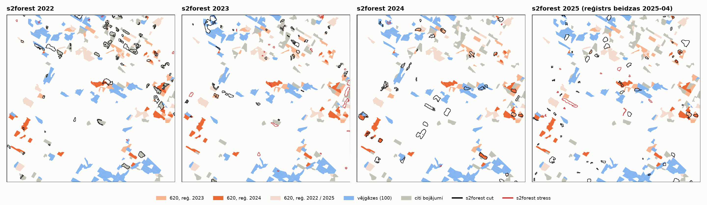
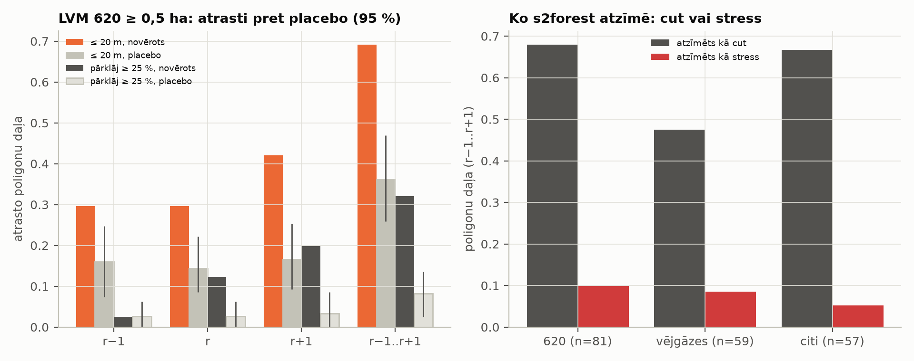
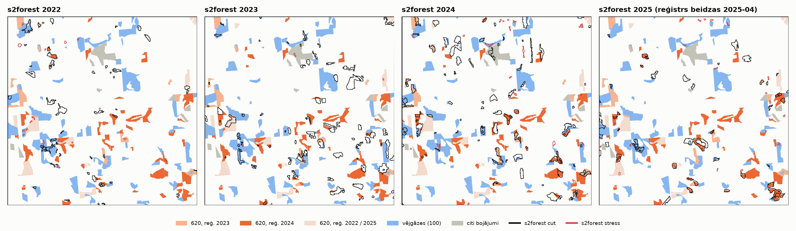
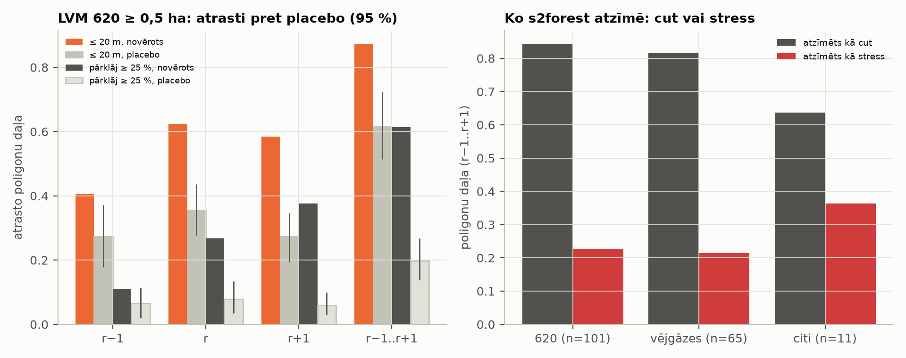

# 5b posms: s2forest aklā validācija uz LVM zemes

Statuss: **pabeigts (a–d) + replikācija uz AOI 3 (2026-10-29, sadaļa „Replikācija (AOI 3)”).** Lietotājs izvēlējās 1. kandidātu (Vidzeme). Visi skaitļi b)–d) daļā ir no palaišanas. **[P]** = aprēķināts no datiem,
**[N]** = pieņēmums. Avoti kā 5a posmā (`docs/DATU_AVOTI.md`, 5a sadaļa): LVM_BOJAJUMI un LVM_ZEMES_VIENIBAS (Wayback
kopijas), HRL Dominant Leaf Type 2018 (100 m, tas pats kešs kā 5. posmā), GISCO NUTS 2024.

Reproducēšana: `mezasargs-risk lvm-aoi configs/rm_5b_lvm.yaml` → `output/rm5b_lvm/tables/lvm_5b_aoi_candidates.csv`,
AOI faili `output/rm5b_lvm/aoi/aoi_kandidats_<n>.geojson` (CRS84, kā Kalsnavas AOI).

## a) AOI izvēle [P]

Šūnas: 5 × 5 km LKS-92 režģis (kā 5a `target_cells`), 10 šūnas ar visvairāk LVM 620 poligoniem ≥ 0,5 ha, reģistrētiem
2023–2024 (poligons pieder šūnai pēc reprezentatīvā punkta). Kritēriji (lietotājs, 2026-10-23):

- LVM zeme ≥ 80 % šūnas platības (`LVM_ZEMES_VIENIBAS` ∩ šūna);
- HRL skujkoki ≥ 50 % — definēts kā DLT 2018 skujkoku pikseļi / koku segums (1 + 2), tāpat kā `ConiferConfig.min_share`;
- ≥ 30 LVM 620 poligoni ≥ 0,5 ha, reģistrēti 2023–2024;
- kārtojums: visi kritēriji izpildīti → Vidzeme → attālums līdz Kalsnavas AOI centram.

| Rangs | Centrs lon / lat | Reģions | km no Kalsnavas | LVM zeme | Koku segums | Skujkoki | 620 ≥ 0,5 ha (2023 / 2024) | ≥ 1 ha | 620 ha | Vējgāzes 2023–24 | Citi 2023–24 | Visi kritēriji |
|---|---|---|---|---|---|---|---|---|---|---|---|---|
| **1** | 26,506 / 56,931 | Vidzeme | 48 | 100 % | 80 % | 80 % | 81 (47 / 34) | 59 | 145 | 67 | 66 | jā |
| **2** | 24,367 / 56,641 | Zemgale | 92 | 83 % | 80 % | 66 % | 80 (51 / 29) | 51 | 143 | 10 | 3 | jā |
| **3** | 24,123 / 56,731 | Rīga | 107 | 81 % | 79 % | 64 % | 102 (28 / 74) | 68 | 194 | 72 | 11 | jā |
| 4 | 23,795 / 56,776 | Rīga | 127 | 95 % | 73 % | 73 % | 101 (77 / 24) | 73 | 214 | 240 | 12 | jā |
| 5–7 | Kurzeme | Kurzeme | 252–289 | 86–95 % | 82–91 % | 72–83 % | 75–96 | 57–77 | | | | jā |
| 8 | 26,673 / 56,972 | Vidzeme | 59 | **72 %** | 80 % | 56 % | 72 (34 / 38) | 64 | 220 | 3 | 14 | nē (LVM zeme) |
| 9 | 24,041 / 56,732 | Rīga | 112 | **78 %** | 82 % | 52 % | 117 (63 / 54) | 88 | 309 | 107 | 6 | nē (LVM zeme) |
| 10 | 22,879 / 57,310 | Kurzeme | 195 | **66 %** | 69 % | 75 % | 79 (30 / 49) | 62 | 209 | 5 | 28 | nē (LVM zeme) |

Pilna tabula: `lvm_5b_aoi_candidates.csv`. „Vējgāzes” = `DAMAGESUBT 100`, „citi” = visi pārējie, izņemot 620.


Piezīmes:

- Vidzemē kritērijus izpilda **tikai 1. kandidāts**. Otra Vidzemes šūna (8., 59 km) neiztur LVM zemes kritēriju (72 %).
- Kandidātam 4 ir visvairāk vējgāžu poligonu (240) — der atsevišķai vējgāžu pārbaudei, ja to vajag [N].
- HRL DLT ir 2018. gada; kopš tā skujkoku segums bojājumu dēļ var būt mazāks [N]. s2forest meža maska ir tā pati
  DLT 2018 klase 2, tāpēc 620 poligoni ārpus tās netiks analizēti.

**Lēmums (lietotājs, 2026-10-23):** 1. kandidāts → `data/aoi_lvm5b_vidzeme.geojson`.

## b) s2forest palaišana [P]

Iesaldētā v0.2 konfigurācija (`configs/test_kalsnava_2025.yaml` tagā `v0.2-kalsnava`). Mainīts **tikai** `run_name`, `aoi`,
`time.monitor_year`; noņemts Kalsnavas `reference` bloks (`stands` v0.2 konfigurācijā vēl nebija). Neviens detekcijas,
maskas, bāzes vai noturības parametrs nemainās. Bāze = 3 iepriekšējās sezonas (1. maijs – 30. septembris), kā v0.2.

Diff pret v0.2 (2023. gads; pārējie gadi atšķiras tikai ar gadu un nosaukumu):

```diff
@@ -1,12 +1,14 @@
-# Same AOI as test_kalsnava.yaml, monitoring 2025 with baseline 2022-2024.
-# Exercises the 2022 gap in sentinel-2-c1-l2a (filled from Planetary Computer).
-run_name: test_kalsnava_2025
-aoi: ../data/test_aoi_kalsnava.geojson
+# Stage 5b: s2forest blind validation on LVM land (AOI candidate 1, Vidzeme, 5 x 5 km).
+# Frozen v0.2-kalsnava config (configs/test_kalsnava_2025.yaml at the tag); changed ONLY:
+# run_name, aoi, time.monitor_year (2023, baseline = 3 previous seasons as in v0.2);
+# `reference` (Kalsnava winter cuts) removed.
+run_name: lvm5b_vidzeme_2023
+aoi: ../data/aoi_lvm5b_vidzeme.geojson
 output_dir: ../output
 cache_dir: ../cache
 
 time:
-  monitor_year: 2025
+  monitor_year: 2023
   baseline_years: 3
   season_start: "05-01"
   season_end: "09-30"
@@ -42,12 +44,3 @@
   normalization:
     enabled: true
     buffer_m: 5000
-
-# Winter cuts 2025/26 found by the 2026 run (scripts/make_winter_cut_references.py).
-# Cut reason UNKNOWN (mostly regular fellings); cut date = earliest possible, so
-# lead times are lower bounds. Question: was stress visible in 2025 before the cut?
-reference:
-  path: ../data/local/test_kalsnava_2025_winter_cut_references.gpkg
-  id_field: nr
-  date_field: cirtes_datums
-  description: "2025./2026. gada ziemas cirtes, ko atrada 2026. gada analīze. Cirtes iemesls NAV zināms (visticamāk, galvenokārt kārtējās cirtes, nevis mizgraužu bojājumi). Cirtes datums ir agrākais iespējamais (2025-09-30), tāpēc aizkave ir apakšējā robeža."
```

`stress_only` variants (informatīvi) pievieno tikai `forest_mask.amplitude_scope: stress_only`.
Konfigurācijas: `configs/lvm5b_vidzeme_<gads>[_stress_only].yaml`. Palaišana: `s2forest run <config>`.

| Monitoringa gads | Bāze | Lietojamās ainas (bāze → monitorings) | Analizēts mežs | Cirtes (cut) | Stress |
|---|---|---|---|---|---|
| 2022 | 2019–2021 | 20 / 13 / 12 → 11 | 1 299 ha (54,0 % AOI) | 57 (47,0 ha) | 7 (1,1 ha) |
| 2023 | 2020–2022 | 13 / 12 / 11 → 21 | 1 143 ha (47,1 %) | 38 (21,2 ha) | 20 (10,2 ha) |
| 2024 | 2021–2023 | 12 / 11 / 22 → 15 | 1 340 ha (55,2 %) | 41 (42,4 ha) | 3 (0,7 ha) |
| 2025 | 2022–2024 | 11 / 22 / 15 → 13 | 1 341 ha (55,5 %) | 53 (32,4 ha) | 11 (5,6 ha) |

- AOI daļa, kas nav HRL skujkoku klasē: 36,7 %. 2023. gadā „liela sezonālā amplitūda” izslēdz 14,2 % AOI (citos gados
  4,5–7,0 %).
- `stress_only`: 2023. gadā 59 cirtes (33,5 ha) pret 38; citos gados ±1 poligons.
- **s2forest atskaites kļūda (nav detekcijas kļūda):** 2022. un 2023. gada (abu variantu) palaišanās HTML atskaite
  neizdevās. Cēlonis: `viz.monthly_availability` → `pd.to_datetime` ar jauktiem datuma formātiem 2020. gada ainās
  (`2020-07-13 09:44:34+00:00`). Detekcijas izvade (`suspects.gpkg`, rastri, maska) ir pilnīga. s2forest kods nav
  mainīts (iesaldēts).
  - **2026-10-29 labots** (lietotāja lēmums, commit `b00649c`): `format="ISO8601"` `viz.monthly_availability` un
    `report.py`; zelta tests iziet; atskaites 2022 un 2023 ģenerētas no keša, detekcija nepārrēķināta.

## c) Validācija pret LVM bojājumiem [P]

`mezasargs-risk lvm-validate configs/rm_5b_lvm.yaml` → `output/rm5b_lvm/tables/val_*.csv`.

- **AOI LVM bojājumi:** 549 poligoni, kuru reprezentatīvais punkts ir AOI (apgriezti pēc AOI). Reģistrēti 2023–2024:
  - 620: 88 (147,8 ha);
  - vējgāzes (100): 67 (106,6 ha);
  - citi: 66 (89,7 ha) — galvenokārt sausums (900; 23 + 18) un slimības (500; 16 2024. gadā).
- **Saskaņošana:** s2forest poligons ≤ 20 m no LVM poligona (lietotāja definīcija). Papildus informatīvi stingrāka:
  s2forest poligoni pārklāj **≥ 25 %** LVM poligona platības.
- **Placebo:** visi 549 LVM poligoni 100 reizes nejauši pārvietoti (centroids uz nejauša HRL skujkoku pikseļa AOI,
  nejauša rotācija, poligons pilnībā AOI; seed 42). p = (1 + #placebo ≥ novērotais) / 101; mazākā iespējamā p = 0,010.

### c1) Detekcija pēc objekta — LVM 620 ≥ 0,5 ha (n = 81, 145 ha)

| Gads attiecībā pret reģistrāciju | ≤ 20 m | placebo (95 %) | p | pārklāj ≥ 25 % | placebo (95 %) | p |
|---|---|---|---|---|---|---|
| r−1 | 29,6 % | 16,0 % (7,4–24,7) | 0,010 | **2,5 %** | 2,6 % (0–6,2) | 0,61 |
| r | 29,6 % | 14,4 % (8,6–22,2) | 0,010 | 12,3 % | 2,6 % (0–6,2) | 0,010 |
| r+1 | 42,0 % | 16,6 % (9,2–25,3) | 0,010 | 19,8 % | 3,4 % (0–8,6) | 0,010 |
| **jebkurā (r−1..r+1)** | **69,1 %** | 36,2 % (25,9–46,9) | 0,010 | **32,1 %** | 8,2 % (2,5–13,6) | 0,010 |

- **Platība:** atrasti 66,7 % no 620 ha (≤ 20 m).
- **Lielumu klases (jebkurā gadā, ≤ 20 m / ≥ 25 %):**
  - visi 620 (n = 88): 70,5 % / 30,7 %;
  - ≥ 1 ha (n = 59): 69,5 % / 23,7 %;
  - ≥ 0,5 ha un ≥ 50 % platības analizētajā maskā (n = 74): 68,9 % / 31,1 %.
- **Kā atrasti:** 55 no 56 kā **cut**, 8 (arī) kā stress. Atrastie ir gandrīz tikai cirtes, ne stresa signāls.
- **r−1 signāls ir blakus esošas cirtes:** ≤ 20 m rādītājs r−1 ir virs placebo, bet pārklāšanās ≥ 25 % ir tieši
  placebo līmenī. Tātad gadā pirms reģistrācijas s2forest atrod cirtes **blakus** vēlāk reģistrētajiem bojājumiem, nevis
  pašos bojātajos nogabalos [P]. Vai tās ir ciršu malas, kurās uzbrūk mizgrauži, ir pieņēmums [N].

### c2) Precizitāte — s2forest poligoni LVM bojājumos (jebkurš veids)

„Ārpus” = **neapstiprināts** (LVM reģistrs nav pilnīgs; regulārās cirtes tajā nav). 2022–2024 kopā (`all`):

| | n | jebkura gada bojājumos | placebo | p | reģ. y−1..y+1 | placebo | p | 620, reģ. y−1..y+1 | placebo | p |
|---|---|---|---|---|---|---|---|---|---|---|
| cut | 136 | 94,1 % | 76,1 % | 0,010 | 66,9 % | 44,9 % | 0,010 | 48,5 % | 24,3 % | 0,010 |
| stress | 30 | 73,3 % | 70,7 % | 0,52 | 50,0 % | 39,8 % | 0,14 | 23,3 % | 21,0 % | 0,48 |

- **Pa gadiem:**
  - cut jebkura gada bojājumos: 98 % (2022), 97 % (2023), 85 % (2024); neapstiprināti attiecīgi 1, 1, 6;
  - stress: 5/7, 15/20, 2/3 (tabula `val_precision_all.csv`).
- **AOI ir ļoti blīvi bojājumu poligoni:** pat nejauši novietoti poligoni aptver 76 % s2forest ciršu. Tāpēc „jebkura gada
  bojājumos” bez placebo neko neizsaka.
- **Cirtes** ir būtiski biežāk LVM bojājumos nekā nejauši. **Stresa poligoni nav** (p 0,14–0,52; n = 30).
- **2025 atsevišķi — neapstiprinātas (reģistrs beidzas 2025-04):**
  - cut 53, no tām 28 jebkura gada bojājumos, **25 neapstiprinātas**;
  - stress 11, no tiem 3 bojājumos, **8 neapstiprināti**.

  2025. gada reģistrācijas Wayback kopijā ir tikai līdz 2025-04-27, tāpēc šos skaitļus ar 2022–2024 nesalīdzina.

### c3) Laika nobīde — s2forest `first_detected` pret reģistrācijas gadu (620)

| | n | r−1 | r | r+1 | `onset_before_season` | mēnesis |
|---|---|---|---|---|---|---|
| ≤ 20 m | 62 | 28 | 18 | 16 | 40 / 62 | 41 maijā, 21 jūl.–sept. |
| pārklāj ≥ 25 % | 27 | 3 | 10 | 14 | 19 / 27 | 19 maijā, 8 jūn.–sept. |

- **Pēc reģistrācijas gada (≥ 25 %):** 2023. gada poligoni visbiežāk atrasti gadā r+1 (11 no 15), 2024. gada poligoni — gadā
  r (8 no 12).
- Lielākā daļa sakritību ir cirtes, kuru sākums ir **pirms sezonas** (pirmais datums = sezonas sākums maijā). Tātad tā ir
  ziemas cirte pēc reģistrācijas; precīzu cirtes datumu S2 sezona nedod [P].
- Agrīna stresa signāla pirms reģistrācijas šeit nav redzams: stingrajā variantā r−1 = 3 (placebo līmenis).

### c4) Vējgāzes un citi bojājumi — vai s2forest tos atzīmē kā cut vai stress

≥ 0,5 ha, jebkurā gadā r−1..r+1:

| | n | ≤ 20 m | kā cut | kā stress | pārklāj ≥ 25 % |
|---|---|---|---|---|---|
| 620 | 81 | 69,1 % | 55 | 8 | 32,1 % |
| vējgāzes (100) | 59 | 54,2 % | 28 | 5 | 8,5 % |
| citi | 57 | 68,4 % | 38 | 3 | 22,8 % |

- **Atšķiršanas spēja nav [P]:** visas trīs grupas s2forest atzīmē galvenokārt kā **cut**, stress ir 5–10 %.
  s2forest tips norāda uz izmaiņas veidu (audzi nomainoša vai pakāpeniska), nevis uz cēloni.
- **Vējgāzes:** stingrā pārklāšanās ir zema (8,5 %). Tās ir ≤ 20 m no ciršu poligoniem, bet reti pašas atrastas [P].
  Placebo vējgāzēm un citiem nav rēķināts.
- **Citi** (sausums / slimības) atrasti galvenokārt gadā **r−1** (≥ 25 %: visi 13 gadā r−1).
  - Tikai 7 no 57 ir ≥ 50 % analizētajā maskā: 50 % platības ir „liela sezonālā amplitūda”, 12 % „zems bāzes NDVI”.
  - Visticamāk, tās ir jaunaudzes uz iepriekšējām cirtēm [N].

### c5) `stress_only` (informatīvi)

- **620 ≥ 0,5 ha jebkurā gadā:** 70,4 % (≤ 20 m) un 32,1 % (≥ 25 %), praktiski kā `all` (69,1 % / 32,1 %).
- **Vējgāzes:** 57,6 % / 8,5 %. **Citi:** 73,7 % / 29,8 %.
- **Precizitāte:** 2023. gada cirtes 89,8 % jebkura gada bojājumos (pret 97,4 %).
- Placebo `stress_only` variantam nav rēķināts.





## Replikācija (AOI 3)

Lietotāja lēmums (2026-10-29): 5b validāciju atkārtot tikai uz AOI 3. kandidāta (Rīgas reģions, LKS-92 šūna
505000/285000, centrs 24,123 / 56,731; `data/aoi_lvm5b_riga.geojson`). 2. kandidāts nav pārbaudīts. Tikai variants
`all`, gadi 2022–2025 (4 palaišanas). Validācija tā pati kā AOI 1: ≤ 20 m un ≥ 25 %, gadi r−1 / r / r+1, placebo
100 permutācijas, seed 42. Papildus placebo arī LVM vējgāzēm (`validation.placebo_groups: ["620", "100"]`; 620
placebo kolonnas ar to nemainās, tests `test_placebo_relocates_inside_aoi`).

Reproducēšana: `s2forest run configs/lvm5b_riga_<gads>.yaml` (`output/rm5b_lvm_aoi3/run_all.sh`), tad
`mezasargs-risk lvm-validate configs/rm_5b_lvm_aoi3.yaml` → `output/rm5b_lvm_aoi3/tables/val_*.csv`. Stresa poligonu
laika diagnostika: `python scripts/rm5b_stress_timing.py configs/rm_5b_lvm.yaml configs/rm_5b_lvm_aoi3.yaml`.

### Konfigurācijas diff pret v0.2 [P]

Tāpat kā AOI 1: mainīts tikai komentārs, `run_name`, `aoi`, `time.monitor_year`; `reference` bloks noņemts. Pret
Vidzemes konfigurāciju atšķiras tikai komentārs, `run_name` un `aoi` (`output/rm5b_lvm_aoi3/config_diff_v02_<gads>.diff`).

```diff
-run_name: test_kalsnava_2025
-aoi: ../data/test_aoi_kalsnava.geojson
+run_name: lvm5b_riga_2023
+aoi: ../data/aoi_lvm5b_riga.geojson
...
-  monitor_year: 2025
+  monitor_year: 2023
...
-reference:   (Kalsnavas ziemas cirtes; viss bloks noņemts)
```

### Palaišanas [P]

| Gads | cut | stress | analizētais mežs (% no AOI 2500 ha) |
|---|---|---|---|
| 2022 | 47 (32,8 ha) | 15 (3,0 ha) | 41,5 % |
| 2023 | 81 (76,6 ha) | 4 (0,6 ha) | 37,3 % |
| 2024 | 79 (85,1 ha) | 26 (6,2 ha) | 38,4 % |
| 2025 | 43 (50,3 ha) | 18 (3,1 ha) | 36,3 % |

- 49,1 % AOI nav HRL DLT 2018 skujkoku klasē (Vidzemes AOI 36,7 %); analizēti 36–42 % AOI (Vidzemē 47–56 %).
- Visas 4 palaišanas beidzās ar kodu 0, ieskaitot HTML atskaiti 2022. un 2023. gadam (labojums `b00649c`).

### LVM bojājumi AOI 3 [P]

- 372 poligoni ar reprezentatīvo punktu AOI. Reģistrēti 2023–2024: 620 — 111 (192,7 ha); vējgāzes — 72 (162,7 ha);
  citi — 11 (27,4 ha: uguns 6, dzīvnieki 5).
- 620 ≥ 0,5 ha: **n = 101 (189 ha)**, no tiem 28 reģistrēti 2023. g., 73 — 2024. g.

### Detekcija — LVM 620 ≥ 0,5 ha (n = 101) [P]

| Gads attiecībā pret reģistrāciju | ≤ 20 m | placebo (95 %) | p | pārklāj ≥ 25 % | placebo (95 %) | p |
|---|---|---|---|---|---|---|
| r−1 | 40,6 % | 27,3 % (17,8–37,1) | 0,010 | **10,9 %** | 6,6 % (2,0–11,4) | **0,109** |
| r | 62,4 % | 35,5 % (27,7–43,6) | 0,010 | 26,7 % | 7,8 % (3,5–13,4) | 0,010 |
| r+1 | 58,4 % | 27,3 % (19,3–34,7) | 0,010 | 37,6 % | 5,9 % (3,0–9,9) | 0,010 |
| **jebkurā (r−1..r+1)** | **87,1 %** | 61,5 % (51,5–72,3) | 0,010 | **61,4 %** | 19,8 % (13,9–26,7) | 0,010 |

- **Kā atrasti (jebkurā gadā, ≤ 20 m):** 85 no 88 kā **cut**, 23 (arī) kā stress.
- **Stingrās sakritības (≥ 25 %) pa gadiem:** r−1 11 (visas kā cut, 0 kā stress), r 27 (cut 27, stress 2), r+1 38
  (visas kā cut).
- **Lielumu klases (jebkurā gadā, ≤ 20 m / ≥ 25 %):** visi 620 (n = 111) 85,6 % / 61,3 %; ≥ 1 ha (n = 67)
  91,0 % / 55,2 %; ≥ 0,5 ha un ≥ 50 % analizēts (n = 96) 87,5 % / 61,5 %.
- **Laika nobīde** (visi 620, agrākais `first_detected` pret reģistrācijas gadu): ≤ 20 m (n = 95) r−1 42, r 37,
  r+1 16; ≥ 25 % (n = 68) r−1 11, r 25, r+1 32. `onset_before_season` 69 / 95 un 59 / 68 (pirmais datums maijā
  74 / 95 un 62 / 68), t. i. galvenokārt ziemas cirtes.
- **Placebo fons šeit ir augstāks** nekā AOI 1 (≤ 20 m jebkurā gadā 61,5 % pret 36,2 %): AOI 3 ir blīvāki ciršu un
  bojājumu poligoni.

### Precizitāte 2022–2024 (`all`) [P]

| | n | jebkura gada bojājumos | placebo | p | reģ. y−1..y+1 | placebo | p | 620, reģ. y−1..y+1 | placebo | p |
|---|---|---|---|---|---|---|---|---|---|---|
| cut | 207 | 84,5 % | 73,6 % | 0,010 | 62,8 % | 51,8 % | 0,010 | 43,5 % | 34,4 % | 0,010 |
| stress | 45 | 71,1 % | 64,3 % | 0,23 | **62,2 %** | 39,1 % | **0,020** | **40,0 %** | 23,8 % | **0,030** |

- **2025 atsevišķi — neapstiprinātas (reģistrs beidzas 2025-04):** cut 43, no tām 37 jebkura gada bojājumos,
  **6 neapstiprinātas**; stress 18, no tiem 12 bojājumos, **6 neapstiprināti**.
- **Atšķirība no AOI 1:** stresa poligoni reģistrācijas logā (y−1..y+1) ir **virs placebo** (AOI 1: p 0,14 un 0,48).
- **Kad šie stresa poligoni parādās** (`scripts/rm5b_stress_timing.py`, tieša krustošanās bez bufera, tāpēc skaits
  nedaudz atšķiras no tabulas): 25 no 45 krusto bojājumu, kas reģistrēts y−1..y+1. Reģistrācijas gads pret stresa gadu:
  **tas pats gads 17**, nākamais gads 2, iepriekšējais 1, vairāki 5. 12 no 25 nākamā gada palaišanā pārklāj cirte.
  - Tātad AOI 3 stresa poligoni iezīmē bojājumus **reģistrācijas gadā** (bieži pirms sanitārās cirtes), nevis gadu
    pirms reģistrācijas [P].
  - AOI 1 tie paši skaitļi: 13 no 30 logā; nākamais gads 6, iepriekšējais 4, tas pats 2, vairāki 1; nākamā gada
    cirte 3 [P].

### Vējgāzes (100) ar placebo [P]

≥ 0,5 ha, n = 65 (160 ha):

| | ≤ 20 m | placebo | p | pārklāj ≥ 25 % | placebo | p |
|---|---|---|---|---|---|---|
| r−1 | 44,6 % | 29,8 % | 0,030 | 1,5 % | 6,1 % | 0,96 |
| r | 61,5 % | 38,2 % | 0,010 | 15,4 % | 7,4 % | 0,050 |
| r+1 | 36,9 % | 27,0 % | 0,030 | 7,7 % | 5,0 % | 0,25 |
| jebkurā | 84,6 % | 62,7 % | 0,010 | **23,1 %** | 18,2 % | **0,21** |

- Vējgāzes ir **tuvu** s2forest poligoniem biežāk nekā nejauši, bet pašas vējgāžu platības s2forest **neiezīmē**
  biežāk nekā nejauši (≥ 25 % jebkurā gadā p 0,21; tikai reģistrācijas gadā robežā, p 0,05).
- Atrastās: 53 kā cut, 14 (arī) kā stress. Citi bojājumi (n = 11): 63,6 % / 27,3 %, 7 kā cut, 4 kā stress; placebo nav.
- **Cēloņa atšķiršana [P]:** tāpat kā AOI 1 — visas grupas galvenokārt kā cut.

### Maska [P]

620 (2023–2024, visi, 192,7 ha): analizēti 82,8 %; nav analizēti **33,1 ha = 17,2 %**: nav HRL skujkoku klasē 10,3 %,
liela sezonālā amplitūda 4,5 %, ceļa buferī 1,8 %, zems bāzes NDVI 0,6 %. Vējgāzēm ārpus maskas 33,0 %, citiem 55,6 %.





### Abi AOI kopā [P]

| | AOI 1 (Vidzeme) | AOI 3 (Rīgas reģions) |
|---|---|---|
| 620 ≥ 0,5 ha, n | 81 | 101 |
| ≤ 20 m jebkurā gadā (placebo; p) | 69,1 % (36,2 %; 0,010) | 87,1 % (61,5 %; 0,010) |
| ≥ 25 % jebkurā gadā (placebo; p) | 32,1 % (8,2 %; 0,010) | 61,4 % (19,8 %; 0,010) |
| r−1, ≤ 20 m (placebo; p) | 29,6 % (16,0 %; 0,010) | 40,6 % (27,3 %; 0,010) |
| **r−1, ≥ 25 % (placebo; p)** | **2,5 % (2,6 %; 0,61)** | **10,9 % (6,6 %; 0,11)** — visas kā cut |
| atrasti kā cut / stress (≤ 20 m) | 55 / 8 no 56 | 85 / 23 no 88 |
| stresa poligoni 2022–24, n | 30 | 45 |
| stress jebkura gada bojājumos (placebo; p) | 73,3 % (70,7 %; 0,52) | 71,1 % (64,3 %; 0,23) |
| stress bojājumos reģ. y−1..y+1 (placebo; p) | 50,0 % (39,8 %; 0,14) | **62,2 % (39,1 %; 0,020)** |
| stress 620 reģ. y−1..y+1 (placebo; p) | 23,3 % (21,0 %; 0,48) | **40,0 % (23,8 %; 0,030)** |
| 620 platība ārpus maskas | 18,1 % | 17,2 % |

### Vai AOI 3 apstiprina AOI 1 secinājumu?

AOI 1 secinājums: *s2forest atrod sekas / cirtes, nevis agrīnu stresu pirms reģistrācijas.*

- **Apstiprina [P]:**
  - 620 bojājumi atrasti biežāk nekā nejauši abos rādītājos, galvenokārt kā **cut** gadā r un r+1 (≥ 25 %:
    27 un 38 pret 11 gadā r−1), lielākoties ziemas cirtes;
  - gadā **r−1** stingrais rādītājs nav virs placebo (p 0,11), un visas 11 r−1 stingrās sakritības ir **cirtes**,
    nevis stress. Agrīna stresa signāla gadu pirms reģistrācijas nav;
  - cēloni (mizgrauži / vējgāzes / citi) s2forest neatšķir.
- **Daļēji neapstiprina [P]:** AOI 3 stresa poligoni reģistrācijas logā ir virs placebo (p 0,02–0,03), AOI 1 nav.
  Lielākā daļa no tiem ir **tajā pašā gadā** kā reģistrācija, un puse vēlāk nocirsti. Tas ir bojājuma signāls
  reģistrācijas gadā (pirms sanitārās cirtes), nevis brīdinājums gadu iepriekš. Vai tas ir pirms vai pēc LVM
  reģistrācijas datuma gada iekšienē, nav zināms: LVM poligoniem ir tikai gads [N].
- **Kopā:** galvenais secinājums apstiprināts; papildus AOI 3 rāda, ka S2 stresa poligoni var iezīmēt jau notiekošu
  bojājumu reģistrācijas gadā. Ar 2 AOI un 30 + 45 stresa poligoniem tas nav pietiekami, lai stresu lietotu kā
  etiķeti [N].

### Ierobežojumi (AOI 3)

- (a) 2023. gada bojājumi ir 2024. gada bāzē (v0.2 īpašība). Šeit 2024. gadā stresa poligonu ir vairāk (26) nekā
  2023. gadā (4) — pretēji AOI 1; ierobežojuma ietekme nav nosakāma no šiem datiem [N].
- (b) 17,2 % 620 platības ārpus maskas (tabula augstāk).
- Placebo fons AOI 3 ir augsts (blīvi poligoni), tāpēc absolūtās daļas starp AOI nav tieši salīdzināmas; salīdzina
  pārsniegumu pār placebo.
- Placebo pārvieto visus poligonus kopā tikai HRL skujkoku mežā (kā AOI 1).
- Stresa laika diagnostika ir viena skripta rezultāts bez placebo pa gadu nobīdēm [N].

## Ierobežojumi

- **(a) 2023. gada bojājumi ir 2024. gada bāzē** (v0.2 metodes īpašība, nemainīta). 2024. gada palaišanā ir tikai
  3 stresa poligoni (0,7 ha) pret 20 2023. gadā; tas atbilst šim ierobežojumam, bet cēlonis nav pierādīts [N].
- **(b) 620 poligoni ārpus s2forest analizētās maskas** (reģistrācijas gada palaišanas maska, visi 620 2023–2024,
  148 ha): **26,8 ha = 18,1 %** nav analizēti:

  | Maskas kods | ha | % no 620 |
  |---|---|---|
  | analizēts | 121,2 | 81,9 % |
  | nav HRL DLT 2018 skujkoku klasē | 11,7 | 7,9 % |
  | liela sezonālā amplitūda | 11,5 | 7,8 % |
  | ceļa buferī | 3,4 | 2,3 % |
  | zems bāzes NDVI | 0,2 | 0,1 % |

  Vējgāzēm ārpus maskas 27,7 %, citiem 81,2 % (`val_lvm_mask_cover.csv`).
- LVM poligoniem ir tikai reģistrācijas gads. Ja cirte notikusi ziemā, s2forest sezona cirtes datumu nedod.
- Viens AOI (25 km²), n = 81. Rezultāts nav vispārināms uz visu Latviju bez citiem AOI [N].
- Placebo pārvieto visus bojājumu veidus kopā un tikai HRL skujkoku mežā. Ja LVM bojājumi ir tuvāk cirtēm nekā
  nejauši (ciršu malas), placebo var nenovērtēt fona līmeni; stingrais rādītājs to mazina [N].

## Fakti pret pieņēmumiem

- **[P]:**
  - visi skaitļi tabulās (no palaišanas);
  - konfigurācijas diff;
  - placebo sadalījumi;
  - maskas kodu platības;
  - s2forest atskaites kļūdas cēlonis.
- **[N]:**
  - r−1 sakritības ir ciršu malas, kurās uzbrūk mizgrauži;
  - „citi” bojājumi ir jaunaudzēs;
  - 2024. gada mazais stresa skaits ir no 2023. gada bojājumiem bāzē;
  - vispārināmība ārpus šī AOI.

## Kas NAV izdarīts

- s2forest detekcijas kods nav mainīts. Atskaites datuma kļūda (`viz.monthly_availability`) labota vēlāk (2026-10-29,
  `b00649c`); detekciju tā neietekmē.
- Placebo nav rēķināts vējgāzēm, citiem bojājumiem un `stress_only` variantam (tikai 620 un precizitāte, `all`).
  Replikācijā (AOI 3) placebo rēķināts arī vējgāzēm; AOI 1 vējgāžu placebo nav pārrēķināts.
- Nav pārbaudīti citi AOI kandidāti (2, 3). Replikācijā (2026-10-29) pārbaudīts 3. kandidāts (tikai `all`); 2. nav.
- Replikācijā nav `stress_only` varianta un nav placebo stresa poligonu laika nobīdēm (reģistrācijas gads pret
  stresa gadu).
- Nav salīdzināts ar MVR vai ortofoto (bez attēlu lejupielādes).
- Nav S1 testa ar šiem mērķiem.
