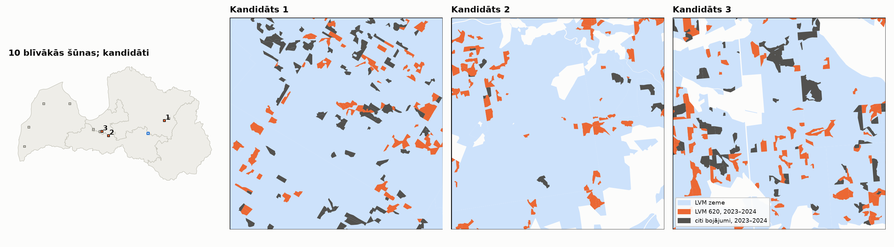

# 5b posms: s2forest aklā validācija uz LVM zemes

Statuss: **a) AOI kandidāti — gaidu lietotāja izvēli.** s2forest nav palaists. **[P]** = aprēķināts no datiem,
**[N]** = pieņēmums. Avoti kā 5a posmā (`docs/DATU_AVOTI.md`, 5a sadaļa): LVM_BOJAJUMI un LVM_ZEMES_VIENIBAS (Wayback
kopijas), HRL Dominant Leaf Type 2018 (100 m, tas pats kešs kā 5. posmā), GISCO NUTS 2024.

Reproducēšana: `mezasargs-risk lvm-aoi configs/rm_5b_lvm.yaml` → `output/rm5b_lvm/tables/lvm_5b_aoi_candidates.csv`,
AOI faili `output/rm5b_lvm/aoi/aoi_kandidats_<n>.geojson` (CRS84, kā Kalsnavas AOI).

## a) AOI izvēle [P]

Šūnas: 5 × 5 km LKS-92 režģis (kā 5a `target_cells`), 10 šūnas ar visvairāk LVM 620 poligoniem ≥ 0,5 ha, reģistrētiem
2023–2024 (poligons pieder šūnai pēc reprezentatīvā punkta). Kritēriji (lietotājs, 2026-10-23):

- LVM zeme ≥ 80 % šūnas platības (`LVM_ZEMES_VIENIBAS` ∩ šūna);
- HRL skujkoki ≥ 50 % — definēts kā DLT 2018 skujkoku pikseļi / koku segums (1 + 2), tāpat kā `ConiferConfig.min_share`;
- ≥ 30 LVM 620 poligoni ≥ 0,5 ha, reģistrēti 2023–2024;
- kārtojums: visi kritēriji izpildīti → Vidzeme → attālums līdz Kalsnavas AOI centram.

| Rangs | Centrs lon / lat | Reģions | km no Kalsnavas | LVM zeme | Koku segums | Skujkoki | 620 ≥ 0,5 ha (2023 / 2024) | ≥ 1 ha | 620 ha | Vējgāzes 2023–24 | Citi 2023–24 | Visi kritēriji |
|---|---|---|---|---|---|---|---|---|---|---|---|---|
| **1** | 26,506 / 56,931 | Vidzeme | 48 | 100 % | 80 % | 80 % | 81 (47 / 34) | 59 | 145 | 67 | 66 | jā |
| **2** | 24,367 / 56,641 | Zemgale | 92 | 83 % | 80 % | 66 % | 80 (51 / 29) | 51 | 143 | 10 | 3 | jā |
| **3** | 24,123 / 56,731 | Rīga | 107 | 81 % | 79 % | 64 % | 102 (28 / 74) | 68 | 194 | 72 | 11 | jā |
| 4 | 23,795 / 56,776 | Rīga | 127 | 95 % | 73 % | 73 % | 101 (77 / 24) | 73 | 214 | 240 | 12 | jā |
| 5–7 | Kurzeme | Kurzeme | 252–289 | 86–95 % | 82–91 % | 72–83 % | 75–96 | 57–77 | | | | jā |
| 8 | 26,673 / 56,972 | Vidzeme | 59 | **72 %** | 80 % | 56 % | 72 (34 / 38) | 64 | 220 | 3 | 14 | nē (LVM zeme) |
| 9 | 24,041 / 56,732 | Rīga | 112 | **78 %** | 82 % | 52 % | 117 (63 / 54) | 88 | 309 | 107 | 6 | nē (LVM zeme) |
| 10 | 22,879 / 57,310 | Kurzeme | 195 | **66 %** | 69 % | 75 % | 79 (30 / 49) | 62 | 209 | 5 | 28 | nē (LVM zeme) |

Pilna tabula: `lvm_5b_aoi_candidates.csv`. „Vējgāzes” = `DAMAGESUBT 100`, „citi” = visi pārējie, izņemot 620.

Piezīmes:

- Vidzemē kritērijus izpilda **tikai 1. kandidāts**. Otra Vidzemes šūna (8., 59 km) neiztur LVM zemes kritēriju (72 %).
- Kandidātam 4 ir visvairāk vējgāžu poligonu (240) — der atsevišķai vējgāžu pārbaudei, ja to vajag [N].
- HRL DLT ir 2018. gada; kopš tā skujkoku segums bojājumu dēļ var būt mazāks [N]. s2forest meža maska ir tā pati
  DLT 2018 klase 2, tāpēc 620 poligoni ārpus tās netiks analizēti.
