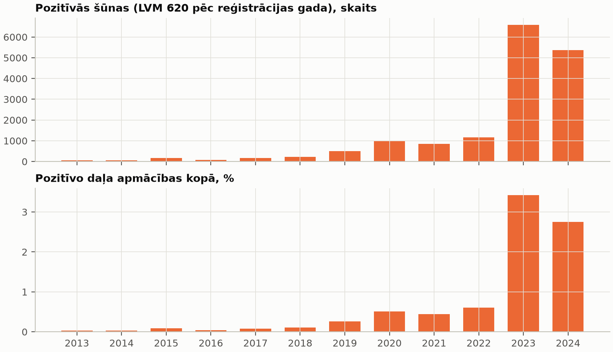
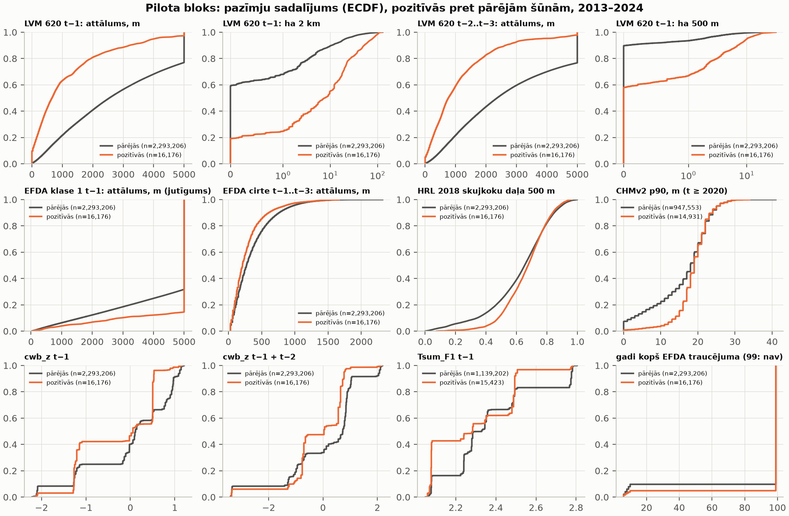

# 6a posms: pazīmju specifikācija un pilota bloks (2026-11-04)

Lietotāja lēmums 2026-11-04 (pēc RM_4b): pēc 2018. gada uzliesmojums ir pašuzturošs, un sausums ir sākuma faktors.
Tāpēc **galvenās pazīmes ir mizgraužu spiediens** (iepriekšējo gadu bojājumi tuvumā) un **audzes uzņēmība**;
klimats ir papildus. Šis posms ir **tikai pilota bloks**, ne visa Latvija, un **bez modeļa** (7. posms).
**[P]** = aprēķināts / nolasīts, **[N]** = pieņēmums vai interpretācija.

```
mezasargs-risk features-pilot configs/rm_6a_pilots.yaml
```

Kods: `src/mezasargs_risk/features.py` (pazīmes, noplūdes aizsardzība), `features_io.py` (bloka ievaddati, CHMv2,
tabula), testi `tests/test_rm_features.py`. Izvade (nav git): `output/rm6a_pilots/tables/training_pilot.nc` un
`pilot_*.csv`; attēli `docs/rm_figures/rm6a_pilots_*.png`.

## 1. Kas jau bija repo (pārbaudīts pirms darba) [P]

| Elements | Stāvoklis | Lietots 6a |
|---|---|---|
| PLANS 2.6 pazīmju tabula | balstīta uz EFDA klasi 1 un Open-Meteo → **novecojusi** | aizstāta ar **PLANS 2.23** |
| PLANS 2.5 etiķešu shēma `cell_id, year, label, source, confidence` | ir | jā |
| PLANS 2.14 L2 / L3, 2.16 (LVM 620 etiķetes, PU), 2.22 (Tsum) | ir | jā |
| EFDA v3.0 (`cache/efda/v3.0/Lithuania.zip`) | ir (5. posms) | malas, vēsture, klase 1 jutīgumam |
| LVM_BOJAJUMI 620, LVM_ZEMES_VIENIBAS (Wayback) | ir (5a) | etiķetes, spiediens, analīzes kopa |
| HRL DLT 2018 100 m Latvija | ir (5. posms) | skujkoku pazīmes |
| ERA5-Land cwb_z, RITY-2 (4. posms) | ir | klimats t−1 |
| CHMv2 | tikai Kalsnavas testa logs; flīzes 200–300 MB | **pilotā lasīti bloka logi** (nekas nav saglabāts) |
| Picea varbūtība | tikai Kalsnavas tests | **pilotā nav** |
| LĢIA DTM 20 m | nav lejupielādēts (7z 399 MB > 200 MB, vajag 7-Zip) | **pilotā nav** → vajag atļauju |
| HRL Water & Wetness | tikai Kalsnavas tests, vājš (RM_4 3. posms) | nav |

## 2. Pazīmes (PLANS 2.23) [P kods, N izvēles]

Vienība: EFDA v3.0 30 m šūna (EPSG:3035). Analīzes kopa: EFDA meža zemes lietojums ∩ LVM zeme, šūnas centrs blokā.

- **Etiķete:** LVM 620 poligons ar reģistrācijas gadu t pārklāj šūnas centru. `confidence` = poligona pārklātā šūnas
  daļa (3 × 3 apakššūnas). `source = lvm620_wayback20250503`. Negatīvās = „nav reģistrēts” (PU).
- **Apmācības kopa (`in_set`):** EFDA traucējums (1–3) šūnā t−5 … t−1 → ārā (2.5, k = 5).
- **Mizgraužu spiediens (galvenā grupa):**
  - attālums līdz tuvākajam 620 poligonam (≤ 5 km);
  - 620 platība 500 m un 2 km rādiusā;
  - **t−1 un t−2 … t−3 atsevišķi**; t−2 … t−3 grupa viena pati = L3 jutīgums.
- **EFDA klase 1:** tās pašas pazīmes, tikai jutīgumam.
- **Malas / vēsture (EFDA ≤ t−1):**
  - attālums līdz cirtei t−1 … t−3 un t−1 … t−10;
  - svaiga mala uz D / DR / R ≤ 60 m;
  - gadi kopš traucējuma.
- **Audze:**
  - HRL 2018 skujkoki (100 m) un skujkoku daļa 500 m; karogs `hrl_after_t` gadiem t ≤ 2018 (2.4);
  - CHMv2 vidējais, p90, daļa > 5 m — **tikai t ≥ 2020** (L2).
- **Klimats (ERA5-Land, tuvākā 0,1° šūna):**
  - cwb_z t−1; cwb_z t−1 + t−2; Tsum_F1 t−1 (Tsum_F2 t−1 arī tabulā);
  - izlidošanas DOY, paaudzes (tiešā un INCA) t−1 — tikai jutīgumam.

## 3. Pilota bloks [P]

**20 × 20 km, LKS-92 [490000, 275000, 510000, 295000]** (Rīgas plānošanas reģions, ~24,0° A / 56,7° Z).
- Satur **AOI 3** (5b validācija, [505000, 285000] 5 km šūna).
- Izvēlēts no 2 139 20 km blokiem (5 km solis) pēc kritērija: gadu skaits 2013–2024 ar ≥ 5 LVM 620 poligoniem →
  **12 / 12** (vienīgais), 806 poligoni, 45 no tiem 2013–2018.
- AOI 3 pats (5 × 5 km) ir par mazu: tajā 2013–2018 ir 0–5 poligoni gadā.

| | 2013 | 2014 | 2015 | 2016 | 2017 | 2018 | 2019 | 2020 | 2021 | 2022 | 2023 | 2024 |
|---|---|---|---|---|---|---|---|---|---|---|---|---|
| 620 poligoni blokā | 7 | 6 | 6 | 8 | 5 | 13 | 35 | 40 | 35 | 32 | 296 | 322 |

## 4. Apmācības tabula (šūna × gads, 2013–2024) [P]

- 444 799 šūnas blokā, no tām **213 182** LVM meža šūnas.
- **2 558 184 rindas**, no tām apmācības kopā 2 309 382; NetCDF 60,5 MB.
- Pozitīvās: 17 050 rindas, apmācības kopā 16 176.

| Gads | Šūnas kopā | Pozitīvās | Daļa |
|---|---|---|---|
| 2013 | 192 269 | 58 | 0,030 % |
| 2014 | 189 745 | 63 | 0,033 % |
| 2015 | 191 040 | 170 | 0,089 % |
| 2016 | 193 205 | 84 | 0,044 % |
| 2017 | 195 083 | 161 | 0,083 % |
| 2018 | 193 415 | 217 | 0,11 % |
| 2019 | 192 141 | 492 | 0,26 % |
| 2020 | 191 536 | 973 | 0,51 % |
| 2021 | 191 791 | 845 | 0,44 % |
| 2022 | 191 602 | 1 165 | 0,61 % |
| 2023 | 192 535 | 6 588 | 3,4 % |
| 2024 | 195 020 | 5 360 | 2,7 % |

Pozitīvo daļa pieaug ~100 reizes; 2023–2024 dod 74 % no visām pozitīvajām šūnām. Metrikas jāliek katram gadam atsevišķi
(L4).



## 5. Noplūdes testi [P]

- **Kodā:** katra pazīme datus lasa tikai caur `Ctx.layer` / `Ctx.clim`. Pieprasījums gadam ≥ t izraisa
  `LeakageError`.
- **Pilota palaidienā:** izmantoto gadu ieraksts (`pilot_leakage_years_used.csv`) — **visām pazīmēm visos gados maks.
  nobīde −1**:
  - t−2 … t−3 grupām maks. nobīde ir −2;
  - EFDA vēsturei min. nobīde ir −10;
  - ja būtu ≥ 0, komanda apstātos ar Exit 5.
- **pytest** (`tests/test_rm_features.py`, 6 testi):
  1. sargs izraisa kļūdu gadam t un vēlāk;
  2. visas pazīmes gadam t nemainās, ja maina visus LVM / EFDA / klimata datus gados ≥ t;
  3. **spiediens nav pati etiķete:** tās pašas šūnas 620 poligons gadā t maina etiķeti, bet ne vienu pazīmi;
  4. iepriekšējā gada poligons tajā pašā šūnā dod attālumu 0 tikai t−1 grupā;
  5. **t−2 … t−3 grupa nemainās no t−1 poligoniem** (L3);
  6. attāluma, platības, D / DR malas, CHM agregācijas un quadkey pareizība; apraksta statistika.

**Pseidonoplūde (L3) datos:** cik pozitīvo šūnu jau bija 620 poligonā iepriekšējā gadā?

| Gads | 2013 | 2014 | 2015 | 2016 | 2017 | 2018 | 2019 | 2020 | 2021 | 2022 | 2023 | 2024 | kopā |
|---|---|---|---|---|---|---|---|---|---|---|---|---|---|
| tā pati šūna t−1 | 0 | 0 | 0 | 0 | 8 % | 11 % | 4 % | 1 % | 1 % | 7 % | 4 % | **22 %** | 10 % |
| ≤ 500 m no t−1 poligona (pozitīvās) | 0 | 0 | 15 % | 25 % | 34 % | 27 % | 13 % | 24 % | 18 % | 18 % | 31 % | 74 % | 42 % |
| ≤ 500 m no t−1 poligona (pārējās) | 0,5 % | 3 % | 2 % | 2 % | 3 % | 2 % | 5 % | 13 % | 14 % | 12 % | 13 % | 55 % | 10 % |

- 2024. gadā 22 % pozitīvo šūnu tajā pašā šūnā jau bija 620 poligons 2023. gadā. Tas, visticamāk, ir **tā paša bojājuma
  atkārtota reģistrācija** vai bojājuma paplašināšanās [N].
- Tāpēc 7. posmā vajag:
  - L3 variantu (tikai t−2 … t−3 spiediens);
  - metrikas šūnām > 500 m no t−1 poligoniem.

## 6. Aprakstoša statistika (bez modeļa) [P]

Visi gadi kopā, apmācības kopa. Mediāna [IQR]; SMD = standartizēta vidējo starpība (pozitīvās − pārējās).

| Pazīme | Pozitīvās (n = 16 176) | Pārējās (n = 2 293 206) | SMD |
|---|---|---|---|
| 620 t−1: attālums, m | 660 [228; 1 640] | 2 543 [1 158; 4 746] | −1,05 |
| 620 t−1: ha 2 km | 7,6 [1,1; 21,5] | 0 [0; 2,3] | 0,72 |
| 620 t−2 … t−3: attālums, m | 765 [330; 1 570] | 2 363 [1 140; 4 689] | −1,05 |
| 620 t−2 … t−3: ha 2 km | 5,5 [1,0; 19,4] | 0 [0; 2,4] | 0,90 |
| EFDA klase 1 t−1: attālums, m | 5 000 [5 000; 5 000] | 5 000 [4 012; 5 000] | +0,29 |
| EFDA cirte t−1 … t−3: attālums, m | 212 [108; 362] | 272 [134; 488] | −0,25 |
| D / DR / R svaiga mala | gandrīz visur 0 | gandrīz visur 0 | 0,03 |
| HRL skujkoku daļa 500 m | 0,68 [0,57; 0,77] | 0,65 [0,51; 0,77] | 0,25 |
| HRL skujkoks (100 m pikselis) | 1 [1; 1] | 1 [0; 1] | 0,37 |
| CHMv2 p90, m (t ≥ 2020; n = 14 931 / 947 553) | 19 [17; 22] | 18 [12; 22] | 0,44 |
| CHMv2 daļa > 5 m | 0,97 [0,80; 1,00] | 0,94 [0,44; 1,00] | 0,46 |
| cwb_z t−1 | 0,06 [−1,24; 0,50] | 0,12 [−0,21; 0,88] | −0,31 |
| cwb_z t−1 + t−2 | 0,04 [−0,76; 0,65] | 0,73 [−0,81; 0,87] | −0,24 |

- **Mizgraužu spiediens ir spēcīgākā atšķirība** (|SMD| 0,7–1,05), arī **t−2 … t−3 grupā bez t−1**.
- **Pa gadiem tas nav vienmērīgi** (`pilot_feature_distributions_by_year.csv`):
  - t−1 attāluma SMD ir −0,4 … −1,4 gados 2014, 2016, 2017, 2018, 2020, 2023, 2024;
  - ≈ 0 gados 2019, 2021, 2022;
  - 2013 un 2015 iepriekšējā gadā blokā nav poligonu tuvumā.
  - Kopējais SMD daļēji ir gadu sastāva efekts: 2023–2024 ir daudz pozitīvo un augsts spiediens [N].
- **EFDA klase 1:** pozitīvās ir **tālāk** no klases 1 nekā pārējās (SMD +0,29). Tas saskan ar RM_4b — klase 1 nav
  mizgraužu signāls [N].
- **Uzņēmība:** pozitīvās ir biežāk skujkoku pikseļos un augstākās audzēs (CHMv2 SMD 0,44–0,46). Cirtes tuvums ir vājš
  (−0,25), D / DR malas pazīme gandrīz nemainās (svaigas cirtes ≤ 60 m ir retas).
- **Klimats bloka iekšienē nav informatīvs:** 20 km blokā ir tikai 2–3 ERA5-Land šūnas, tāpēc gada ietvaros vērtība ir
  gandrīz konstanta. Kopējā SMD ir tikai gadu sastāvs. Klimata pazīmēm vajag visu Latviju vai vairākus blokus [N].



## 7. Laiks un RAM; novērtējums visai Latvijai [P pilots, N novērtējums]

**Pilots (laptops, i5-13450HX), pirmais palaidiens ar CHMv2 no tīkla:**
- ievaddati 13,6 s; pazīmes 12 gadiem 23,8 s;
- CHMv2 lasīšana 385 s (4 flīzes, pārklājums 100 %); CHM 3 m → 30 m agregācija un tabula ~300 s;
- **kopā 729 s; maks. izsekotā atmiņa 911 MB.**

| Apjoms [N] | Bloki / rindas | Laptops | Serveris (2 vCPU Haswell, 3,7 GB RAM) | RTU HPC |
|---|---|---|---|---|
| LVM zeme (1,61 milj. ha), bez CHMv2 | 201 bloks (20 km ar LVM zemi); ~16–18 M šūnas × 12 g. ≈ 190–215 M rindu, ~4,5 GB NetCDF | ~201 × 60 s ≈ **3–4 h** | ~2× lēnāk [N] ≈ **7 h**; atmiņa ~1 GB / bloks — iespējams secīgi | paralēli pa blokiem; **< 1 h** [N: HPC parametri nav zināmi] |
| + CHMv2 (t ≥ 2020) | ~140 flīzes, ~30 GB pārraide (PLANS 2.3) | + ~201 × 11 min ≈ **+37 h** (tīkls; agregāciju var paātrināt) | līdzīgi, ierobežo tīkls | ierobežo S3 tīkls |
| Visi īpašnieki (EFDA mežs ~43 M šūnas) | ×2,7 rindu | ×2,7 | diska vieta 20 GB — robeža | ieteicams |

- **Apmācības tabula modelim:** pilnā tabula (190 M rindu × ~30 pazīmes ≈ 23 GB float32) neietilpst atmiņā. Vajag
  negatīvo izlasi 1:10 ar svariem (L5); tad ~3–4 M rindu, kas der laptopam un serverim [N].
- Visas Latvijas aprēķins **nav palaists** (lietotāja lēmums: apstāties).

## 8. Kas nav izdarīts / vajag lēmumu

- **DTM (slīpums, TPI):** LĢIA DTM 20 m 7z ir 399 MB > 200 MB, un vajag sistēmas 7-Zip → vajag lietotāja atļauju.
- **Picea varbūtība:** pilotā nav lejupielādēta (Zenodo slānis; apjoms blokam nav novērtēts).
- **Tsum t−1 gadiem 2013–2018:** gaida papildu lejupielādi (I–III, X 2011–2017); sk. 9. sadaļu.
- Literatūra (Kärvemo u. c. 2014; Stadelmann u. c. 2013): DOI un bibliogrāfija pārbaudīta, saturs nav atvērts → [N]
  (`DATU_AVOTI.md`).

## 9. Tsum papildu lejupielāde 2011–2017 (A daļa) — PROCESĀ [P]

- **Mērķis:** Tsum t−1 / t−2 LVM 620 etiķetēm no 2013. gada.
- **Pieprasījumi:** I–III un X 2011–2017 = 28 mēneši + 7 `acc00_YYYY_11`; novērtējums pirms sākšanas ~0,5 GB (< 1 GB).
  Mainīgie tie paši 8: tikai `t2m` prasītu izmaiņas 4 apstrādes funkcijās.
- **Gaita:** serverī, `tmux`, secīgi, atsākšana pēc job ID; auth kļūdu nav. Sākts 2026-11-04 13:15 UTC.
- **Stāvoklis 2026-11-04 15:53 UTC:** 3 / 35 gatavi (h_2011_01–03, 17–20 MB katrs). CDS rindas gaidīšana pieaug: 18 s
  → 1 883 s → 3 029 s; darbs aizņem 9–80 min. Ar šādu rindu atlikušais laiks ir ~1–2 diennaktis [N].
- **Kods gatavs** (commits 15395dc): `pheno_extra_years: [2011, 2017]`. Dienas kubs tiek pārbūvēts, kad parādās jauni
  mēneši; `cds-latvia --step daily`, pēc tam `--step pheno` rēķina tikai 2011–2017.
- **Pēc lejupielādes:**
  1. RITY-2 2011–2017 serverī (~8 min);
  2. uz laptopu tikai `output/rm4_klimats/latvia/*`;
  3. Kalsnavas pārbaude: Open-Meteo prototipā 2011–2017 ir tikai IV–IX, tāpēc RITY-2 salīdzināt nevar. Salīdzinās
     dienas T_max / T_min IV–IX;
  4. pilota tabula no jauna; tad Tsum_F1 t−1 būs arī gadiem 2013–2018. Šobrīd Tsum t−1 ir tikai t ≥ 2019:
     n = 15 423 pozitīvās / 1 139 202 pārējās.
