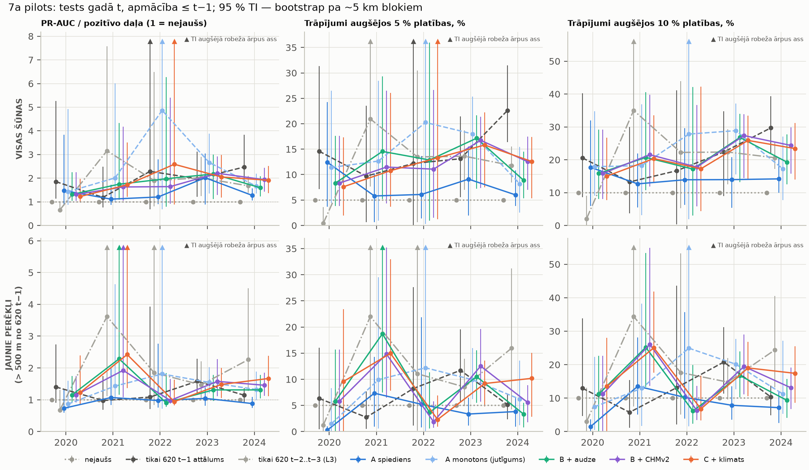
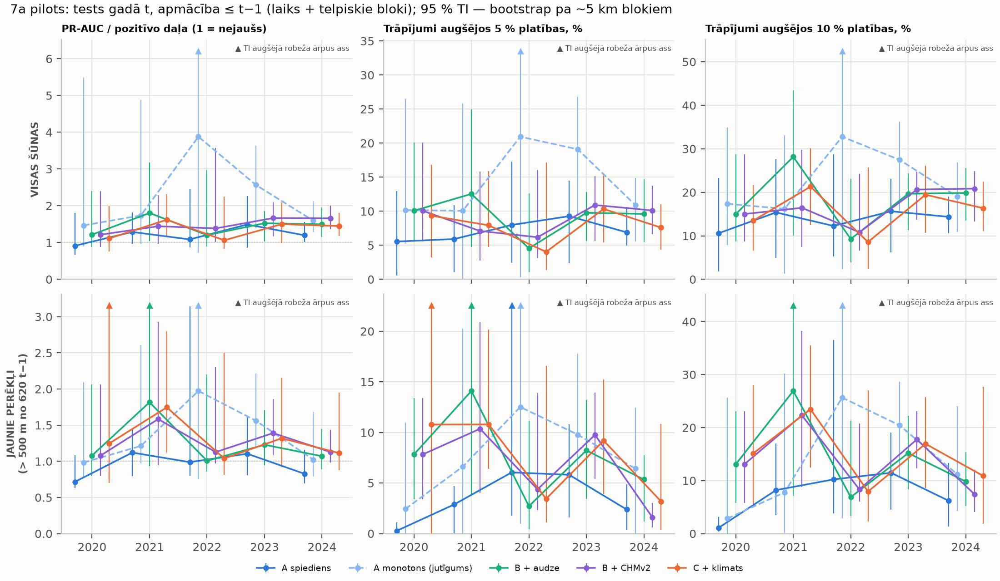
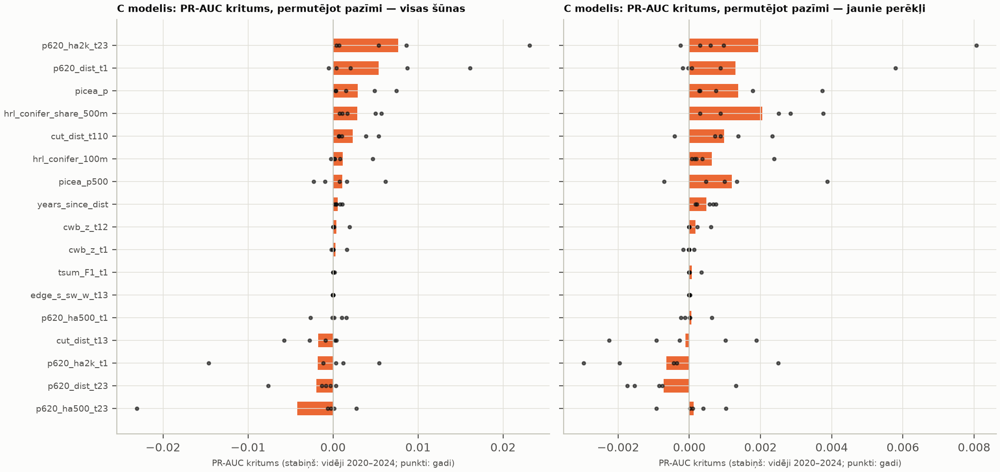

# 7a posms: pirmie modeļi pilota blokā (2026-11-05)

Lietotāja lēmums 2026-11-05: pirmie modeļi **tikai pilota blokā** (LKS-92 [490000, 275000, 510000, 295000]).
Šeit nav Latvijas modeļa, nav CHMv2 visai Latvijai, nav hiperparametru pielāgošanas pret testa gadu un nav SHAP.
**[P]** = aprēķināts / nolasīts, **[N]** = pieņēmums vai interpretācija.

```
mezasargs-risk models-pilot   configs/rm_7a_modeli.yaml   # 82 min laptopā (n_boot 999)
mezasargs-risk models-diagnose configs/rm_7a_modeli.yaml  # kāpēc attāluma bāzlīnija uzvar 2024
mezasargs-risk mvr-leakage     configs/rm_7a_modeli.yaml --mvr <MVR shp> ...
```

Kods: `src/mezasargs_risk/models.py` (metrikas, izlase, bootstrap), `cli.py` (`models-pilot`, `models-diagnose`,
`mvr-leakage`), `viz.py`. Testi: `tests/test_rm_models.py`, `tests/test_rm_features.py`.
Izvade (nav git): `output/rm7a_modeli/tables/rm7a_*.csv`. Attēli: `docs/rm_figures/rm7a_*.png`.

## 0. Īsumā

1. **Galvenā metrika ("jaunie perēkļi", > 500 m no 620 t−1).** Nevienā testa gadā (2020–2024) neviens HGB variants
   pēc punktvērtības nepārspēj labāko vienkāršo bāzlīniju.
   - Labākā bāzlīnija mainās no gada uz gadu: 2020. un 2023. gadā tas ir attālums t−1, 2021., 2022. un 2024. gadā
     attālums t−2…t−3.
   - Ticamības intervāli ir ļoti plati, jo pilotā ir tikai 16 telpiskie bloki ~5 km.
   - Vidēji pa gadiem (PR-AUC / pozitīvo daļa): t−2…t−3 bāzlīnija 1,98, C 1,55, B 1,39, A_mono 1,39, t−1 bāzlīnija 1,24,
     A 0,94 [P].
   - Bāzlīnija t−2…t−3 nav stabila: 2020. gadā tā ir sliktāka par nejaušu (0,68).
2. **Visas šūnas.** 2024. gadā attāluma t−1 bāzlīnija statistiski pārspēj visus HGB variantus (pārī salīdzinātais CI
   < 0). Iemesls ir **2024. gada sadalījuma maiņa**:
   - 37 % no 2024. gada pozitīvajām šūnām `p620_ha2k_t1` vērtība ir **lielāka par visu apmācības gadu maksimumu**;
   - koks tur dod konstantu prognozi (5. sadaļa).
   - Hiperparametri netika mainīti.
3. **Audzes pazīmes palīdz HGB.** C pret A jaunajos perēkļos ir labāks 2021., 2023. un 2024. gadā; 95 % CI ir > 0 [P].
4. **Klimats pilota blokā nav novērtējams.**
   - Blokā ir tikai ~15 ERA5-Land šūnas, un viena gada iekšienē klimata z-vērtību std ir 0,01–0,12.
   - Klimata permutācijas nozīmīgums ≈ 0.
   - C pret B atšķirības (2022. un 2024. gadā visās šūnās CI > 0) tāpēc **nav pierādījums klimata signālam [N]**.
   - Godīgi: C nav pārliecinoši labāks par B klimata dēļ.
5. **Picea ir nozīmīga, lai gan ir piesātināta.**
   - `picea_p` ir 3. vietā C modelī (visas šūnas) un 3. vietā jaunajos perēkļos.
   - 2024. gadā tās permutācija samazina PR-AUC par ~14 % no tā vērtības [P].
   - Signāls ir zemajā astē: 5 % kvantile pozitīvajām šūnām ir 97, citām 86.
   - **Ieteikums: Latvijas modelī iekļaut** (lēmums lietotājam).
6. **Monotonie ierobežojumi (A_mono) stipri uzlabo A** 2021.–2024. gadā. Tas norāda uz nemonotonu pārmācīšanos uz
   2023. gadu [N]. Tas ir jutīguma tests, nevis pielāgošana pret testa gadu: ierobežojumu zīmes izriet no fizikas, nevis
   no testa rezultātiem.

## 1. Iestatījumi [P]

| | |
|---|---|
| Rindas | pilota tabula `training_pilot.nc` (RM_6a), tikai `in_set` = 2 309 382 šūnu-gadi, 2013–2024 |
| Bāzlīnijas | nejaušs (PR-AUC = pozitīvo daļa); tikai −attālums līdz 620 t−1; tikai −attālums līdz 620 t−2…t−3 (L3) |
| A | 6 spiediena pazīmes (`p620_dist/ha500/ha2k` × `t1`, `t23`) |
| A_mono | A ar monotoniem ierobežojumiem: risks krīt ar attālumu, aug ar 620 platību (jutīgums) |
| B | A + audze: HRL skujkoki 100 m un 500 m daļa, `picea_p`, `picea_p500`, EFDA cirtes attālums t−1…3 un t−1…10, D/DR/R mala t−1…3, gadi kopš traucējuma |
| B_chm | B + CHMv2 (vidējais, p90, daļa > 5 m; tikai t ≥ 2020; 2020. gadā apmācībā CHM nav → **B_chm = B**) |
| C | B + klimats (`cwb_z_t1`, `cwb_z_t12`, `tsum_F1_t1`) |
| HGB | `HistGradientBoostingClassifier`: lr 0,05, 300 iterācijas, 31 lapa, min 100 lapā, l2 1,0, bez agrās apstāšanās; sēkla 20261105. **Fiksēti iepriekš, nav pielāgoti** |
| Negatīvās | 1:10 katrā apmācības gadā, svars = negatīvo skaits / izlasē (L5) |
| Validācija laikā | apmācība ≤ t−1, tests t, t = 2020…2024 (paplašināms logs) |
| Laiks + telpa | z12 Web Mercator flīzes (~5 km; pilotā 16), nejauši sadalītas 5 grupās; šūna gadā t tiek vērtēta ar modeli, kas mācīts uz gadiem < t un **citām** flīzēm |
| Metrikas | PR-AUC (vidējā precizitāte) / pozitīvo daļa; trāpījumu daļa un pacēlums augšējos 5 % un 10 % platības |
| CI | 95 %, klasteru bootstrap pa 16 flīzēm (999 atkārtojumi); pārī salīdzinājumi uz tiem pašiem atkārtojumiem |
| Nozīmīgums | permutācija testa gadā (PR-AUC kritums, 5 atkārtojumi), nevis koka iekšējais |

Apmācības un testa apjomi [P, `rm7a_train_test_sizes.csv`]:

| Tests t | Apmācības gadi | Apmācības rindas (pozitīvās) | Testa šūnas (pozitīvās) | Jaunie perēkļi: šūnas (pozitīvās) |
|---|---|---|---|---|
| 2020 | 2013–2019 | 13 695 (1 245) | 191 536 (973) | 166 517 (742) |
| 2021 | 2013–2020 | 24 398 (2 218) | 191 791 (845) | 165 264 (695) |
| 2022 | 2013–2021 | 33 693 (3 063) | 191 602 (1 165) | 168 030 (959) |
| 2023 | 2013–2022 | 46 508 (4 228) | 192 535 (6 588) | 165 973 (4 559) |
| 2024 | 2013–2023 | 118 976 (10 816) | 195 020 (5 360) | 86 312 (1 385) |

2024. gada apmācībā 61 % pozitīvo ir no 2023. gada.

## 2. Rezultāti pa gadiem — validācija laikā [P, `rm7a_metrics.csv`]



**PR-AUC / pozitīvo daļa** (1 = nejaušs). Treknrakstā labākā vērtība gadā.

| Modelis | 2020 visas | 2021 | 2022 | 2023 | 2024 | | 2020 jaunie | 2021 | 2022 | 2023 | 2024 |
|---|---|---|---|---|---|---|---|---|---|---|---|
| attālums t−1 | **1,85** | 1,19 | 2,29 | 1,98 | **2,47** | | **1,40** | 0,97 | 1,09 | **1,58** | 1,14 |
| attālums t−2…3 | 0,66 | **3,16** | 1,90 | 2,01 | 1,68 | | 0,68 | **3,62** | **1,85** | 1,47 | **2,26** |
| A | 1,47 | 1,11 | 1,20 | 2,02 | 1,27 | | 0,73 | 1,07 | 0,98 | 1,04 | 0,88 |
| A_mono | 1,43 | 2,01 | **4,87** | **2,66** | 1,66 | | 0,86 | 1,43 | 1,81 | 1,55 | 1,32 |
| B | 1,31 | 1,74 | 1,98 | 2,18 | 1,59 | | 1,15 | 2,29 | 0,90 | 1,31 | 1,31 |
| B_chm | 1,31 | 1,63 | 1,64 | 2,21 | 1,94 | | 1,15 | 1,93 | 0,98 | **1,58** | 1,46 |
| C | 1,22 | 1,72 | 2,59 | 2,05 | 1,91 | | 1,23 | 2,42 | 0,94 | 1,48 | 1,67 |
| pozitīvo daļa | 0,51 % | 0,44 % | 0,61 % | 3,42 % | 2,75 % | | 0,45 % | 0,42 % | 0,57 % | 2,75 % | 1,61 % |

**Trāpījumi augšējos 10 % platības** (nejaušs = 10 %):

| Modelis | 2020 visas | 2021 | 2022 | 2023 | 2024 | | 2020 jaunie | 2021 | 2022 | 2023 | 2024 |
|---|---|---|---|---|---|---|---|---|---|---|---|
| attālums t−1 | 21 % | 13 % | 17 % | 22 % | 30 % | | 13 % | 6 % | 13 % | 21 % | 10 % |
| attālums t−2…3 | 2 % | 35 % | 22 % | 22 % | 21 % | | 3 % | 34 % | 18 % | 15 % | 24 % |
| A | 18 % | 13 % | 14 % | 14 % | 14 % | | 2 % | 14 % | 10 % | 8 % | 7 % |
| A_mono | 18 % | 18 % | 28 % | 29 % | 17 % | | 7 % | 13 % | 25 % | 20 % | 11 % |
| B | 16 % | 21 % | 17 % | 27 % | 19 % | | 11 % | 25 % | 6 % | 17 % | 9 % |
| C | 15 % | 20 % | 17 % | 26 % | 23 % | | 14 % | 25 % | 7 % | 19 % | 17 % |

CI piemēri (visas šūnas, PR-AUC attiecība):
- 2024: attālums t−1 2,47 [1,80; 3,84], C 1,91 [1,36; 2,51].
- 2022: A_mono 4,87 [0,69; 35,7].

Mazos gados (2020–2022 ir < 1 200 pozitīvo, ~1 000 vienā flīzē) CI ir platāki par atšķirībām starp modeļiem.

### Pārī salīdzinājumi (Δ PR-AUC attiecība, 95 % CI; tie paši bootstrap atkārtojumi) [P, `rm7a_paired_differences.csv`]

Treknrakstā: CI neietver 0.

| Pāris (otrais − pirmais) | Kopa | 2020 | 2021 | 2022 | 2023 | 2024 |
|---|---|---|---|---|---|---|
| C − attālums t−1 | visas | −0,63 [−3,6; 0,1] | +0,53 [−0,8; 2,2] | +0,30 [−5,9; 4,2] | +0,07 [−0,5; 0,4] | **−0,56 [−2,06; −0,07]** |
| C − attālums t−1 | jaunie | −0,18 [−1,2; 0,8] | **+1,45 [0,30; 7,5]** | −0,14 [−3,1; 0,3] | −0,10 [−0,6; 0,2] | +0,53 [−0,09; 1,25] |
| A − attālums t−1 | visas | −0,38 | −0,07 | −1,08 | +0,04 | **−1,20 [−2,38; −0,69]** |
| A_mono − attālums t−1 | visas | −0,43 | **+0,82 [0,03; 3,5]** | +2,58 [−0,06; 26] | +0,69 [−0,12; 1,30] | **−0,81 [−2,10; −0,20]** |
| B − A | jaunie | +0,42 | **+1,22 [0,18; 7,4]** | −0,07 | +0,27 [−0,10; 0,69] | **+0,43 [0,27; 0,77]** |
| C − A | jaunie | +0,49 | **+1,35 [0,40; 7,3]** | −0,03 | **+0,44 [0,11; 0,77]** | **+0,79 [0,35; 1,42]** |
| C − B | visas | −0,09 | −0,03 | **+0,61 [0,05; 2,7]** | −0,13 | **+0,32 [0,01; 0,52]** |
| C − B | jaunie | +0,07 | +0,14 | +0,04 | +0,17 | +0,36 [−0,03; 0,87] |
| B_chm − B | visas | 0 (= B) | −0,12 | −0,33 | +0,03 | **+0,34 [0,10; 0,60]** |
| B_chm − B | jaunie | 0 | −0,36 | +0,08 | **+0,27 [0,05; 0,58]** | +0,15 [−0,12; 0,37] |
| A − attālums t−2…3 | jaunie | +0,06 | **−2,55 [−9,4; −0,01]** | −0,87 | −0,43 [−1,2; 0,0] | **−1,38 [−3,73; −0,39]** |

## 3. Laiks + telpiskie bloki [P]



Telpiskās grupas pārbauda, vai modelis "atceras" vietas.
- HGB varianti parasti zaudē salīdzinājumā ar validāciju tikai laikā. Piemēram, C jaunajos perēkļos: 2021. gadā 2,42 → 1,75,
  2024. gadā 1,67 → 1,11.
- Daļa ieguvuma laika validācijā nāk no vietas atmiņas tajā pašā ~5 km apkārtnē [N].
- A_mono zaudē vismazāk.
- Ierobežojums: 16 flīzes pa 5 grupām, tāpēc vienā grupā ir 3–4 flīzes, un dažās grupās ir ļoti maz pozitīvo
  (2020. gadā min 5, 2022. gadā jaunajos perēkļos min 2). Šis tests ir **tikai indikatīvs**. Latvijas tabulā (205 bloki)
  to var atkārtot ar daudz vairāk grupām.

## 4. Pazīmju nozīmīgums (permutācija testa gadā) [P, `rm7a_permutation_importance.csv`]



C modelis, PR-AUC kritums × 1000, vidēji 2020–2024 (gadu amplitūda iekavās):

| Pazīme | Visas šūnas | Jaunie perēkļi |
|---|---|---|
| `p620_ha2k_t23` | 7,7 (0,4…23,1) | 1,9 (−0,3…8,1) |
| `p620_dist_t1` | 5,3 (−0,5…16,1) | 1,3 (−0,2…5,8) |
| **`picea_p`** | **2,9 (0,3…7,5)** | **1,4 (0,3…3,7)** |
| `hrl_conifer_share_500m` | 2,9 | **2,1** (1. vieta) |
| `cut_dist_t110` | 2,3 | 1,0 |
| `hrl_conifer_100m` | 1,1 | 0,6 |
| **`picea_p500`** | **1,1 (−2,3…6,2)** | **1,2 (−0,7…3,9)** |
| `years_since_dist` | 0,6 | 0,5 |
| `cwb_z_t12`, `cwb_z_t1`, `tsum_F1_t1` | 0,4 / 0,3 / 0,04 | 0,2 / 0,0 / 0,1 |
| `edge_s_sw_w_t13` | 0,0 | 0,0 |
| `cut_dist_t13`, `p620_ha2k_t1`, `p620_dist_t23`, `p620_ha500_t23` | negatīvi (−1,8…−4,2) | ≈ 0 vai negatīvi |

**Picea (lietotāja punkts 2).**
- `picea_p` **nav ≈ 0**: B un C modelī tā ir 3. nozīmīgākā pazīme. 2024. gadā (C, visas šūnas) tās permutācija samazina
  PR-AUC par 0,0075, t. i., ~14 % no PR-AUC 0,052 [P].
- Kāpēc tā strādā, lai gan mediāna ir 99 abām grupām:
  - pozitīvajām šūnām 5 % kvantile ir 97, 10 % kvantile 98;
  - citām šūnām 5 % kvantile ir 86, 10 % kvantile 96 [P].
  - Pazīme atsijā šūnas, kurās egle maz ticama, un HRL/CHMv2 to nespēj (skujkoki = egle + priede).
- `picea_p500` ir nestabila: zīme mainās pa gadiem.
- **Ieteikums [N]: Latvijas modelī `picea_p` iekļaut, `picea_p500` atstāt kā kandidātu** (lēmums lietotājam).

**Negatīvais nozīmīgums** (`p620_ha500_t23` −23 2022. gadā, `p620_ha2k_t1` −14,6 2023. gadā) nozīmē, ka modelis no šīm
pazīmēm iemācījās sakarības, kas testa gadā neturas. Tas ir tas pats nestacionaritātes signāls kā 5. sadaļā [N].

**Klimats.**
- Pilota blokā (20 × 20 km) ir ~15 ERA5-Land 0,1° šūnas.
- Gada iekšienē std: `cwb_z_t1` 0,01–0,08, `cwb_z_t12` 0,02–0,12, `tsum_F1_t1` ≤ 0,011 [P].
- Klimats šeit faktiski ir **gada konstante**, kas neranžē šūnas testa gadā, tāpēc permutācijas nozīmīgums ≈ 0 pēc
  konstrukcijas.
- C pret B atšķirības ir koku struktūras atšķirības, nevis klimata signāls [N].
- Klimata ieguldījumu var novērtēt tikai Latvijas mērogā, kur ir telpiska variācija.

## 5. Kāpēc attāluma t−1 bāzlīnija pārspēj HGB 2024. gadā (lietotāja punkts 4) [P, `rm7a_diag_*.csv`]

Hiperparametri **netika** mainīti. Tika aprēķināta tikai diagnostika (`models-diagnose`).

| Gads | Pozitīvās | Pozitīvās tajā pašā šūnā kā 620 t−1 | Pozitīvās ≤ 500 m no t−1 | Šūnas ≤ 500 m no t−1 | AP attiecība, attālums t−1 |
|---|---|---|---|---|---|
| 2019 | 492 | 3,7 % | 13 % | 4,8 % | 2,73 |
| 2020 | 973 | 1,3 % | 24 % | 13,1 % | 1,85 |
| 2021 | 845 | 0,6 % | 18 % | 13,8 % | 1,19 |
| 2022 | 1 165 | 7,4 % | 18 % | 12,3 % | 2,29 |
| 2023 | 6 588 | 4,0 % | 31 % | 13,8 % | 1,98 |
| **2024** | 5 360 | **21,5 %** | **74 %** | **55,7 %** | 2,47 |

1. **Gada sadalījuma maiņa 2023 → 2024.**
   - Pēc 2023. gada uzliesmojuma (6 588 pozitīvās) 56 % bloka šūnu 2024. gadā ir ≤ 500 m no t−1 poligona; iepriekš
     ≤ 14 %.
   - Spiediena pazīmju diapazons 2024. gadā ir ārpus apmācības:

     | | `p620_ha2k_t1` p90 | `p620_ha2k_t1` max | `p620_ha500_t1` p90 |
     |---|---|---|---|
     | 2024 | 64 ha | 128 ha | 6,8 ha |
     | apmācībā | ≤ 17 ha | 46,6 ha | ≤ 0,8 ha |

   - 18,8 % no 2024. gada šūnām un **36,6 % no 2024. gada pozitīvajām** ir virs apmācības maksimuma `p620_ha2k_t1`.
   - Koku modelis ārpus diapazona dod konstantu prognozi, tāpēc lielā daļā "karsto" šūnu ranžējums sabrūk. Attālums t−1
     ir vienkārša monotona funkcija, un tā šīs šūnas ranžē joprojām.
   - Spearman(A prognoze, −attālums) testa šūnās 2024. gadā ir 0,28, 2023. gadā 0,48.
2. **Atkārtotās reģistrācijas.**
   - 2024. gadā 21,5 % pozitīvo ir tajā pašā šūnā, kur 620 t−1 poligons; agrāk 0,6–7,4 %. Pozitīvo daļa šajā joslā
     2024. gadā ir 13,6 %, apmācībā 7,4 %.
   - Tas ir gan perēkļa paplašināšanās, gan, iespējams, tā pati vieta reģistrēta divos gados [N]. RM_6a noplūdes
     aizsardzība (EFDA traucējums t−5…t−1 → ārā) šīs šūnas neizslēdz, ja EFDA tur traucējumu neredz.
   - Tas jāpārbauda pirms Latvijas modeļa: pārklāšanās ar t−1 poligonu un `confidence` (PLANS 2.16).
3. **Negatīvo izlase un svari.**
   - Izlase 1:10 ar svariem atjauno izplatību katrā gadā, tāpēc ranžējumu gada iekšienē teorētiski nemaina.
   - Bet 2024. gada apmācībā 61 % pozitīvo ir no 2023. gada, kad 24 % pozitīvo bija > 2 km no t−1 (plaša izplešanās).
     Modelis lielā mērā ir "2023. gada modelis".
   - Svari pa gadiem nav normalizēti uz vienādu gada ietekmi. Tā ir iespējamā izmaiņa nākamajam posmam, nevis pielāgota
     pret 2024 [N].
4. **A_mono** (risks krīt ar attālumu, aug ar platību) 2024. gadā aizver daļu plaisas: visās šūnās 1,27 → 1,66,
   jaunajos perēkļos 0,88 → 1,32. Tas atbilst skaidrojumam par nemonotonu pārmācīšanos [N].

## 6. MVR: noplūde un vēsturiskās versijas (lietotāja punkts 3)

### 6.1 Noplūdes diagnostika (pilota bloks; aprakstoša) [P, `rm7a_mvr_leakage.csv`]

Pašreizējais MVR (data.gov.lv, 2026-10-14), nogabals pie šūnas centra:
- 620 pozitīvās šūnas: 13 860;
- nejauša izlase no pārējām `in_set` šūnām: 50 000.

| Pašreizējā MVR stāvoklis | Pozitīvās | Pārējās |
|---|---|---|
| cirte pēc gada t (`p_cirg` > t) | **84,2 %** | 24,5 % |
| sanitārā cirte (30 / 31) pēc t | **71,6 %** | 10,6 % |
| sanitārā vienlaidus cirte (31) pēc t | 33,6 % | 0,8 % |
| izcirtums (`zkat` 14) | 10,9 % | 3,5 % |
| audze jaunāka par laiku kopš t | 31,3 % | 5,2 % |
| mežaudze **bez** egles sastāvā | **8,8 %** | 51,9 % |
| mežaudze ar egli sastāvā | 48,9 % | 37,5 % |
| nav MVR nogabala | 0,03 % | 0,7 % |

- Sugu sastāvs pašreizējā MVR atspoguļo **pēc** bojājuma notikušo sanitāro cirti, tāpēc kā apmācības pazīme tas būtu
  stipra noplūde.
- Lēmums (PLANS 2.24): MVR sugu sastāvs ir tikai **prognozes kartes maska** (piemēram, 2027. gadā risks tikai audzēs
  ar egli), nevis apmācības pazīme.

### 6.2 Vēsturiskās versijas (bez lielām lejupielādēm) [P, ja nav norādīts citādi]

- data.gov.lv datu kopa "Meža valsts reģistra meža dati" izveidota 2022-08-31.
  - Resursi tiek **pārrakstīti tajā pašā resursā**. CKAN versiju API nav (`package_activity_list` → "Action name not
    known").
- Wayback 2023-01-23 lapa rāda 11 reģionālos failus `*_04jan2023.7z`.
  - data.gov.lv tie ir 404, vai ar to pašu resursa id atgriež pašreizējo 2026-10-14 failu.
  - Wayback šie faili nav arhivēti (availability API).
- Wayback CDX: tikai 2025-05-05…07 kopijas no 5 pašreizējiem arhīviem, 84–129 MB katrs (~508 MB kopā).
- CDX prefiksu meklēšana bija daļēji nepieejama ("Temporarily Offline") → **pārbaude nav pilnīga [N]**.
- 2025. gada kopijas lauki (s10–s14, k10–k14) **nav pārbaudīti**, jo nekas netika lejupielādēts [N].
- Secinājums: MVR stāvokli 2013–2022 no atvērtajiem datiem atjaunot nevar. Agrākā iespējamā vēsturiskā versija ir
  2025. gada maijs, un arī tā ir pēc lielākās daļas etiķešu gadiem.

## 7. Bloki pie EFDA rastra malas (lietotāja punkts 1) [P]

- `block_inputs` lasa EFDA ar `boundless=True` un rastra nodata vērtību (aģents 255, meža maska 0).
- Šūnas ārpus rastra saņem `valid = False`, un `forest = forest & valid`. Tātad tās nav analīzes kopā un netiek
  uzskatītas par "mežu bez traucējuma".
- Tests: `test_boundless_edge_cells_are_nodata_and_outside_the_set` (logs, kas šķērso rastra malu).
- 205 Latvijas blokos 20 ir pie rastra malas; neviens nav starp blokiem 0–11. Bloki 0–11 nav pārrēķināti.
- Serverī jau aprēķinātajiem malas blokiem 12–14 šūnu skaits sakrīt ar jauno kodu (190 / 49 263 / 12 724).
  `forest & ~valid` = 0.

## 8. Servera Latvijas pazīmju tabula (bez CHMv2) [P]

(sk. zemāk, aizpildīts pēc pabeigšanas)

## 9. Ierobežojumi un nākamie soļi (lēmumi lietotājam)

- Viens 20 × 20 km bloks, 16 telpiskās flīzes. CI ir plati, un 2020–2022 ir maz pozitīvo. **Rezultāti nav vispārināmi
  uz Latviju [N].**
- Galvenais atvērtais jautājums ir nestacionaritāte: spiediena pazīmes 2024. gadā ir ārpus apmācības diapazona.
  Iespējamie risinājumi nākamajam posmam [N, nav izmēģināti]:
  - monotoni ierobežojumi spiediena pazīmēm (A_mono rezultāts);
  - relatīvas spiediena pazīmes, piemēram, platība / bloka 620 kopplatība gadā;
  - vienāda gadu ietekme svaros.
- Atkārtotās reģistrācijas (21,5 % 2024. gadā) jāizvērtē pirms Latvijas modeļa.
- Picea: ieteikums iekļaut `picea_p`.
- Klimats un DTM: novērtējami tikai Latvijas mērogā.
