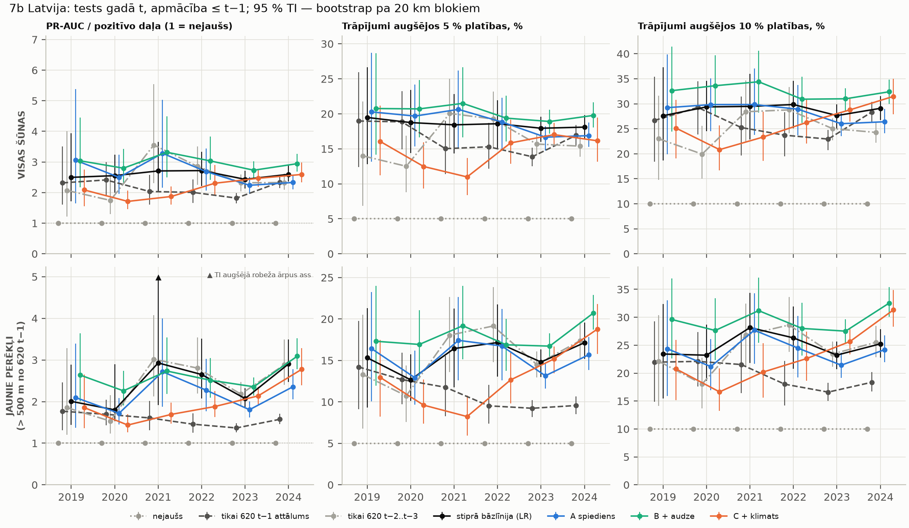
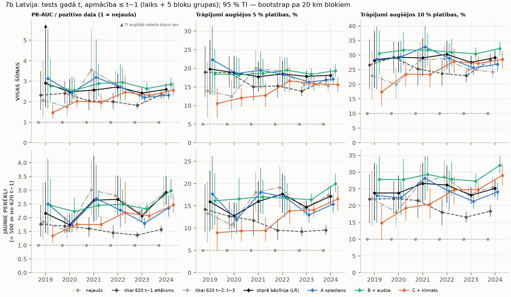
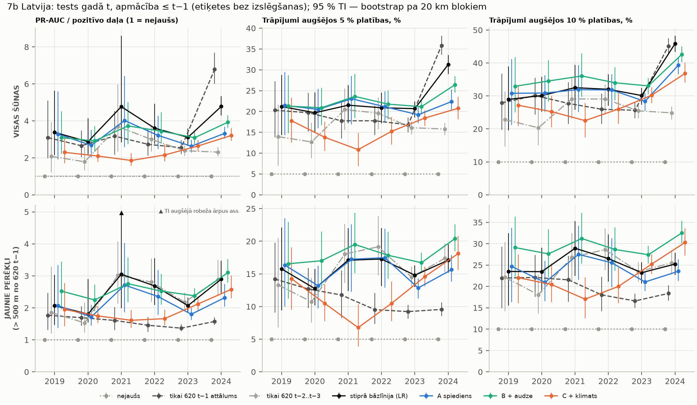
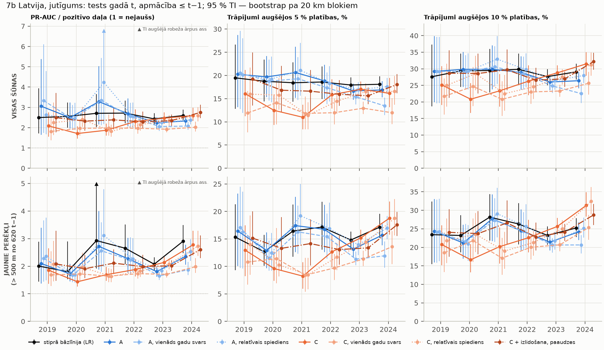
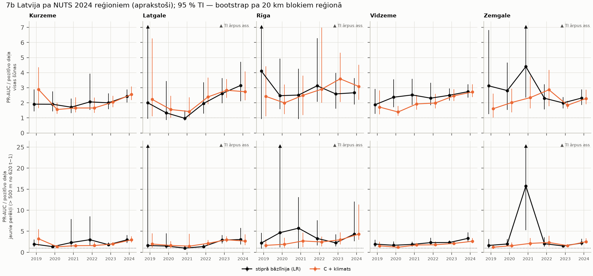
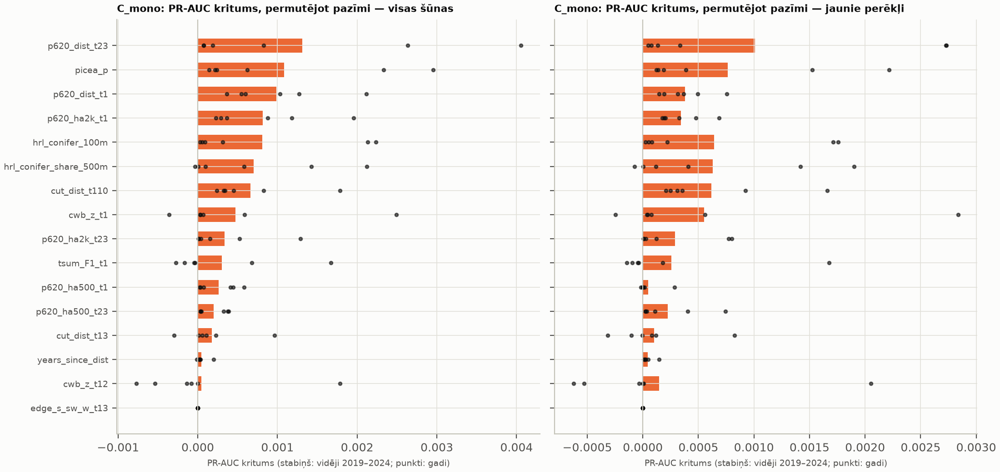

# RM 7b — Latvijas modelis (2026-11-10)

Visi varianti un metrikas ir iepriekš reģistrēti PLANS 2.25 (commit `570ff77`, reģionu labojums `52a8829`). Abi
commiti ir veikti pirms jebkura 7b modeļa palaišanas. Šeit ziņoti **visi** reģistrētie varianti, nekas nav pievienots
vai izvēlēts pēc testa rezultātiem. Vienīgais izņēmums ir **B_chm**: tas nav aprēķināts, jo serveris nav pieejams
(sk. §8).

Skaitļi ir no `output/rm7b_modeli/tables` (nav git). Formāts: vērtība [95 % TI]. TI aprēķināts ar klasteru
bootstrap pa 20 km blokiem, 999 atkārtojumi. Pāru starpībām lietoti tie paši atkārtojumi; **trekns** = TI neietver 0.
Marķējums: [P] — pārbaudīts dati/kods; [N] — mana interpretācija.

## 0. Kopsavilkums (atbildes uz jautājumiem)

**(a) Vai kāds modelis jaunajos perēkļos pārspēj stipro bāzlīniju?**
Daļēji, un tas ir tikai **B_mono** (spiediens + audze).
- **Trāpījumi augšējos 10 % platības:** B_mono pārspēj LR 5 no 6 gadiem, starpība +3…+7 procentpunkti. TI neietver 0
  gados 2019, 2020, 2023 un 2024. 2021. gadā apakšējā robeža ir 0,0, 2022. gadā starpība ir +1,7 [−2,1…5,0] pp. [P]
- **PR-AUC / pozitīvo daļa:** B_mono − LR ir pozitīvs 4 no 6 gadiem, bet TI neietver 0 tikai 2019. gadā
  (+0,63 [0,17–1,16]) un 2023. gadā (+0,28 [0,16–0,41]). [P]
- **A_mono** (tikai spiediens) ir sliktāks par LR 2022–2024. **C_mono** (+ klimats) ir sliktāks par LR 2020–2022,
  pārējos gados statistiski neatšķiras. [P]
- Telpiskajā validācijā (laiks + 5 bloku grupas) aina tā pati: B_mono − LR PR-AUC ir pozitīvs 2020. un 2023. gadā,
  pārējos gados TI ietver 0. [P]
- Tātad stiprā bāzlīnija (divi log-attālumi) jaunajos perēkļos ir grūti pārspējama. Audzes pazīmes uzlabo
  augšējo 10 % trāpījumus konsekventi, bet visas ranžēšanas kvalitāti (PR-AUC) tikai dažos gados. [N]

**(b) Vai klimats Latvijas mērogā kaut ko dod?** Nē, out-of-time testā klimats pasliktina rezultātu.
- **C_mono − B_mono** ir negatīvs **visos 6 gados**.
  - Jaunajiem perēkļiem TI neietver 0 5 no 6 gadiem; 2024: −0,32 [−0,62–0,03].
  - Visām šūnām TI neietver 0 visos 6 gados.
  - Tas pats atkārtojas telpiskajā validācijā (5 no 6 gadiem) un variantā bez izslēgšanas. [P]
- Jutīguma varianti ar klimatu nevienā gadā nav labāki par B_mono. Tie ir C_fen_mono (+ izlidošanas DOY un paaudzes),
  C_mono_rel un C_mono_yw. [P]
- **Permutācijas nozīmīgums** (C_mono, PR-AUC kritums % no modeļa PR-AUC; jaunajos perēkļos, visās šūnās līdzīgi):
  - `cwb_z_t1`: kritums > 0 5 no 6 gadiem, vidēji +3,0 %, bet 2021. gadā −10,1 % un 2024. gadā +18,3 %.
  - `cwb_z_t12`: > 0 3 no 6 gadiem, vidēji −0,5 %.
  - `tsum_F1_t1`: > 0 2 no 6 gadiem, vidēji −0,3 %.
  - Klimats „palīdz” tikai atsevišķos gados (2024), bet citos kaitē, tātad zīme nav stabila. [P]
- [N] Iespējamais skaidrojums: ERA5-Land šūna (~9 km) un gada līmeņa klimata anomālija pārsvarā kodē **gadu**. Ar
  paplašināmu logu modelis iemācās iepriekšējo gadu klimata un uzliesmojuma attiecības, kas nākamajā gadā neatkārtojas.
  Tas saskan ar RM_4b: kopīgs 2018–2024 trends, lags nav identificējams.

**(c) Vai rezultāti būtiski atšķiras pa reģioniem?** Nē, sistemātiskas atšķirības nav redzamas (aprakstoši, §5).
- LR un C_mono PR-AUC / pozitīvo daļa visos 5 reģionos ir apmēram 1,5–3,5, un TI lielākoties pārklājas. [P]
- Platie TI un izlēcēji ir reģionos ar maz pozitīvo vai bloku:
  - Rīga: 18 bloki;
  - Latgale 2019–2020: < 600 pozitīvo jaunajos perēkļos;
  - Zemgale 2021, LR jaunajos perēkļos: 15,8 [5,2–29,0] — viena gada izlēcējs. [P]
- Vidzemē LR ≥ C_mono visos gados; citur secība mainās. [P]

**(d) Cik pozitīvo izslēdza atkārtotās reģistrācijas noteikums?** Skaitļi attiecas uz visu Latviju (`in_set`), ne
izlasi:

| gads | pozitīvās `in_set` | izslēgtās (tā pati šūna t−1) | daļa | šūnas ar 620 t−1 tajā pašā šūnā |
|---|---|---|---|---|
| 2013 | 11 225 | 13 | 0.12 % | 570 |
| 2014 | 2 092 | 13 | 0.62 % | 15 091 |
| 2015 | 3 225 | 25 | 0.78 % | 3 054 |
| 2016 | 1 889 | 16 | 0.85 % | 4 371 |
| 2017 | 1 777 | 38 | 2.14 % | 2 582 |
| 2018 | 7 750 | 25 | 0.32 % | 2 429 |
| 2019 | 18 803 | 345 | 1.83 % | 10 793 |
| 2020 | 18 394 | 293 | 1.59 % | 25 484 |
| 2021 | 26 510 | 949 | 3.58 % | 25 117 |
| 2022 | 39 763 | 1 316 | 3.31 % | 35 195 |
| 2023 | 214 142 | 8 848 | 4.13 % | 52 814 |
| 2024 | 189 093 | 50 776 | 26.85 % | 274 738 |

Līdz 2022. gadam izslēgtas < 4 % pozitīvo, 2023. gadā 4,1 %, bet **2024. gadā 26,9 %** (50 776 no 189 093). [P]

## 1. Iestatījumi [P]

- **Dati.** Avots ir laptopa kopija `server_backup/.../rm6b_latvija/blocks` (205 bloki, tikai lasīšanai, SHA-256 =
  serveris). Pirms modeļiem pārbaudīti arī pārējie 17 EFDA malas bloki ar jauno valid masku. Visos šūnu skaits sakrīt
  ar servera izvadi, tāpēc pārrēķins nebija vajadzīgs.
- **Izlase** (`latvia-sample`):
  - katrā blokā × gadā × slānī: visas pozitīvās; negatīvās n = min(N, max(10 × pozitīvās, 200)), svars N / n;
    sēkla 20261105;
  - apjoms: 5 834 935 rindas, 534 663 pozitīvās, 118 MB fails, maksimālā atmiņa 1,2 GB, 25 min. Robežas (8 GB RAM,
    2 GB diskā) netika sasniegtas;
  - apmācība un tests ir uz tās pašas izlases, metrikas ar svariem;
  - testa svaru summa ≈ visa Latvijas analīzes kopa (~15,6–16,1 milj. šūnu gadā).
- **Modeļi un validācija** — kā PLANS 2.25:
  - HGB: lr 0,05, 300 iterācijas, 31 lapa, min 100 lapā, l2 1,0;
  - monotoni ierobežojumi spiediena pazīmēm (attālums −1, platība +1);
  - LR: log(attālums t−1 + 30), log(attālums t−2…3 + 30);
  - paplašināms logs t = 2019…2024; telpa: 5 nejaušas bloku grupas.
- **Aprēķina laiks laptopā** (6 kodoli):
  - galvenā daļa ~6 h (2019–2022 43 min; 2023 2,8 h; 2024 1,9 h; etiķetes bez izslēgšanas 1,4 h);
  - telpiskā daļa 1,9 h;
  - ar `--resume` (commit `18c0b7f`) aprēķins divreiz pārtraukts un atsākts; pabeigtie gadi ņemti no saglabātajām
    tabulām, sēklas fiksētas.

Testa apjoms (galvenās etiķetes):

```
labels  year  train_rows  train_pos     train_w  test_rows  test_pos       test_w  test_new_pos  test_new_w  blocks
  izsl  2019      489156      27828  95865200.0     219096     18458 1.605279e+07         16739  15739962.0     205
  izsl  2020      708252      46286 111917984.0     214034     18101 1.598700e+07         14986  15279285.0     205
  izsl  2021      922286      64387 127904992.0     295834     25561 1.593316e+07         22074  15243493.0     205
  izsl  2022     1218120      89948 143838144.0     432930     38447 1.589029e+07         32588  15101199.0     205
  izsl  2023     1651050     128395 159728448.0    2262215    205294 1.587997e+07        167507  14720070.0     205
  izsl  2024     3913265     333689 175608416.0    1526326    138317 1.563088e+07         64867  11641558.0     205
   bez  2019      509920      27958  95893296.0     226902     18803 1.606358e+07         16739  15739962.0     205
   bez  2020      736822      46761 111956864.0     230777     18394 1.601249e+07         14986  15279285.0     205
   bez  2021      967599      65155 127969368.0     314457     26510 1.595828e+07         22074  15243493.0     205
   bez  2022     1282056      91665 143927648.0     456932     39763 1.592549e+07         32588  15101199.0     205
   bez  2023     1738988     131428 159853120.0    2311824    214142 1.593279e+07        167507  14720070.0     205
   bez  2024     4050812     345570 175785920.0    1784123    189093 1.590562e+07         64867  11641558.0     205
```

## 2. Galvenie rezultāti — laiks, etiķetes ar izslēgšanu



### 2.1 Jaunie perēkļi (> 500 m no 620 t−1) — GALVENĀ

PR-AUC / pozitīvo daļa:

| modelis | 2019 | 2020 | 2021 | 2022 | 2023 | 2024 |
|---|---|---|---|---|---|---|
| random | 1.00 [1.00–1.00] | 1.00 [1.00–1.00] | 1.00 [1.00–1.00] | 1.00 [1.00–1.00] | 1.00 [1.00–1.00] | 1.00 [1.00–1.00] |
| dist_t1 | 1.77 [1.31–2.46] | 1.69 [1.44–2.05] | 1.61 [1.31–2.02] | 1.46 [1.25–1.72] | 1.37 [1.27–1.48] | 1.57 [1.46–1.70] |
| dist_t23 | 1.85 [1.20–3.29] | 1.53 [1.23–2.15] | 3.02 [2.13–4.08] | 2.81 [2.19–3.54] | 2.18 [1.91–2.47] | 2.88 [2.40–3.49] |
| LR | 2.01 [1.44–2.88] | 1.80 [1.53–2.89] | 2.93 [1.92–5.29] | 2.65 [2.07–3.51] | 2.07 [1.84–2.32] | 2.91 [2.47–3.49] |
| A_mono | 2.10 [1.38–3.40] | 1.72 [1.45–2.09] | 2.72 [1.88–4.00] | 2.28 [1.76–3.03] | 1.80 [1.62–2.00] | 2.36 [2.05–2.78] |
| B_mono | 2.64 [2.01–3.64] | 2.26 [1.91–2.73] | 2.73 [2.18–3.54] | 2.51 [2.09–3.05] | 2.36 [2.14–2.58] | 3.09 [2.78–3.52] |
| C_mono | 1.85 [1.36–2.65] | 1.44 [1.26–1.70] | 1.69 [1.47–1.97] | 1.88 [1.62–2.25] | 2.14 [1.94–2.35] | 2.77 [2.39–3.28] |

Trāpījumi augšējos 10 % platības, %:

| modelis | 2019 | 2020 | 2021 | 2022 | 2023 | 2024 |
|---|---|---|---|---|---|---|
| random | 10.0 [10.0–10.0] | 10.0 [10.0–10.0] | 10.0 [10.0–10.0] | 10.0 [10.0–10.0] | 10.0 [10.0–10.0] | 10.0 [10.0–10.0] |
| dist_t1 | 22.0 [14.9–29.3] | 22.1 [17.6–27.3] | 21.5 [16.4–27.1] | 18.0 [14.2–22.2] | 16.6 [15.0–18.3] | 18.4 [16.7–20.2] |
| dist_t23 | 22.1 [14.1–30.4] | 18.1 [13.7–22.8] | 26.8 [21.1–32.5] | 28.6 [23.8–33.6] | 23.4 [21.1–25.6] | 25.5 [22.8–28.5] |
| LR | 23.4 [15.4–32.3] | 23.2 [18.6–28.7] | 28.2 [21.8–34.4] | 26.3 [20.8–31.9] | 23.2 [20.7–25.6] | 25.2 [22.8–27.9] |
| A_mono | 24.4 [15.9–33.0] | 21.2 [16.9–26.1] | 27.7 [21.7–34.3] | 24.5 [19.2–30.2] | 21.4 [19.2–23.7] | 24.2 [21.9–26.8] |
| B_mono | 29.6 [22.6–37.0] | 27.6 [22.3–33.4] | 31.2 [25.4–37.1] | 28.0 [23.2–32.6] | 27.5 [25.3–29.7] | 32.5 [30.1–35.4] |
| C_mono | 20.7 [15.2–25.9] | 16.6 [13.2–20.9] | 20.2 [15.6–25.3] | 22.6 [18.6–27.4] | 25.7 [23.3–27.9] | 31.3 [28.3–34.9] |

Trāpījumi augšējos 5 % platības, %:

| modelis | 2019 | 2020 | 2021 | 2022 | 2023 | 2024 |
|---|---|---|---|---|---|---|
| random | 5.0 [5.0–5.0] | 5.0 [5.0–5.0] | 5.0 [5.0–5.0] | 5.0 [5.0–5.0] | 5.0 [5.0–5.0] | 5.0 [5.0–5.0] |
| dist_t1 | 14.2 [9.1–19.8] | 12.7 [9.7–15.9] | 11.8 [8.3–15.5] | 9.5 [7.4–12.1] | 9.2 [8.2–10.2] | 9.6 [8.5–10.6] |
| dist_t23 | 13.3 [6.8–20.5] | 10.7 [7.6–14.4] | 18.0 [13.6–22.6] | 19.2 [14.8–23.8] | 14.5 [12.9–16.1] | 17.4 [15.3–19.7] |
| LR | 15.3 [9.3–21.3] | 12.7 [10.1–15.7] | 16.4 [11.7–21.3] | 17.2 [13.0–21.7] | 14.8 [13.0–16.3] | 17.1 [15.2–19.6] |
| A_mono | 16.4 [10.1–23.3] | 12.9 [9.7–16.2] | 17.4 [12.6–22.6] | 16.7 [12.6–21.2] | 13.2 [11.6–14.7] | 15.7 [13.9–17.8] |
| B_mono | 17.3 [12.0–24.0] | 16.9 [12.8–21.1] | 19.2 [15.1–24.0] | 16.9 [13.7–20.0] | 16.7 [15.2–18.3] | 20.7 [18.7–22.9] |
| C_mono | 13.0 [8.2–17.5] | 9.6 [7.4–12.7] | 8.2 [5.9–10.8] | 12.7 [9.8–16.0] | 15.2 [13.5–16.7] | 18.8 [15.8–21.8] |

Lift ir `rm7b_metrics.csv`; stiprajai bāzlīnijai LR jaunajos perēkļos (lift5, lift10 ar TI):

```
lift5  lift5_lo  lift5_hi  lift10  lift10_lo  lift10_hi
year                                                         
2019   3.07      1.87      4.27    2.34       1.54       3.23
2020   2.53      2.03      3.15    2.32       1.86       2.87
2021   3.29      2.35      4.25    2.82       2.18       3.44
2022   3.43      2.61      4.35    2.63       2.08       3.19
2023   2.96      2.60      3.26    2.32       2.07       2.56
2024   3.43      3.04      3.91    2.52       2.28       2.79
```

Pāru starpības (PR-AUC / pozitīvo daļa, modelis − bāze):

| pāris (modelis − bāze) | 2019 | 2020 | 2021 | 2022 | 2023 | 2024 |
|---|---|---|---|---|---|---|
| A_mono − LR | 0.09 [-0.27–0.86] | -0.08 [-1.10–0.09] | -0.21 [-1.66–0.21] | **-0.37 [-0.69–-0.11]** | **-0.27 [-0.39–-0.16]** | **-0.55 [-0.79–-0.36]** |
| B_mono − LR | **0.63 [0.17–1.16]** | 0.46 [-0.60–0.77] | -0.19 [-2.12–0.50] | -0.14 [-0.68–0.28] | **0.28 [0.16–0.41]** | 0.19 [-0.14–0.44] |
| C_mono − LR | -0.15 [-0.87–0.47] | **-0.37 [-1.43–-0.13]** | **-1.24 [-3.47–-0.32]** | **-0.77 [-1.45–-0.27]** | 0.06 [-0.13–0.26] | -0.13 [-0.61–0.34] |
| C_mono − B_mono | **-0.78 [-1.64–-0.03]** | **-0.82 [-1.18–-0.54]** | **-1.04 [-1.60–-0.65]** | **-0.63 [-0.93–-0.36]** | **-0.22 [-0.35–-0.09]** | -0.32 [-0.62–0.03] |
| B_mono − A_mono | 0.54 [-0.05–0.89] | **0.54 [0.40–0.72]** | 0.02 [-0.69–0.53] | 0.24 [-0.15–0.48] | **0.55 [0.48–0.63]** | **0.74 [0.58–0.90]** |

Trāpījumu starpības jaunajos perēkļos (procentpunkti, [TI]):

| pāris | 2019 | 2020 | 2021 | 2022 | 2023 | 2024 |
|---|---|---|---|---|---|---|
| B_mono − LR, top 10 % | **+6,2 [1,9–10,7]** | **+4,4 [0,5–8,3]** | +3,0 [0,0–7,1] | +1,7 [−2,1–5,0] | **+4,3 [2,9–5,9]** | **+7,3 [5,7–8,9]** |
| B_mono − LR, top 5 % | +2,0 [−0,5–4,7] | **+4,3 [0,9–7,4]** | **+2,7 [0,7–5,1]** | −0,3 [−3,8–3,0] | **+1,9 [0,9–3,0]** | **+3,6 [2,1–4,8]** |
| C_mono − LR, top 10 % | −2,7 [−9,9–3,9] | **−6,6 [−11,0–−2,6]** | **−8,0 [−13,0–−2,8]** | −3,7 [−9,5–1,5] | **+2,4 [0,3–4,8]** | **+6,1 [3,9–8,0]** |
| C_mono − B_mono, top 10 % | **−8,9 [−15,0–−3,1]** | **−11,0 [−16,6–−6,3]** | **−11,0 [−15,6–−6,6]** | **−5,4 [−8,5–−2,1]** | **−1,9 [−3,6–−0,2]** | −1,2 [−3,0–0,4] |

### 2.2 Visas šūnas

| modelis | 2019 | 2020 | 2021 | 2022 | 2023 | 2024 |
|---|---|---|---|---|---|---|
| random | 1.00 [1.00–1.00] | 1.00 [1.00–1.00] | 1.00 [1.00–1.00] | 1.00 [1.00–1.00] | 1.00 [1.00–1.00] | 1.00 [1.00–1.00] |
| dist_t1 | 2.32 [1.60–3.50] | 2.41 [1.91–3.00] | 2.04 [1.60–2.58] | 2.01 [1.66–2.43] | 1.82 [1.65–1.98] | 2.34 [2.15–2.56] |
| dist_t23 | 2.07 [1.22–4.00] | 1.75 [1.30–2.54] | 3.56 [2.31–5.55] | 2.86 [2.26–3.50] | 2.32 [2.04–2.60] | 2.33 [2.09–2.61] |
| LR | 2.50 [1.71–3.93] | 2.55 [2.00–3.24] | 2.71 [2.03–3.65] | 2.72 [2.21–3.33] | 2.43 [2.13–2.72] | 2.60 [2.36–2.89] |
| A_mono | 3.06 [1.65–5.37] | 2.50 [1.95–3.23] | 3.28 [2.16–5.03] | 2.69 [2.06–3.44] | 2.24 [1.96–2.51] | 2.33 [2.11–2.59] |
| B_mono | 3.04 [2.18–4.45] | 2.80 [2.29–3.43] | 3.32 [2.50–4.49] | 3.04 [2.41–3.83] | 2.73 [2.45–3.02] | 2.95 [2.69–3.27] |
| C_mono | 2.09 [1.56–2.75] | 1.71 [1.46–2.06] | 1.87 [1.61–2.20] | 2.30 [1.92–2.90] | 2.47 [2.18–2.76] | 2.59 [2.34–2.98] |

| pāris (modelis − bāze) | 2019 | 2020 | 2021 | 2022 | 2023 | 2024 |
|---|---|---|---|---|---|---|
| A_mono − LR | 0.56 [-0.17–1.79] | -0.06 [-0.25–0.21] | **0.58 [0.04–1.42]** | -0.03 [-0.34–0.36] | **-0.19 [-0.30–-0.10]** | **-0.27 [-0.33–-0.21]** |
| B_mono − LR | 0.54 [-0.25–1.17] | 0.24 [-0.11–0.59] | **0.61 [0.29–0.97]** | 0.32 [-0.05–0.82] | **0.30 [0.16–0.43]** | **0.35 [0.24–0.49]** |
| C_mono − LR | -0.41 [-1.60–0.30] | **-0.84 [-1.32–-0.46]** | **-0.83 [-1.55–-0.35]** | -0.41 [-0.87–0.03] | 0.03 [-0.18–0.21] | -0.00 [-0.19–0.27] |
| C_mono − B_mono | **-0.95 [-1.96–-0.28]** | **-1.09 [-1.52–-0.72]** | **-1.45 [-2.34–-0.82]** | **-0.73 [-1.20–-0.33]** | **-0.26 [-0.40–-0.14]** | **-0.35 [-0.56–-0.10]** |
| B_mono − A_mono | -0.02 [-1.03–0.71] | 0.30 [-0.03–0.53] | 0.03 [-0.67–0.44] | **0.35 [0.13–0.57]** | **0.49 [0.42–0.57]** | **0.61 [0.51–0.74]** |

[N] Visās šūnās B_mono − LR ir pozitīvs visos gados (TI neietver 0 2021, 2023 un 2024). Tuvumā (≤ 500 m) audzes
pazīmes palīdz vairāk nekā jaunajos perēkļos.

## 3. Laiks + telpa (5 bloku grupas)



Jaunie perēkļi, PR-AUC / pozitīvo daļa:

| modelis | 2019 | 2020 | 2021 | 2022 | 2023 | 2024 |
|---|---|---|---|---|---|---|
| random | 1.00 [1.00–1.00] | 1.00 [1.00–1.00] | 1.00 [1.00–1.00] | 1.00 [1.00–1.00] | 1.00 [1.00–1.00] | 1.00 [1.00–1.00] |
| dist_t1 | 1.77 [1.31–2.46] | 1.69 [1.44–2.05] | 1.61 [1.31–2.02] | 1.46 [1.25–1.72] | 1.37 [1.27–1.48] | 1.57 [1.46–1.70] |
| dist_t23 | 1.85 [1.20–3.29] | 1.53 [1.23–2.15] | 3.02 [2.13–4.08] | 2.81 [2.19–3.54] | 2.18 [1.91–2.47] | 2.88 [2.40–3.49] |
| LR | 2.17 [1.46–3.29] | 1.74 [1.47–2.12] | 2.64 [1.85–4.24] | 2.67 [2.10–3.53] | 2.07 [1.84–2.32] | 2.92 [2.48–3.52] |
| A_mono | 2.50 [1.39–4.14] | 1.76 [1.47–2.17] | 2.70 [1.91–3.93] | 2.28 [1.66–3.44] | 1.80 [1.62–1.99] | 2.36 [2.04–2.80] |
| B_mono | 2.45 [1.88–3.40] | 2.23 [1.87–2.73] | 2.45 [2.02–2.99] | 2.49 [2.05–3.03] | 2.32 [2.12–2.53] | 2.99 [2.70–3.41] |
| C_mono | 1.34 [1.08–1.72] | 1.76 [1.52–2.07] | 1.75 [1.51–2.08] | 2.19 [1.80–3.32] | 2.07 [1.89–2.28] | 2.46 [2.20–2.86] |

| pāris (modelis − bāze) | 2019 | 2020 | 2021 | 2022 | 2023 | 2024 |
|---|---|---|---|---|---|---|
| A_mono − LR | 0.34 [-0.19–1.09] | 0.01 [-0.17–0.19] | 0.06 [-0.67–0.42] | -0.39 [-0.87–0.29] | **-0.28 [-0.40–-0.17]** | **-0.56 [-0.81–-0.37]** |
| B_mono − LR | 0.28 [-0.26–0.79] | **0.49 [0.24–0.74]** | -0.19 [-1.49–0.38] | -0.18 [-0.71–0.13] | **0.24 [0.12–0.37]** | 0.07 [-0.29–0.35] |
| C_mono − LR | **-0.82 [-1.81–-0.21]** | 0.01 [-0.24–0.22] | **-0.88 [-2.37–-0.16]** | -0.48 [-1.07–0.54] | -0.00 [-0.20–0.18] | **-0.46 [-0.89–-0.04]** |
| C_mono − B_mono | **-1.11 [-2.04–-0.48]** | **-0.47 [-0.78–-0.24]** | **-0.70 [-1.08–-0.40]** | -0.30 [-0.70–0.80] | **-0.25 [-0.39–-0.11]** | **-0.52 [-0.76–-0.24]** |
| B_mono − A_mono | -0.05 [-0.86–0.62] | **0.47 [0.31–0.65]** | -0.24 [-1.10–0.32] | 0.21 [-0.52–0.50] | **0.52 [0.45–0.61]** | **0.63 [0.43–0.80]** |

[N] Rezultāti ir gandrīz tādi paši kā tikai laika validācijā, tātad uz citiem blokiem pārnesot, nekas būtisks netiek
zaudēts. Izņēmums ir C_mono 2019. gadā (1,34): ar mazu apmācības kopu klimats tiek „iemācīts” konkrētām vietām.

## 4. Jutīgums

### 4.1 Etiķetes bez izslēgšanas



Jaunie perēkļi (> 500 m no 620 t−1, tātad tās pašas šūnas kā galvenajā variantā; atšķiras apmācības kopa):

| modelis | 2019 | 2020 | 2021 | 2022 | 2023 | 2024 |
|---|---|---|---|---|---|---|
| random | 1.00 [1.00–1.00] | 1.00 [1.00–1.00] | 1.00 [1.00–1.00] | 1.00 [1.00–1.00] | 1.00 [1.00–1.00] | 1.00 [1.00–1.00] |
| dist_t1 | 1.77 [1.31–2.46] | 1.69 [1.44–2.05] | 1.61 [1.31–2.02] | 1.46 [1.25–1.72] | 1.37 [1.27–1.48] | 1.57 [1.46–1.70] |
| dist_t23 | 1.85 [1.20–3.29] | 1.53 [1.23–2.15] | 3.02 [2.13–4.08] | 2.81 [2.19–3.54] | 2.18 [1.91–2.47] | 2.88 [2.40–3.49] |
| LR | 2.07 [1.46–3.03] | 1.81 [1.54–2.90] | 3.05 [1.99–5.49] | 2.69 [2.09–3.55] | 2.07 [1.84–2.32] | 2.90 [2.47–3.48] |
| A_mono | 2.07 [1.37–3.33] | 1.72 [1.45–2.09] | 2.71 [1.87–4.03] | 2.36 [1.79–3.18] | 1.80 [1.62–1.99] | 2.32 [2.04–2.74] |
| B_mono | 2.52 [1.96–3.45] | 2.25 [1.90–2.72] | 2.75 [2.18–3.57] | 2.52 [2.10–3.06] | 2.38 [2.16–2.61] | 3.10 [2.79–3.53] |
| C_mono | 1.95 [1.43–2.77] | 1.75 [1.52–2.06] | 1.61 [1.38–1.93] | 1.66 [1.46–1.94] | 2.12 [1.91–2.36] | 2.58 [2.30–3.01] |

| pāris (modelis − bāze) | 2019 | 2020 | 2021 | 2022 | 2023 | 2024 |
|---|---|---|---|---|---|---|
| A_mono − LR | -0.00 [-0.34–0.68] | -0.09 [-1.12–0.08] | -0.34 [-1.81–0.09] | **-0.33 [-0.63–-0.06]** | **-0.27 [-0.38–-0.17]** | **-0.58 [-0.84–-0.38]** |
| B_mono − LR | 0.45 [-0.03–0.92] | 0.44 [-0.62–0.73] | -0.30 [-2.24–0.41] | -0.16 [-0.75–0.27] | **0.31 [0.19–0.43]** | 0.21 [-0.11–0.46] |
| C_mono − LR | -0.12 [-0.76–0.48] | -0.06 [-1.07–0.15] | **-1.44 [-3.77–-0.41]** | **-1.02 [-1.78–-0.47]** | 0.05 [-0.16–0.26] | -0.32 [-0.70–0.02] |
| C_mono − B_mono | -0.57 [-1.30–0.09] | **-0.50 [-0.77–-0.29]** | **-1.14 [-1.75–-0.64]** | **-0.86 [-1.26–-0.52]** | **-0.26 [-0.42–-0.10]** | **-0.53 [-0.77–-0.26]** |
| B_mono − A_mono | 0.46 [-0.14–0.79] | **0.53 [0.38–0.71]** | 0.04 [-0.68–0.51] | 0.17 [-0.29–0.46] | **0.58 [0.50–0.66]** | **0.79 [0.60–0.96]** |

[P] Secinājumi ir tie paši: B_mono > LR 2023. gadā, C < B 5 no 6 gadiem, A < LR 2022–2024. Visās šūnās bez
izslēgšanas 2024. gadā −attālums t−1 vien dod 6,78. Atkārtotās reģistrācijas tajā pašā šūnā padara uzdevumu
„triviālu” (`rm7b_metrics.csv`, labels = bez). Tāpēc galvenais variants tās izslēdz.

### 4.2 Vienāds gadu svars, relatīvais spiediens, fenoloģija



Jaunie perēkļi, PR-AUC / pozitīvo daļa:

| modelis | 2019 | 2020 | 2021 | 2022 | 2023 | 2024 |
|---|---|---|---|---|---|---|
| LR | 2.01 [1.44–2.88] | 1.80 [1.53–2.89] | 2.93 [1.92–5.29] | 2.65 [2.07–3.51] | 2.07 [1.84–2.32] | 2.91 [2.47–3.49] |
| A_mono | 2.10 [1.38–3.40] | 1.72 [1.45–2.09] | 2.72 [1.88–4.00] | 2.28 [1.76–3.03] | 1.80 [1.62–2.00] | 2.36 [2.05–2.78] |
| A_mono_yw | 2.29 [1.44–3.66] | 1.67 [1.42–2.05] | 2.56 [1.80–3.59] | 2.22 [1.69–3.05] | 1.65 [1.50–1.81] | 1.87 [1.67–2.15] |
| A_mono_rel | 2.36 [1.49–3.76] | 1.69 [1.41–2.09] | 3.11 [1.99–4.79] | 2.27 [1.78–3.02] | 1.84 [1.65–2.04] | 2.53 [2.19–2.98] |
| C_mono | 1.85 [1.36–2.65] | 1.44 [1.26–1.70] | 1.69 [1.47–1.97] | 1.88 [1.62–2.25] | 2.14 [1.94–2.35] | 2.77 [2.39–3.28] |
| C_mono_yw | 1.69 [1.28–2.54] | 1.72 [1.44–2.11] | 1.64 [1.42–1.93] | 1.73 [1.55–1.98] | 1.71 [1.59–1.85] | 1.98 [1.75–2.30] |
| C_mono_rel | 2.07 [1.45–2.92] | 1.96 [1.68–2.49] | 1.63 [1.42–1.89] | 1.82 [1.61–2.12] | 2.07 [1.88–2.29] | 2.73 [2.37–3.28] |
| C_fen_mono | 2.08 [1.47–3.28] | 1.91 [1.57–2.41] | 2.11 [1.72–2.61] | 1.99 [1.73–2.42] | 2.01 [1.83–2.21] | 2.60 [2.29–3.11] |

Visas šūnas:

| modelis | 2019 | 2020 | 2021 | 2022 | 2023 | 2024 |
|---|---|---|---|---|---|---|
| LR | 2.50 [1.71–3.93] | 2.55 [2.00–3.24] | 2.71 [2.03–3.65] | 2.72 [2.21–3.33] | 2.43 [2.13–2.72] | 2.60 [2.36–2.89] |
| A_mono | 3.06 [1.65–5.37] | 2.50 [1.95–3.23] | 3.28 [2.16–5.03] | 2.69 [2.06–3.44] | 2.24 [1.96–2.51] | 2.33 [2.11–2.59] |
| A_mono_yw | 3.34 [1.74–6.11] | 2.42 [1.89–3.12] | 3.35 [2.12–5.43] | 2.56 [2.01–3.23] | 2.06 [1.83–2.27] | 2.08 [1.89–2.29] |
| A_mono_rel | 2.63 [1.67–4.79] | 2.46 [1.89–3.23] | 4.23 [2.17–7.88] | 2.55 [2.00–3.24] | 2.26 [1.98–2.51] | 2.38 [2.16–2.64] |
| C_mono | 2.09 [1.56–2.75] | 1.71 [1.46–2.06] | 1.87 [1.61–2.20] | 2.30 [1.92–2.90] | 2.47 [2.18–2.76] | 2.59 [2.34–2.98] |
| C_mono_yw | 1.82 [1.38–2.51] | 1.97 [1.61–2.41] | 1.99 [1.61–2.64] | 1.97 [1.71–2.37] | 1.92 [1.77–2.09] | 2.02 [1.82–2.29] |
| C_mono_rel | 2.25 [1.64–3.24] | 2.40 [2.04–3.03] | 1.82 [1.56–2.15] | 2.15 [1.85–2.58] | 2.35 [2.09–2.62] | 2.59 [2.31–3.01] |
| C_fen_mono | 2.49 [1.76–3.70] | 2.32 [1.86–2.95] | 2.39 [1.92–2.97] | 2.28 [1.96–2.79] | 2.35 [2.07–2.65] | 2.75 [2.47–3.13] |

[P] Rezultāti pa variantiem:
- **Vienāds gadu svars** (`_yw`) 2023–2024 pasliktina gan A, gan C (piem., A 2024. gadā 1,87 pret 2,36).
- **Relatīvais spiediens** (`_rel`) A modelim punktveidā uzlabo 2019, 2021, 2023 un 2024 (2024. gadā 2,53 pret 2,36).
  Pret LR tas ir augstāks 2019. un 2021. gadā, zemāks pārējos; pāru tests šim variantam nebija reģistrēts.
- **Fenoloģija** (C_fen) ir augstāk par C 2019–2022 un zemāk 2023–2024.
- Visi klimata varianti (C, C_yw, C_rel, C_fen) visos gados ir zem B_mono.
[N] Nestacionaritāti (2023–2024 spiediena līmenis ārpus apmācības diapazona) neviens no abiem labojumiem neatrisina.

## 5. Reģioni (aprakstoši; NUTS 2024 3. līmenis, šūnas centrs)



Jaunie perēkļi, PR-AUC / pozitīvo daļa (TI pa 20 km blokiem reģionā; bloks var būt vairākos reģionos):

| reģions | modelis | 2019 | 2020 | 2021 | 2022 | 2023 | 2024 |
|---|---|---|---|---|---|---|---|
| Kurzeme | LR | 2.0 [1.3–3.0] | 1.4 [1.2–1.6] | 2.3 [1.3–7.9] | 3.0 [1.6–8.5] | 1.8 [1.4–2.4] | 3.0 [2.2–4.1] |
| Kurzeme | C_mono | 3.2 [1.5–5.5] | 1.3 [1.1–1.6] | 1.6 [1.3–2.0] | 1.6 [1.3–2.4] | 2.0 [1.6–2.4] | 3.0 [2.3–3.8] |
| Latgale | LR | 1.6 [1.0–128.7] | 1.5 [0.9–4.5] | 1.0 [0.8–1.7] | 1.4 [1.0–2.0] | 2.9 [2.1–4.1] | 3.0 [1.8–5.8] |
| Latgale | C_mono | 2.0 [1.1–4.5] | 1.6 [1.0–2.6] | 1.5 [1.1–4.4] | 2.1 [1.7–2.9] | 3.0 [2.4–3.8] | 2.7 [1.7–4.3] |
| Rīga | LR | 2.2 [0.9–4.6] | 4.7 [1.2–157.7] | 5.7 [0.9–13.1] | 3.3 [1.6–7.6] | 2.3 [1.4–4.2] | 4.3 [2.7–12.1] |
| Rīga | C_mono | 1.7 [1.1–3.1] | 1.9 [1.1–3.5] | 2.7 [1.2–4.7] | 2.5 [1.4–3.7] | 3.0 [1.8–4.7] | 4.3 [3.0–11.3] |
| Vidzeme | LR | 2.0 [1.3–3.0] | 1.7 [1.2–2.5] | 1.9 [1.4–2.5] | 2.3 [1.8–3.5] | 2.3 [2.0–2.8] | 3.3 [2.4–4.7] |
| Vidzeme | C_mono | 1.5 [1.1–2.5] | 1.2 [1.0–1.5] | 1.7 [1.4–2.2] | 1.8 [1.5–2.6] | 2.1 [1.8–2.4] | 2.6 [2.2–3.4] |
| Zemgale | LR | 1.6 [1.0–3.1] | 2.0 [1.5–3.1] | 15.8 [5.2–29.0] | 2.0 [1.3–3.6] | 1.5 [1.3–1.8] | 2.2 [1.6–3.2] |
| Zemgale | C_mono | 1.2 [1.0–1.7] | 1.6 [1.1–2.4] | 2.1 [1.5–3.4] | 2.3 [1.4–3.9] | 1.6 [1.4–1.9] | 2.5 [2.1–3.3] |

pos: year       2019    2020    2021     2022     2023     2024
region                                                    
Kurzeme  4532.0  5092.0  4898.0   6469.0  53219.0  25246.0
Latgale   581.0   493.0  2736.0   2978.0  15530.0   7375.0
Rīga     1387.0  1393.0  1336.0   3136.0   9872.0   3299.0
Vidzeme  6173.0  5261.0  8850.0  12340.0  50495.0  16563.0
Zemgale  4066.0  2747.0  4254.0   7665.0  38385.0  12384.0

Bloku skaits pa reģioniem: Kurzeme 54, Latgale 53–54, Rīga 18, Vidzeme 74–76, Zemgale 48. PR-AUC / pozitīvo daļa ir
relatīva pret reģiona izplatību, tāpēc reģionu līmeņi nav tieši salīdzināmi kā „modelis labāks reģionā X”.

## 6. Permutācijas nozīmīgums (C_mono)



PR-AUC kritums, % no C_mono PR-AUC testa gadā (5 atkārtojumi, ar svariem):

```
subset                 jaunie                                visi                                  vid      
year                     2019  2020  2021  2022  2023  2024  2019  2020  2021  2022  2023  2024 jaunie  visi
feature                                                                                                     
cut_dist_t110            10.5  17.8  12.7   8.7   6.8   6.0  10.1  16.8  11.3   8.1   5.6   3.6   10.4   9.2
p620_dist_t1             18.7  10.5  12.9  12.2   3.1   1.2  22.8  18.9  19.9  18.5   6.6   5.5    9.8  15.4
picea_p                   6.2   9.9   7.6   9.5   9.1   9.9   5.8  11.1   8.1  11.2   9.3  10.2    8.7   9.3
p620_dist_t23             3.9   3.4   5.4   8.3  11.2  17.7   3.2   3.8   6.3  14.8  12.7  11.5    8.3   8.7
p620_ha2k_t1              9.8  12.6   8.2   8.0   2.0   4.4   9.5  18.9   9.6  15.7   6.1   5.1    7.5  10.8
hrl_conifer_100m          2.7   1.7   3.2   5.4   7.2  11.1   2.4   1.5   3.0   5.6   7.0   9.3    5.2   4.8
hrl_conifer_share_500m   -3.8   0.1   4.7  10.1   7.8   9.2  -1.5   0.3   3.2  10.5   6.6   6.2    4.7   4.2
cwb_z_t1                  4.0   2.6 -10.1   1.1   2.3  18.3   2.8   1.4 -11.9   0.6   1.8  10.9    3.0   0.9
p620_ha500_t1            14.5  -0.1   0.0   0.4  -0.1   0.0  18.5   1.2   1.1   1.4   1.3   2.5    2.5   4.3
p620_ha2k_t23             0.4   0.5   1.1   3.0   3.2   5.2   0.5   0.6   1.3   2.7   4.0   2.3    2.2   1.9
p620_ha500_t23            1.1   1.7   1.5   2.7   1.7   4.8   1.3   1.8   1.5   6.8   1.2   1.4    2.2   2.3
years_since_dist          0.7   1.6   1.0   0.3   0.2   1.0   0.6   1.4   1.1   0.3  -0.0   0.9    0.8   0.7
edge_s_sw_w_t13          -0.1   0.0   0.0  -0.0   0.0   0.0   0.0   0.0   0.0  -0.0   0.0   0.0   -0.0  -0.0
tsum_F1_t1               -2.2  -2.7  -5.9  -2.3   0.7  10.8  -2.0  -1.9  -9.1  -3.0   2.1   7.3   -0.3  -1.1
cwb_z_t12                 0.3   0.1  -1.3 -13.0  -2.6  13.3  -5.8   0.1  -2.6  -9.6  -2.4   7.8   -0.5  -2.1
cut_dist_t13              5.9 -22.5   3.3  -0.1   3.4  -0.7   4.6 -15.2   1.8   0.2   3.0   1.0   -1.8  -0.8
```

[P] Pazīmes ar lielāko kritumu:
- jaunajos perēkļos: `cut_dist_t110`, `p620_dist_t1` (2023–2024 tikai 1–3 %), `picea_p` (stabili 6–10 %) un
  `p620_dist_t23` (aug no 4 % līdz 18 %);
- `edge_s_sw_w_t13` un `years_since_dist` ≈ 0;
- klimats — sk. §0 (b).

## 7. Izslēgtie pozitīvie un izlase

Sk. §0 (d). Izlases skaiti pa blokiem × gadiem × slāņiem ir `rm7b_sample_counts.csv`.

## 8. Kas nav izdarīts

- **B_chm_mono pret B_mono nav aprēķināts.**
  - CHMv2 Latvijai (`chm-latvia`, tikai 30 m agregāti) palaists serverī tmux `cds`/`chm7b` 2026-11-09. Paredzētais
    ilgums ~6 h, ~1,8 min uz bloku.
  - 2026-11-09 18:53 SSH atbildēja `Permission denied (publickey,password)`, lai gan lokālā atslēga ir ielādēta.
    Pēc noteikuma tālāk nemēģināju un servera konfigurācijā neko nemainīju.
  - Kad piekļuve būs atjaunota: ar vienu savienojumu nokopēt `output/rm7b_chm/chm`, iestatīt `models.chm_dir` un
    palaist `models-latvia --part bchm`. Variants jau ir reģistrēts PLANS 2.25.
- DTM paliek atlikts (lietotāja lēmums).

## 9. Ierobežojumi [N]

- Testa un apmācības izlase ir viena un tā pati negatīvo izlase. Svari atjauno platību, bet negatīvās nav neatkarīgas
  starp gadiem, jo tā pati šūna var būt dažādos gados.
- TI aptver bloku nenoteiktību vienā gadā, ne gadu-gadu mainību. Secinājumi „X gados no 6” ir aprakstoši, bez
  daudzkārtējo salīdzinājumu korekcijas.
- Jaunie perēkļi ir definēti ar LVM 620 poligoniem. Ja t−1 reģistrācija kavējas (reģistrē t gadā), daļa „jauno” var
  būt vecie perēkļi.
- Klimats ir ERA5-Land ~9 km; ar šo izšķirtspēju un 6 testa gadiem nevar izslēgt, ka smalkāks klimats palīdzētu.
