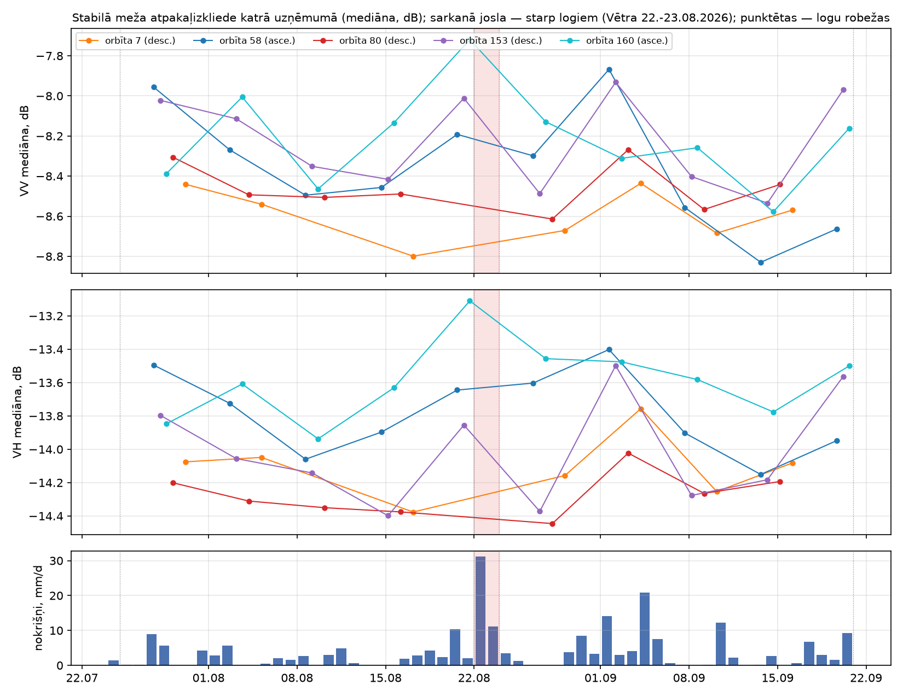
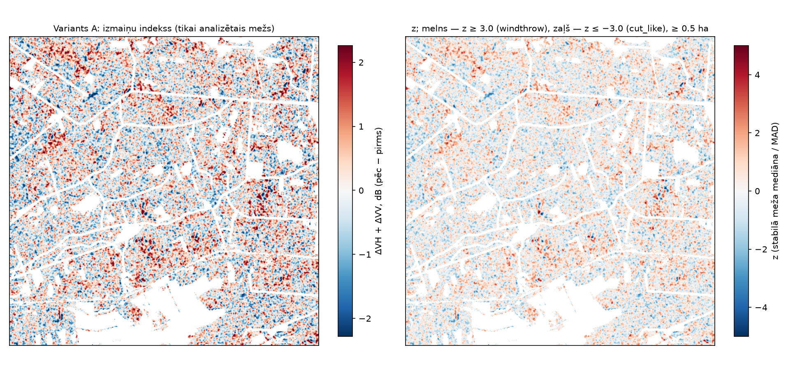
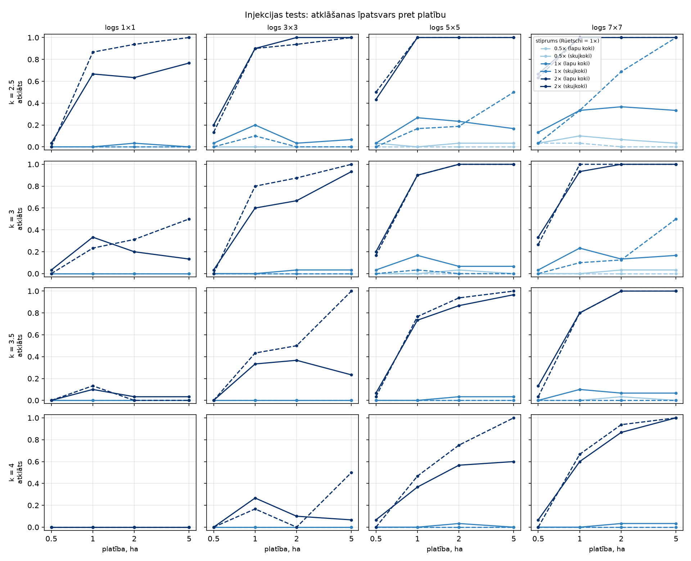
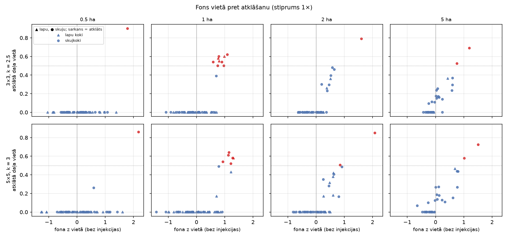
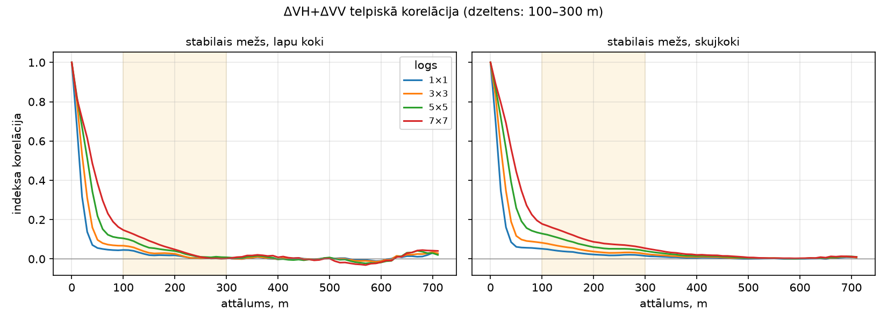
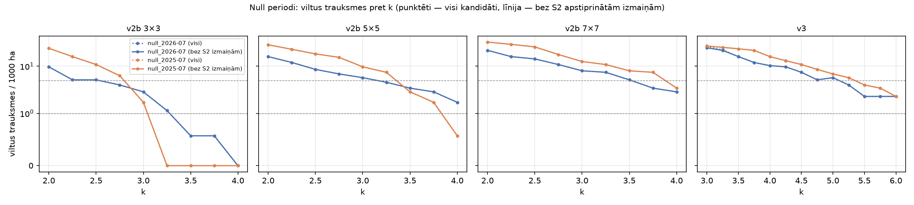
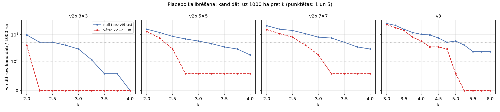
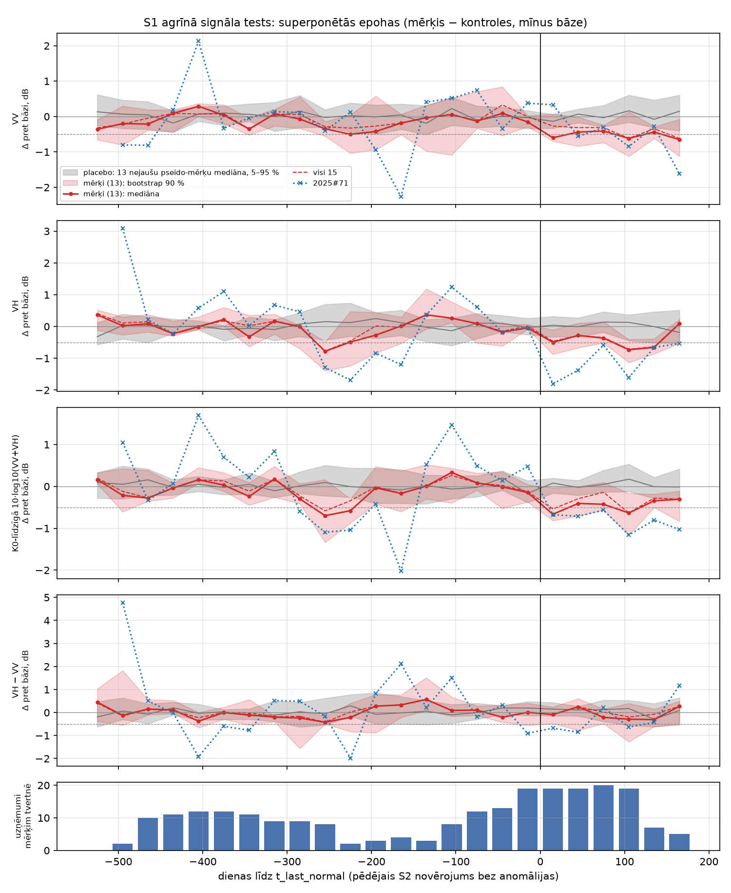
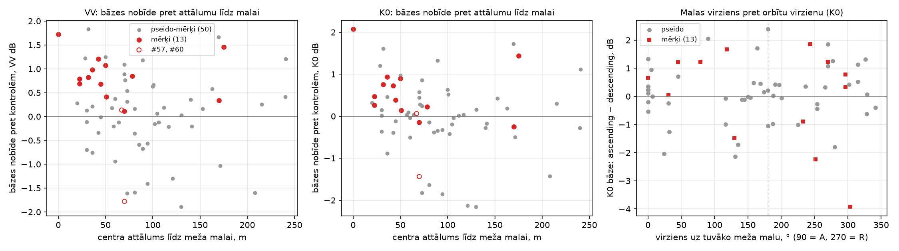

# Sentinel-1 vējgāžu modulis — kopsavilkums (posmi 0–3d) un agrīnā signāla tests

Datums: 2026-10-11 (8. sadaļa papildināta 2026-10-22). Zars `feat/s1-windthrow`, pakotne `src/s1windthrow/` (CLI `s1windthrow run|inject`).
s2forest un tags `v0.2-kalsnava` nav mainīti. Visi skaitļi ir no faktiskām palaišanām; avots
norādīts iekavās (mapes `output/` nav git — galvenie attēli nokopēti uz `docs/s1_figures/`).
Detalizētas atskaites: [S1_INVENTARIZACIJA.md](S1_INVENTARIZACIJA.md), [S1_DATI.md](S1_DATI.md),
[S1_NOTIKUMS.md](S1_NOTIKUMS.md).

## 1. Mērķis un dati

**Mērķis:** pārbaudīt, vai Sentinel-1 atpakaļizkliedes izmaiņa (ΔVH + ΔVV pēc − pirms, metode pēc
Rüetschi u. c. 2019) ļauj atrast vējgāzes pēc vētras, un kādas ir metodes reālās robežas.
Testa notikums: vētra **22.–23.08.2026**, Kalsnavas 5 × 5 km AOI (vējgāžu esamība tur nav zināma).

**Dati** (Planetary Computer `sentinel-1-rtc`, lineārs γ⁰, 10 m, VV + VH; [S1_DATI.md](S1_DATI.md)):
- AOI 2023-01-01 … 2026-10-10: 710 uzņēmumi. Pilnībā AOI pārklāj orbītas 58 A, 160 A, 80 D;
  daļēji 7 D (81–96 %) un 153 D (69–91 %). Nodata −32768 odc-stac nepārvērš NaN — maskē modulis.
- Platformas: tikai S1A līdz 2025-02; S1A + S1C 2025-04…11; S1C AOI nav 2025-12…2026-04 [cēlonis
  nezināms]; S1D no 2026-05; S1A pēdējais 2026-06-29 (ESA plānotā izslēgšana, lietotāja avots).
- Notikuma logi (katra orbīta atsevišķi, ≤ 5 uzņēmumi logā): pirms 25.07.–21.08., pēc
  24.08.–20.09.2026 — **45 uzņēmumi** (variants A); variants B bez 3 uzņēmumiem ar > 5 mm nokrišņu
  6 h pirms uzņēmuma (Open-Meteo) — 42 (`output/s1_kalsnava_2026-08_v1/tables/acquisitions.csv`).
- Null (placebo) periodi bez vētras, tie paši logu garumi: **2026** pirms 27.06.–24.07., pēc
  25.07.–21.08. (47 uzņēmumi); **2025** pirms 28.06.–25.07., pēc 26.07.–22.08. (43 uzņēmumi, S1A + S1C)
  (`output/s1_null_calibration/null_meta.json`).
- Mežs: HRL Dominant Leaf Type 2018 klases 1 + 2 (2071 ha) mīnus OSM ceļi 20 m mīnus zināmās S2 cirtes
  2025/2026 ar 20 m buferi (98 poligoni, 194 ha) = **1751 ha analizētā meža**; stabilais mežs 1689 ha
  (bez S2 suspects poligoniem + 30 m) (`output/s1_kalsnava_2026-08_v2b/run_metadata.json`).

## 2. Metodes evolūcija

| Versija | Izmaiņa | Iemesls / galvenais skaitlis |
|---|---|---|
| **v1** | Katrai orbītai pirms/pēc vidējais lineāri → dB; ΔVV, ΔVH vidēji pāri orbītām; z no stabilā meža (mediāna, MAD); z ≥ 3 → windthrow, z ≤ −3 → cut_like; MMU 0,5 ha | Stabilā meža σ = 1,4826 · 0,541 = **0,80 dB** → slieksnis +2,40 dB, bet Rüetschi vējgāzei ΔVV + ΔVH ≈ 0,45 + 0,68 = 1,13 dB (z ≈ 1,4). **0 kandidātu** pie k 2,5–4; lielākais laukums virs k 2,5 = 48 px (< 50 px MMU) (`output/s1_kalsnava_2026-08_v1/`, aprēķins no `rasters/z_A.tif`) |
| **v2** | Katra uzņēmuma normalizācija pret stabilā meža mediānu; telpiskā vidējošana lineāri tikai mežā (3×3/5×5/7×7); z atsevišķi lapu kokiem un skujkokiem | Uzņēmumu līmeņa nobīde ±0,3–0,4 dB (attēls 1); 3×3 σ ≈ 0,62 dB |
| **v2b** | Zināmās S2 cirtes izslēgtas no analīzes maskas; injekcijas tests pa partijām (< 2 % klases meža), vidējošanas izplūduma josla izslēgta no statistikas | v2 windthrow kandidāts atradās S2 kailcirtē; noplūde statistikā ≤ 0,014 dB (`…_v2/injection/diagnostics/a_class_statistics.csv`) |
| **v3** | Objekta līmenis: vidējais pikseļu z apļveida logos 0,5 / 1 / 2 ha (≥ 70 % meža), sliekšņi empīriski no stabilā meža logu sadalījuma; kandidāts = logu nospiedumu apvienojums, MMU 0,5 ha | 1 ha vietā signāls ~1,8 z, bet fona svārstība ~0,57 z → objekta līmenis izmanto visu vietu |

**Diagnostika (v2b, `output/s1_kalsnava_2026-08_v2/injection/diagnostics/`):** atklāšanas kritums ar
platību (skujkoki 3×3 k 2,5: 1 ha 20 %, 2 ha 3 %, 5 ha 7 %) nav kļūda. Daļa vietas pikseļu virs sliekšņa
ir neatkarīga no platības (0,24 / 0,22 / 0,23), bet kritērijs „≥ 50 % platības“ izpildās tikai vietās ar
paaugstinātu fonu (fona z ≳ +0,6…0,8; attēls 4), un fona vidējā svārstība mazinās ar platību
(0,57 / 0,48 / 0,38). Indeksa korelācija stabilajā mežā ir galvenokārt < 50 m, ar vāju nogabala mēroga
asti 100–300 m (0,03–0,18; attēls 5).

## 3. Injekcijas tests un placebo kalibrācija

**Injekcija:** sintētiskas vējgāzes (kompakti diski 0,5 / 1 / 2 / 5 ha; +0,45 dB VV, +0,68 dB VH × 0,5 / 1 / 2)
reālajos „pēc“ kompozītos, 30 vietas katrā klasē un izmērā (lapu kokos 2 ha — 16, 5 ha — 2), seed 42.
Kritērijs „trāpījums“: kandidāts pārklāj ≥ 25 % vietas vai tās centru. Pirmais tests (vētras dati kā
viltus trauksmju avots) ieteica v2b 3×3 k 2,5 / 5×5 k 2,5 — tie izrādījās pārāk zemi (zemāk).

**Placebo kalibrācija** (`output/s1_null_calibration/`): null periodos visi kandidāti pēc definīcijas ir
viltus. S2 pārbaude (CRSWIR / NDVI / NDMI pret stabilo mežu; „reāla izmaiņa“, ja ārpus 0,5–99,5 %
nejaušu stabilā meža disku sadalījuma) hipotēzi par jūlija ciršanu **neapstiprināja**: 2026. gadā
v2b kandidātos 0 reālu izmaiņu, v3 — 3 (k 3) un 1 (k 3,25); 2025. gadā S2 datu „pēc“ logā nav
(nākamais S2 datums 07.09.), tāpēc visi kandidāti „nav S2 datu“. S2 korekcija k nemaina (attēls 6).

**Izvēlētais k** — mazākais, pie kura viltus trauksmes ≤ 5 / 1000 ha **abos** null periodos
(`selected_k.csv`); ≤ 1 / 1000 ha režģī izpildās tikai v2b 3×3 (k 3,5):

| Metode | k (≤ 5, abi) | Null 2026 / 2025 / vētra, kandidāti | 1× trāpījums 0,5 / 1 / 2 / 5 ha | 2× trāpījums 0,5 / 1 / 2 / 5 ha |
|---|---|---|---|---|
| v2b 3×3 | 3,0 | 5 / 3 / 0 | 0 / 0 / 11 / 6 % | 2 / 77 / 98 / 100 % |
| v2b 3×3 (≤ 1) | 3,5 | 1 / 0 / 0 | 0 / 0 / 4 / 6 % | 0 / 42 / 74 / 94 % |
| v2b 5×5 | 3,5 | 6 / 5 / 1 | 0 / 3 / 11 / 16 % | 7 / 85 / 98 / 100 % |
| v2b 7×7 | 4,0 | 5 / 6 / 1 | 0 / 0 / 13 / 16 % | 7 / 72 / 100 / 100 % |
| **v3** | **5,5** | 4 / 7 / 0 | **3 / 13 / 26 / 47 %** | **67 / 98 / 100 / 100 %** |

(`null_fa_curves.csv`, `storm_candidates_at_k.csv`, `injection_hit_final_k.csv`; analizētais mežs 1751 ha.)
v3 ir jutīgākā metode pie vienāda viltus trauksmju līmeņa: Rüetschi vidējā stipruma vējgāzes atklāj
13 % (1 ha) … 47 % (5 ha), divkāršas stiprības — 98–100 % no 1 ha. **Vidēja stipruma vējgāzes < 1 ha
droši atklāt nevar.** Iepriekšējie (v2b) ieteikumi ar k 2,5 null periodos dotu 5,1–18,3 viltus trauksmes / 1000 ha (3×3: 5,1 / 10,9; 5×5: 8,6 / 18,3).

## 4. Rezultāts Kalsnavā 22.–23.08.2026

- Ar null-kalibrētiem k vētrā ir **0–1 kandidāts**, null periodos **0–7** (pie ≤ 5 kritērija 3–7; tabula 3. sadaļā; attēls 7).
  Vētrā kandidātu nav vairāk kā bez vētras → **reāla vētras signāla pazīmju Kalsnavas AOI nav.**
- Operatīvā konfigurācija `configs/s1_kalsnava_2026-08_v3_op.yaml` (v3, k 5,5): **0 kandidātu** abos
  variantos; jutīgums k 5,0 — 1 kandidāts (0,5 ha), k ≥ 5,25 — 0 (`output/s1_kalsnava_2026-08_v3_op/`).
- v2b 5×5 k 2,5 (pirms placebo kalibrācijas) deva 5 kandidātus — atbilst trokšņa līmenim.
  Lauka/drona mērķi (`output/s1_kalsnava_2026-08_v2b_op/field_targets_s1.gpkg`, PROVIZORISKI):

| ID | Vieta | ha | z vid. | ΔVH / ΔVV | S2 d_rel CRSWIR / NDVI | Pārsniedz null-kalibrēto k? |
|---|---|---|---|---|---|---|
| S1-01 | 56,6832 N, 25,8932 E, skujkoki | 0,69 | 2,9 | +0,65 / +0,71 dB | +0,14 / −0,10 | nē (ne 5×5 k 3,25/3,5, ne v3 k 5,25/5,5) |
| S1-02 | 56,6712 N, 25,9002 E, jaukts | 0,80 | 5,5 | +1,39 / +1,21 dB | +0,02 / −0,01 | **jā** — 5×5 k 3,25 un 3,5; v3 nē |

(`output/s1_null_calibration/field_target_hits.json`). S1-02 ir spēcīgākais S1 signāls, bet bez S2
izmaiņas; S1-01 ir vienīgais ar mērenu S2 izmaiņu bojājuma virzienā, bet S1 signāls ir trokšņa līmenī.

## 5. Blakusatradumi

- **Kailcirtēm atpakaļizkliede samazinās (AIZVIETOTĀJS, n = 3 vasaras S2 cirtes):** ΔVH pret stabilo
  mežu negatīvs 13 no 14 orbītu vērtībām (−1,73 … +0,004 dB), ΔVV jaukts (−1,76 … +0,32 dB)
  (`output/s1_kalsnava_2026-08_v1/tables/proxy_cuts.csv`). Zīme pretēja Rüetschi vējgāzei → klase
  `cut_like` ir atsevišķa un netiek saukta par vējgāzi.
- **s2forest amplitūdas maska izslēdz jauktas audzes:** S1 cut_like #1 (56,6913 N, 25,8507 E, 0,66 ha)
  ir S2 audzi nomainoša izmaiņa 29.07.–11.08.2026 (pirms vētras); 62 no 66 pikseļiem s2forest izslēdza
  amplitūdas maska (NDVI p90−p10 0,276 > 0,22). Pierakstīts kā atsevišķs S2 uzdevums
  ([S1_INVENTARIZACIJA.md](S1_INVENTARIZACIJA.md), 10. sadaļa).
- Uz balta trokšņa slīdošo logu maksimums 400 ha platībā sasniedz |z| ≈ 4,3–4,9 (daudzkārtēja testēšana)
  — tāpēc v3 sliekšņi ir 5–5,5, nevis 3.

## 6. Ierobežojumi

- Nav neviena apstiprināta vējgāžu poligona: jutība novērtēta tikai ar sintētiskām injekcijām
  (pieņemts: signāls kā Rüetschi vidējais, vienmērīgs, kompakta forma; z statistika bez injekcijām).
- Viltus trauksmju līmenis balstās uz 2 null periodiem ar 0–19 kandidātiem (liela Puasona nenoteiktība)
  un uz vienu 2500 ha AOI.
- S2 pārbaude nav validācija: 2025. gada null periodā S2 datu nav; slieksnis „skaidrai izmaiņai“ ir
  empīrisks (0,5–99,5 % nejaušu disku).
- HRL 2018 meža maska; S2 cirtes no s2forest izvades; nokrišņi — modelēts punkts 5 km no AOI.
- Uzņēmumu skaits un platformas mainās (S1C robs ziemā 2025/26, S1A beigas 06.2026); ziemas vētrām
  sasaluma/sniega filtrs nav ieviests.
- Metodes kods un testi: 19 bezsaistes testi S1 modulim (sintētiski masīvi), kopā 88 testi; s2forest
  testos ir zināms nestabilitātes uzdevums (S1_INVENTARIZACIJA.md, 9. sadaļa).

## 7. Nākamie soļi

1. **LVM vējgāžu poligoni** — akla validācija ar iesaldētu v3 k 5,5 (un v2b 5×5 k 3,5 salīdzinājumam):
   ražotāja/lietotāja precizitāte pēc platības un objektiem (4. posms).
2. **Rēzeknes notikums** (~12.07.2026, LVM Rēznas un Rušonas iecirkņi, ~1500 m³) — pēc koordinātu
   saņemšanas; tur vējgāzes ir apstiprinātas, tātad pirmais reālais jutības tests.
3. Lauka/drona pārbaude S1-01 un S1-02 (zema prioritāte: neviens nav pārliecinošs).
4. **S1 laika rindas riska modelim:** tā vietā, lai vērtētu tikai pirms/pēc kompozītus, izmantot visu
   uzņēmumu rindu (piem., noturīga izmaiņa vairākos secīgos uzņēmumos, orbītu saskaņa), kas varētu
   samazināt viltus trauksmes bez tik augsta k.
5. Atkārtot placebo kalibrāciju jaunai AOI (sliekšņi kalibrēti tikai Kalsnavā).

## 8. Agrīnā signāla tests (zars `feat/s1-earlysignal`, tags `s1-earlysignal-kalsnava-v1`)

**Jautājums** (Hechtl u. c. 2025, Forests 16(8):1272): vai audzēs, kas vēlāk nokalst mizgraužu dēļ,
atpakaļizkliede samazinās ~1 dB mēnešiem pirms optiski redzama bojājuma? Kods
`src/s1windthrow/earlysignal.py`, konfigurācija `configs/s1_earlysignal_kalsnava.yaml`, atskaite un tabulas
`docs/s1_earlysignal/`.

**Dati un mērķi.** S1 2023-01-01 … 2026-10-11, visas 5 orbītas: 710 uzņēmumi, izslēgti 181 (temperatūra < 0 °C —
125, sniega sega > 0 — 56; Open-Meteo), izmantoti 529. Mērķi — 15 s2forest stresa poligoni („S2 aizdomas“, ne
apstiprināti mizgrauži; 0,10–0,50 ha, visi skujkoki); galvenā kopa 13 (bez #57 iegarens, #60 atkopies). Katram
mērķim 5 kontroles (tāda pati platība un HRL klase, 200–2000 m, ārpus suspects + 50 m); placebo — 50 pseido-mērķi
stabilā skujkoku mežā ar mērķu platībām un datumiem, katram 5 kontroles.

**Metode.** Katrs uzņēmums normalizēts pret stabilā meža mediānu; mainīgie VV, VH, K0-līdzīgā 10·log10(VV+VH),
VH − VV (Kennaugh K5/K8 ar GRD nav iespējami). Atšķirība mērķis − kontroļu mediāna, atpakaļvērsta 30 dienu
mediāna, bāze 24–12 mēnešus pirms t_first. „Agrīnais signāls“: ≤ bāze − 0,5 dB ≥ 60 dienas pirms t_first; nobīde
arī pret t_last_normal (pēdējais S2 datums bez anomālijas; 6 mērķiem tikai augšējā robeža [N]). Superponētās
epohas: 30 dienu tvertnes −540…+180 dienas pret t_last_normal, mērķu mediāna ar bootstrap 90 % pret placebo joslu
(13 nejaušu pseido-mērķu mediānas 5–95 %) (attēls 8).

**Galvenā tabula** (galvenā kopa 13 pret placebo 50; vienpusējs Fišera tests, „kritums > P95“ — binomiālais
pret 5 %; daudzkārtējā testēšana nav koriģēta; `docs/s1_earlysignal/summary.csv`):

| Mainīgais | Signāls pirms t_first | Signāls pirms t_last_normal | Noturīgs kritums > placebo P95 |
|---|---|---|---|
| VV | 6/13 pret 13/50 (p 0,14) | 4/13 pret 10/50 (p 0,31) | 2/13 (P95 0,96 dB; p 0,14) |
| VH | 7/13 pret 14/50 (p 0,08) | 5/13 pret 11/50 (p 0,19) | 2/13 (P95 0,72 dB; p 0,14) |
| K0 | 3/13 pret 7/50 (p 0,34) | 2/13 pret 6/50 (p 0,53) | 3/13 (P95 0,71 dB; p 0,025) |
| VH − VV | 2/13 pret 14/50 | 1/13 pret 8/50 | 0/13 |

Superponētajās epohās mērķi ir konsekventi zem placebo joslas **pēc** t_last_normal (0…+120 dienas; VV, VH, K0
−0,4…−0,7 dB; 19–20 uzņēmumi uz mērķi tvertnē). Pirms t_last_normal ir tikai atsevišķas tvertnes ārpus joslas
(piem., K0 −0,70 dB pie −255 dienām), kur datu ir maz (2–8 uzņēmumi, ziemas robs). Signālu datumi gan mērķiem,
gan placebo koncentrējas oktobrī–janvārī un maijā — sezonālas pārejas, ko kontroles pilnībā nenoņem.

**Secinājums: hipotēzi neapstiprina, bet arī neatspēko.** Signāla biežums pirms t_last_normal neatšķiras no
placebo; S1 kritums ir skaidri redzams vienlaikus ar optisko izmaiņu vai pēc tās, nevis mēnešus pirms tās.
Ar 13 maziem (10–23 pikseļi), neapstiprinātiem mērķiem jutība ir maza.

**#71 — vienīgais „stress pirms cirtes“ (ZC-019)** ir vienīgais pozitīvais gadījums: K0 noturīgs kritums
1,18 dB no 2024-10-11, t. i., 9,0 mēnešus pirms t_last_normal (VH 7,5 mēneši). Tomēr tas ir viens gadījums ar
ļoti trokšņainu rindu (±2 dB), tā bāze ir +2,07 dB virs kontrolēm, un tā centrs ir tieši meža malā (0 m, visi
pikseļi ≤ 20 m no malas).

**Malu diagnostika** (`scripts/s1_edge_diagnostics.py`, attēls 9, `docs/s1_earlysignal/edge_*.csv`). Mērķu bāzes
nobīde pret kontrolēm ir VV +0,82 / K0 +0,47 dB (pseido-mērķiem +0,10 / +0,02 dB).
- Mērķi ir **apmēram 2× tuvāk meža malai**: centra attāluma mediāna 45 m pret pseido-mērķu 83 m (Mann-Whitney
  p = 0,017) un kontroļu 92 m (p = 0,007); malas pikseļu (≤ 20 m) daļa — p = 0,068 un 0,028. Kontroles nav
  izvēlētas pēc attāluma līdz malai, tāpēc tās nav līdzvērtīgas mērķiem.
- Mērķu iekšienē bāzes nobīde ar attālumu līdz malai saistīta vāji un nebūtiski (Spearman ρ VV −0,24, p 0,42;
  K0 −0,41, p 0,17; n = 13); pseido-mērķiem saistības nav (ρ −0,07 un −0,14).
- Orbītu virziens [pieņēmums: S1 skatās pa labi — ascending uz austrumiem, descending uz rietumiem]: mērķiem
  bāze ascending ir augstāka nekā descending neatkarīgi no tā, kurā pusē ir mala (K0 asc − desc +0,95 dB, ja
  mala austrumos; +0,32 dB, ja rietumos), un nobīde ir pozitīva arī descending (VV +0,22…+0,72 dB). Tas neatbilst
  vienkāršam „pret sensoru vērstas malas“ skaidrojumam.
- **Secinājums:** malu efekts ir ticams daļējs skaidrojums (mērķi sistemātiski ir malās, kontroles nē), bet ar
  13 mērķiem to nevar ne apstiprināt, ne izslēgt. Nākamajā testā kontroles jāizvēlas ar līdzīgu attālumu līdz
  malai.

**Kas vajadzīgs tālāk:** LVM sanitāro ciršu poligoni ar ciršanas datumu un iemeslu (mizgrauži), ≥ 0,5 ha
(lielāki un apstiprināti mērķi nekā 0,10–0,23 ha S2 aizdomas), kā arī kontroles ar līdzīgu attālumu līdz meža
malai. Līdz LVM datiem tālāks S1 darbs netiek sākts.

## Attēli

1.  — stabilā meža VV/VH mediāna katrā uzņēmumā un nokrišņi (v1).
2.  — v1 izmaiņu indekss un z.
3.  — pirmais injekcijas tests (PROVIZORISKS, kritērijs ≥ 50 %).
4.  — fona z vietā pret atklāto daļu.
5.  — indeksa telpiskā korelācija stabilajā mežā.
6.  — viltus trauksmes pret k abos null periodos.
7.  — kandidāti null 2026 pret vētras notikumu.
8.  — mērķi (13) pret placebo joslu, VV / VH / K0 / VH − VV.
9.  — bāzes nobīde pret attālumu līdz meža malai un orbītu virziens.
